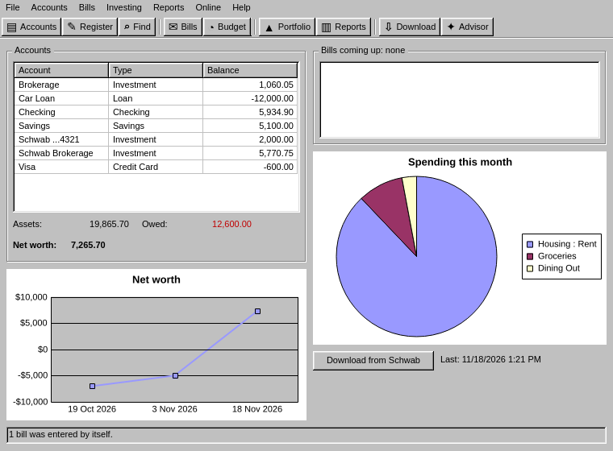

[Contents](index.md) | Previous: [The Tables](02-tables.md) | Next: [Accounts, Payees and Categories](04-accounts.md)

# The Home Page

The Home page is what the program opens with: the accounts and what
they're worth, the bills coming up, this month's spending, and net worth
over time. It also holds the code the whole program shares.



## The form

Click Form1 in the Project window and select the form itself (click its
empty space). Set:

| Property | Value |
|---|---|
| (Name) | `HomeForm` |
| Caption | Wayland Money |
| Width, Height | 760, 560 |

**Project > Properties...**: **Startup form** is `HomeForm`.

## A menu bar and a tool bar

Put these on first: they sit across the top and move everything else
down, and the positions below allow for them.

1. Double-click **Menu** in the Toolbox. Open its **Menus** (F4): the
   Menu Editor starts with **&File > E&xit** and **&Help > &About**.
   Delete the Help menu for now (select each of its two lines and
   **Delete**). The menus grow chapter by chapter; the whole menu is in
   [chapter 13](13-finish.md#the-whole-menu).
2. Double-click **ToolBar**. Open its **Buttons** and delete the two it
   starts with (New and Save: this form has no record to save). Buttons
   are added as the forms they open get made.

## The elements

| Element | (Name) | Left, Top | Width × Height | Properties |
|---|---|---|---|---|
| Frame | `accountsFrame` | 8, 56 | 372 × 270 | Caption: Accounts |
| Frame | `billsFrame` | 388, 56 | 364 × 124 | Caption: Bills coming up |
| DataGrid | `accountGrid` | 16, 76 | 356 × 188 | DataTable: Listing; Columns: Account, Type, Balance |
| Label | `assetsCaption` | 16, 272 | 48 × 17 | Caption: Assets: |
| Label | `assetsLabel` | 64, 272 | 96 × 17 | Caption: (blank); Alignment: Right |
| Label | `owedCaption` | 176, 272 | 40 × 17 | Caption: Owed: |
| Label | `owedLabel` | 216, 272 | 96 × 17 | Caption: (blank); Alignment: Right; ForeColor: #c00000 |
| Label | `worthCaption` | 16, 298 | 72 × 17 | Caption: Net worth:; FontBold: True |
| Label | `worthLabel` | 88, 298 | 120 × 17 | Caption: (blank); FontBold: True |
| ListBox | `billList` | 396, 76 | 348 × 96 |  |
| Graph | `spendingGraph` | 388, 188 | 364 × 240 |  |
| Button | `syncButton` | 388, 436 | 150 × 24 | Caption: Download from Schwab |
| Label | `syncLabel` | 546, 440 | 206 × 17 | Caption: (blank) |
| Graph | `worthGraph` | 8, 334 | 372 × 188 |  |
| Label | `statusLabel` | 8, 530 | 744 × 21 | Caption: (blank); BorderStyle: Sunken |

Put the two Frames on first (a Frame goes behind what's put on it
afterwards).

`accountGrid` is the first of the grids that code fills: its
**DataTable** is Listing and its **Columns** the three headings it wants.

### The two graphs

When you put a **Graph** on the form the Graph Editor opens.

`spendingGraph` is a pie that code fills:

| Graph Editor | Setting |
|---|---|
| Type | Pie |
| Data | What code gives it |
| Title | Spending this month |
| Legend | Right |
| Before | `$` |

`worthGraph` needs no code. It reads the WorthHistory table by itself,
and again whenever a line is added:

| Graph Editor | Setting |
|---|---|
| Type | Line |
| Table | WorthHistory |
| Labels | Day |
| Dates by | A day at a time |
| Values | Worth (Sum) |
| Title | Net worth |
| Legend | None |
| Before | `$` |

## The library

Select the form, press **F7**, and choose **(General)**. Everything here
can be called by this form's events, and by every other form as
`App.form("HomeForm").fmt(12.5)`.

```
// ---- Wayland Money's library -------------------------------------------
// Every other form reaches these through App.form("HomeForm").

// money as text: 1,234.50 (blank for nothing)
function fmt(n) {
    if (n === null || n === undefined || n === "" || isNaN(n))
        return "";
    var v = Math.round(Number(n) * 100) / 100;
    return (v === 0 ? 0 : v).toLocaleString(Qt.locale("en_US"), "f", 2);
}
// what was typed, as a number: "1,234.50", "$12", "(5.00)"; null if it isn't one
function parseMoney(text) {
    var s = String(text === null || text === undefined ? "" : text).replace(/[$,\s]/g, "");
    var negative = /^\(.*\)$/.test(s);
    if (negative)
        s = s.substring(1, s.length - 1);
    if (s === "" || isNaN(Number(s)))
        return null;
    return Math.round((negative ? -Number(s) : Number(s)) * 100) / 100;
}

// days: kept as 2026-11-18, shown as 11/18/2026
function today() { return AppDates.stored("today", "Date"); }
function rightNow() { return AppDates.stored("now", "Date and Time"); }
function showDate(day) { return day ? AppDates.display(String(day).substring(0, 10), "Date", "MM/dd/yyyy", "") : ""; }
function two(n) { return (n < 10 ? "0" : "") + n; }
function iso(d) { return d.getFullYear() + "-" + two(d.getMonth() + 1) + "-" + two(d.getDate()); }
function toDate(day) {
    var p = String(day).substring(0, 10).split("-");
    return new Date(Number(p[0]), Number(p[1]) - 1, Number(p[2]));
}
function addDays(day, n) {
    var d = toDate(day);
    d.setDate(d.getDate() + n);
    return iso(d);
}
function addMonths(day, n) {
    var d = toDate(day), wanted = d.getDate();
    d.setDate(1);
    d.setMonth(d.getMonth() + n);
    var last = new Date(d.getFullYear(), d.getMonth() + 1, 0).getDate();
    d.setDate(Math.min(wanted, last));
    return iso(d);
}
function monthStart(day) { return String(day).substring(0, 8) + "01"; }
function daysBetween(from, to) { return Math.round((toDate(to) - toDate(from)) / 86400000); }

// a setting, kept in the Settings table
function setting(name, fallback) {
    var rows = Db.select("Settings", { where: { Name: name } });
    if (rows.length > 0 && rows[0].Value !== null && rows[0].Value !== "")
        return rows[0].Value;
    return fallback === undefined ? "" : fallback;
}
function setSetting(name, value) {
    var rows = Db.select("Settings", { where: { Name: name } });
    if (rows.length > 0)
        Db.update("Settings", rows[0].id, { Value: String(value) });
    else
        Db.insert("Settings", { Name: name, Value: String(value) });
}

// a table's records' names, by id: names("Payees")[3]
function names(table) {
    var out = {};
    Db.lookupChoices(table).forEach(function (c) { out[c.id] = c.label; });
    return out;
}

// the kinds of account
function isDebt(type) { return type === "Credit Card" || type === "Loan" || type === "Liability"; }
function isInvestment(type) { return type === "Investment" || type === "Retirement"; }

// every account's money: { id: { cash, holdings, value } }
function balances() {
    var out = {};
    Db.select("Accounts").forEach(function (a) {
        out[a.id] = { cash: a.OpeningBalance || 0, holdings: 0, value: 0 };
    });
    Db.select("Transactions").forEach(function (t) {
        if (out[t.Account])
            out[t.Account].cash += t.Amount || 0;
    });
    Db.select("Holdings").forEach(function (h) {
        if (out[h.Account])
            out[h.Account].holdings += h.MarketValue || 0;
    });
    Object.keys(out).forEach(function (k) { out[k].value = out[k].cash + out[k].holdings; });
    return out;
}
function netWorth() {
    var b = balances(), assets = 0, owed = 0;
    Db.select("Accounts").forEach(function (a) {
        if (a.Closed)
            return;
        if (isDebt(a.Type))
            owed -= b[a.id].value;
        else
            assets += b[a.id].value;
    });
    return { assets: assets, liabilities: owed, net: assets - owed };
}
// today's line of the net worth history (the graph at the bottom reads it)
function snapshot() {
    var w = netWorth(), rows = Db.select("WorthHistory", { where: { Day: today() } });
    var line = { Day: today(), Assets: w.assets, Liabilities: w.liabilities, Worth: w.net };
    if (rows.length === 0)
        Db.insert("WorthHistory", line);
    else if (fmt(rows[0].Worth) !== fmt(w.net) || fmt(rows[0].Assets) !== fmt(w.assets))
        Db.update("WorthHistory", rows[0].id, line);
}

// income or spending? (a transfer or a trade only moves money)
function isFlow(t) {
    return !t.TransferAccount && ["Buy", "Sell", "Reinvest", "Add Shares", "Remove Shares"].indexOf(t.Action) < 0;
}

// what came in and went out between two days, by category:
// [{ category, name, kind, total }], the biggest spending first.
function totalsByCategory(from, to) {
    var cats = {}, sums = {}, splits = {};
    Db.select("Categories").forEach(function (c) { cats[c.id] = c; });
    Db.select("Splits").forEach(function (s) {
        if (!splits[s.Transaction])
            splits[s.Transaction] = [];
        splits[s.Transaction].push(s);
    });
    function add(category, amount) {
        var k = category || 0;
        sums[k] = (sums[k] || 0) + (amount || 0);
    }
    Db.select("Transactions").forEach(function (t) {
        if (t.Date < from || t.Date > to || !isFlow(t))
            return;
        if (t.IsSplit && splits[t.id])
            splits[t.id].forEach(function (s) { add(s.Category, s.Amount); });
        else
            add(t.Category, t.Amount);
    });
    return Object.keys(sums).map(function (k) {
        var c = cats[k];
        return { category: c ? c.id : null, name: c ? c.Name : "(no category)",
                 kind: c ? c.Kind : (sums[k] < 0 ? "Expense" : "Income"), total: sums[k] };
    }).sort(function (a, b) { return a.total - b.total; });
}

// ---- the Home page itself ----------------------------------------------

property var billIds: []

// (a change anywhere: the page is read again, a moment later, once)
Timer { id: soon; interval: 300; onTriggered: refreshHome() }
Connections {
    target: Db
    function onChanged(table) {
        if (table !== "WorthHistory" && table !== "Settings" && table !== "Prices")
            soon.restart();
    }
}

function refreshHome() {
    var b = balances(), rows = [];
    Db.select("Accounts", { orderBy: "Name" }).forEach(function (a) {
        if (!a.Closed)
            rows.push({ id: a.id, Account: a.Name, Type: a.Type, Balance: fmt(b[a.id].value) });
    });
    accountGrid.rows = rows;
    var w = netWorth();
    assetsLabel.text = fmt(w.assets);
    owedLabel.text = fmt(w.liabilities);
    worthLabel.text = fmt(w.net);
    snapshot();

    var spent = totalsByCategory(monthStart(today()), today()).filter(function (c) { return c.total < 0; });
    spendingGraph.setData(spent.map(function (c) { return c.name; }),
                          [{ name: "Spent", values: spent.map(function (c) { return Math.round(-c.total * 100) / 100; }) }]);
    showBills();
    var last = setting("SchwabLastSync");
    syncLabel.text = last === "" ? "Never downloaded."
                   : "Last: " + AppDates.display(last, "Date and Time", "MM/dd/yyyy", "h:mm AP");
}

function openRegister() {
    if (accountGrid.currentId === null)
        form.msgBox("Click an account in the list first.", "Register");
    else
        App.openForm("RegisterForm", { account: accountGrid.currentId });
}

// the categories a new file starts with
function seed() {
    if (Db.count("Categories") > 0)
        return;
    var income = ["Salary", "Interest Income", "Investment Income : Dividends", "Investment Income : Interest",
                  "Other Income"];
    var expense = ["Automobile : Fuel", "Automobile : Maintenance", "Bank Charges", "Clothing", "Dining Out",
                   "Education", "Entertainment", "Gifts", "Groceries", "Healthcare", "Housing : Rent",
                   "Housing : Mortgage Interest", "Insurance", "Investment Expense : Fees", "Taxes : Federal",
                   "Taxes : State", "Travel", "Utilities : Electric", "Utilities : Internet", "Utilities : Water"];
    var taxed = ["Salary", "Interest Income", "Investment Income : Dividends", "Investment Income : Interest",
                 "Housing : Mortgage Interest", "Taxes : Federal", "Taxes : State"];
    income.forEach(function (n) { Db.insert("Categories", { Name: n, Kind: "Income", TaxRelated: taxed.indexOf(n) >= 0 }); });
    expense.forEach(function (n) { Db.insert("Categories", { Name: n, Kind: "Expense", TaxRelated: taxed.indexOf(n) >= 0 }); });
}
```

And, until [chapter 7](07-bills.md) writes the real one:

```
// (until the Bills chapter: nothing to show yet)
function showBills() { }
```

Things worth noticing:

- **`fmt` and `parseMoney`** are how every amount in the program is shown
  and read. A table keeps `1234.5`; people read `1,234.50` and type
  `$1,234.50`.
- **`balances()`** reads every transaction and adds them up by account,
  each time it's asked. That's the whole of "the balance is never
  stored".
- **`Timer` and `Connections`** aren't functions: (General) can hold
  these too. `Connections` listens to `Db`: its `changed` says a table
  was written to, by anything. The page doesn't redraw at once (a
  download writes hundreds of records): it starts a 300 millisecond
  timer, and redraws once when the writing stops.
- **`snapshot()`** writes to WorthHistory, which would itself set the
  timer off again, for ever. That's why the `Connections` leaves that
  table out, and why `snapshot()` only writes when the figure changed.
- **`accountGrid.rows = rows`** is the Listing technique from the last
  chapter. Each row's `id` is the account's id, so `accountGrid.currentId`
  is the account that's clicked.
- **`seed()`** gives a new file its categories.

A name in (General) can't be one the form has already: don't call a
function `load`, `current`, `save`, `close`, `show` or `update`.

## Its events

The form's **load**:

```
seed();
refreshHome();
statusLabel.text = "Welcome to Wayland Money.";
```

The form's **unload** (closing the Home page ends the program, as closing
Money's window did; and it keeps the library there for as long as any
other form is open):

```
App.quit();
```

## Try it

**F5**. The page opens with an empty account list, an empty pie, and
*Welcome to Wayland Money.* at the bottom. Close it, open **Categories**
in the Studio and click **Data**: 25 categories are there, seven of them
Tax-related.

If the Output window says `HomeForm, (General), line …`, a line of the
library was mistyped; the line number is the line within (General).

> **One thing to know about `App.form("HomeForm")`**: a form isn't in the
> program's list of open forms until its own `load` has finished. So the
> Home page can't open another form from its `load` and have that form
> find the library. Where the program needs to do something at startup
> that opens a form, it waits a moment with a Timer first
> ([chapter 7](07-bills.md), [chapter 10](10-schwab.md)).

[Contents](index.md) | Previous: [The Tables](02-tables.md) | Next: [Accounts, Payees and Categories](04-accounts.md)
