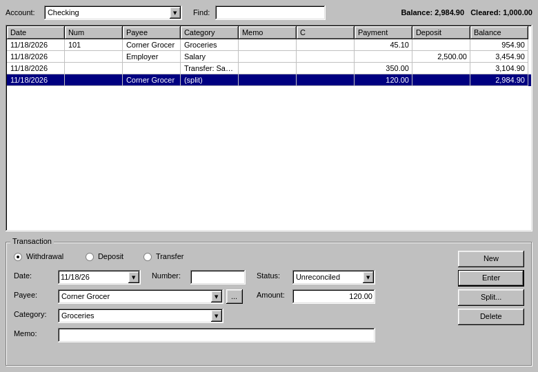
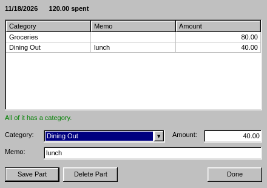
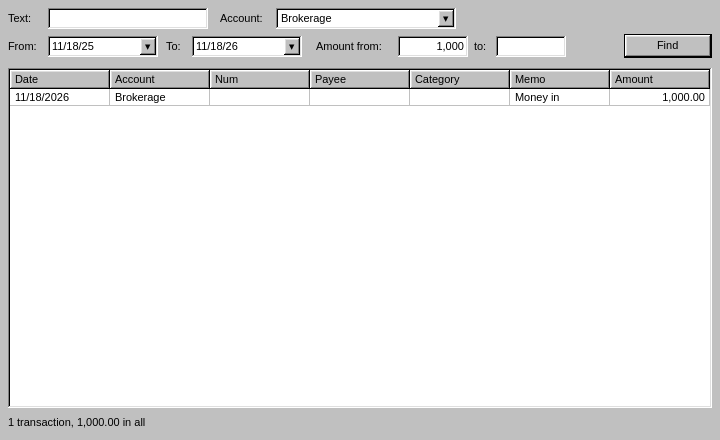

[Contents](index.md) | Previous: [Accounts, Payees and Categories](04-accounts.md) | Next: [Balancing an Account](06-reconcile.md)

# The Account Register

The register is where the work is done: an account's transactions with a
running balance, and under them the form to enter one, as a withdrawal, a
deposit or a transfer.



## More for the library

Open HomeForm's **(General)** and add this at the end. It's the part of
entering transactions that isn't any one form's business: a transfer's
two halves, and deleting cleanly.

```
// ---- transactions ------------------------------------------------------

// keep a transfer's other half in step with it (or take it away)
function matchTransfer(id) {
    var t = Db.get("Transactions", id);
    if (t.id === undefined)
        return;
    var twin = t.TransferId ? Db.get("Transactions", t.TransferId) : ({});
    if (!t.TransferAccount) {
        if (twin.id !== undefined)
            Db.remove("Transactions", twin.id);
        if (t.TransferId)
            Db.update("Transactions", t.id, { TransferId: null });
        return;
    }
    var other = { Account: t.TransferAccount, Date: t.Date, Number: t.Number, Payee: t.Payee, Memo: t.Memo,
                  Amount: -t.Amount, TransferAccount: t.Account, TransferId: t.id, Source: t.Source };
    if (twin.id !== undefined) {
        Db.update("Transactions", twin.id, other);
    } else {
        var r = Db.insert("Transactions", other);
        if (r.ok)
            Db.update("Transactions", t.id, { TransferId: r.id });
    }
}

// delete a transaction: its splits and a transfer's other half go with it
function removeTransaction(id) {
    var t = Db.get("Transactions", id);
    if (t.id === undefined)
        return true;
    Db.select("Splits", { where: { Transaction: id } }).forEach(function (s) { Db.remove("Splits", s.id); });
    if (t.TransferId && Db.get("Transactions", t.TransferId).id !== undefined)
        Db.remove("Transactions", t.TransferId);
    var r = Db.remove("Transactions", id);
    if (r.ok && t.Security)
        rebuildHoldings(t.Account);
    return r.ok;
}
```

And a stand-in, until [chapter 9](09-investing.md):

```
// (until the Investing chapter: no holdings to work out yet)
function rebuildHoldings(accountId) { }
```

A transfer from Checking to Savings is two records: `-300` in Checking
naming Savings, and `+300` in Savings naming Checking, each holding the
other's id. `matchTransfer` is called after either one is saved, and
makes the other agree with it, whichever side was edited.

## RegisterForm

**Project > Add Form**, and set the form:

| Property | Value |
|---|---|
| (Name) | `RegisterForm` |
| Caption | Register |
| DataTable | Transactions |
| Width, Height | 780, 540 |

Its **DataTable** is Transactions: the boxes at the bottom show and edit
one transaction, the form's record.

| Element | (Name) | Left, Top | Width × Height | Properties |
|---|---|---|---|---|
| Frame | `entryFrame` | 8, 344 | 764 × 188 | Caption: Transaction |
| Label | `accountLabel` | 8, 12 | 56 × 17 | Caption: Account: |
| ComboBox | `accountCombo` | 64, 8 | 200 × 21 |  |
| Label | `findLabel` | 280, 12 | 32 × 17 | Caption: Find: |
| TextBox | `findBox` | 312, 8 | 160 × 21 | ToolTipText: Only the transactions with this text in them |
| Label | `balanceLabel` | 480, 12 | 292 × 17 | Caption: (blank); Alignment: Right; FontBold: True |
| DataGrid | `grid` | 8, 36 | 764 × 300 | DataTable: Listing; Columns: Date, Num, Payee, Category, Memo, C, Payment, Deposit, Balance |
| OptionButton | `optWithdrawal` | 20, 364 | 96 × 17 | Caption: Withdrawal; Group: kind; Value: True |
| OptionButton | `optDeposit` | 124, 364 | 76 × 17 | Caption: Deposit; Group: kind |
| OptionButton | `optTransfer` | 208, 364 | 76 × 17 | Caption: Transfer; Group: kind |
| Label | `dateLabel` | 20, 394 | 60 × 17 | Caption: Date: |
| DateTimePicker (Date) | `dateBox` | 84, 392 | 120 × 21 | DataField: Date |
| Label | `numLabel` | 220, 394 | 52 × 17 | Caption: Number: |
| TextBox | `numBox` | 276, 392 | 80 × 21 | DataField: Number |
| Label | `statusLabel` | 372, 394 | 48 × 17 | Caption: Status: |
| ComboBox | `statusCombo` | 424, 392 | 120 × 21 | DataField: Cleared |
| Label | `payeeLabel` | 20, 422 | 60 × 17 | Caption: Payee: |
| ComboBox | `payeeCombo` | 84, 420 | 240 × 21 | DataField: Payee |
| Button | `payeesButton` | 328, 420 | 24 × 21 | Caption: ...; ToolTipText: The list of payees: add a new one there |
| Label | `amountLabel` | 372, 422 | 48 × 17 | Caption: Amount: |
| TextBox | `amountBox` | 424, 420 | 120 × 21 | Alignment: Right |
| Label | `categoryLabel` | 20, 450 | 60 × 17 | Caption: Category: |
| ComboBox | `categoryCombo` | 84, 448 | 240 × 21 | DataField: Category |
| Label | `toLabel` | 372, 450 | 64 × 17 | Caption: To account: |
| ComboBox | `toCombo` | 440, 448 | 208 × 21 | DataField: TransferAccount |
| Label | `memoLabel` | 20, 478 | 60 × 17 | Caption: Memo: |
| TextBox | `memoBox` | 84, 476 | 460 × 21 | DataField: Memo |
| Button | `newButton` | 664, 364 | 96 × 24 | Caption: New |
| Button | `enterButton` | 664, 392 | 96 × 24 | Caption: Enter; Default: True |
| Button | `splitButton` | 664, 420 | 96 × 24 | Caption: Split... |
| Button | `deleteButton` | 664, 448 | 96 × 24 | Caption: Delete |

Put `entryFrame` on first. The three OptionButtons share a **Group**, so
choosing one clears the others. `amountBox` has no DataField: people type
`45.10` for a payment, and code turns that into `-45.10` for the table.
`toLabel` and `toCombo` are only shown for a transfer; code hides them.

### Its code

**(General)**:

```
readonly property var home: App.form("HomeForm")
property var accountId: null
property var accountIds: []
property string lastDate: ""

// the account's transactions into the grid, oldest first, with the balance after each
function fill() {
    var account = Db.get("Accounts", accountId);
    if (account.id === undefined)
        return;
    var payees = home.names("Payees"), categories = home.names("Categories"), accounts = home.names("Accounts");
    var find = findBox.text.trim().toLowerCase();
    var balance = account.OpeningBalance || 0, cleared = balance, out = [];
    Db.select("Transactions", { where: { Account: accountId }, orderBy: "Date" }).forEach(function (t) {
        balance += t.Amount;
        if (t.Cleared !== "Unreconciled")
            cleared += t.Amount;
        var category = t.TransferAccount ? "Transfer: " + (accounts[t.TransferAccount] || "?")
                     : t.IsSplit ? "(split)"
                     : t.Action ? t.Action + (t.Category ? ", " + categories[t.Category] : "")
                     : (categories[t.Category] || "");
        var line = { id: t.id, Date: home.showDate(t.Date), Num: t.Number || "", Payee: payees[t.Payee] || "",
                     Category: category, Memo: t.Memo || "",
                     C: t.Cleared === "Reconciled" ? "R" : t.Cleared === "Cleared" ? "C" : "",
                     Payment: t.Amount < 0 ? home.fmt(-t.Amount) : "", Deposit: t.Amount >= 0 ? home.fmt(t.Amount) : "",
                     Balance: home.fmt(balance) };
        var text = (line.Date + " " + line.Num + " " + line.Payee + " " + line.Category + " " + line.Memo
                    + " " + line.Payment + line.Deposit).toLowerCase();
        if (find === "" || text.indexOf(find) >= 0)
            out.push(line);
    });
    grid.rows = out;
    grid.currentIndex = rowOf(form.recordId);
    var holdings = home.balances()[accountId].holdings;
    balanceLabel.text = "Balance: " + home.fmt(balance)
        + (holdings !== 0 ? "   Investments: " + home.fmt(holdings) : "")
        + "   Cleared: " + home.fmt(cleared);
    form.title = account.Name + " - Register";
}

// where a transaction is in the grid (-1: it isn't)
function rowOf(id) {
    for (var i = 0; i < grid.rows.length; ++i) {
        if (grid.rows[i].id === id)
            return i;
    }
    return -1;
}

function showAccount(id) {
    accountId = id;
    accountCombo.currentIndex = accountIds.indexOf(id);
    form.newRecord();
    fill();
    if (grid.rows.length > 0)
        grid.select(grid.rows.length - 1, false);
}

// the amount box and the three options, from the record that's showing
function showKind() {
    var amount = form.record.Amount;
    amountBox.text = amount ? home.fmt(Math.abs(amount)) : "";
    optTransfer.checked = !!form.record.TransferAccount;
    optDeposit.checked = !optTransfer.checked && amount > 0;
    optWithdrawal.checked = !optTransfer.checked && !optDeposit.checked;
    kindChanged();
}
function kindChanged() {
    toLabel.visible = toCombo.visible = optTransfer.checked;
    categoryLabel.visible = categoryCombo.visible = !optTransfer.checked;
}

// Enter: the record as the form has it, into the register
function enter() {
    var amount = home.parseMoney(amountBox.text);
    if (amount === null || amount === 0) {
        form.msgBox("Type the amount: 12.50", "Register", "warning");
        amountBox.forceActiveFocus();
        return false;
    }
    if (optTransfer.checked && !form.record.TransferAccount) {
        form.msgBox("Choose the account the money goes to.", "Register", "warning");
        return false;
    }
    form.setField("Account", accountId);
    form.setField("Amount", (optDeposit.checked ? 1 : -1) * Math.abs(amount));
    if (optTransfer.checked) {
        form.setField("Category", null);
    } else {
        form.setField("TransferAccount", null);
        // a payee's usual category, if none was chosen
        if (form.record.Payee && !form.record.Category && !form.record.IsSplit) {
            var payee = Db.get("Payees", form.record.Payee);
            if (payee.Category)
                form.setField("Category", payee.Category);
        }
    }
    if (!form.save())
        return false;
    lastDate = form.record.Date;
    // (a transfer's other half is written, and this one is read again with its link to it)
    var id = form.recordId;
    home.matchTransfer(id);
    form.loadRecord(id);
    fill();
    return true;
}

function startNew() {
    form.newRecord();
    if (lastDate !== "")
        form.setField("Date", lastDate);
    grid.currentIndex = -1;
    dateBox.forceActiveFocus();
}

// (another form changed the transactions: a download, a bill, a split)
Timer { id: soon; interval: 300; onTriggered: fill() }
Connections {
    target: Db
    function onChanged(table) {
        if (table === "Transactions" || table === "Splits" || table === "Holdings")
            soon.restart();
    }
}
```

The form's **load**:

```
var accounts = Db.select("Accounts", { orderBy: "Name" });
accountIds = accounts.map(function (a) { return a.id; });
accountCombo.items = accounts.map(function (a) { return a.Name; });
if (accounts.length === 0) {
    form.msgBox("There are no accounts yet: Accounts > Account List.", "Register");
    return;
}
showAccount(form.args.account || accountIds[0]);
if (form.args.transaction && form.loadRecord(form.args.transaction))
    fill();
```

The form's **current**:

```
showKind();
```

`accountCombo`, **changed**:

```
if (accountIds[accountCombo.currentIndex] !== accountId)
    showAccount(accountIds[accountCombo.currentIndex]);
```

`findBox`, **changed**:

```
fill();
```

`grid`, **rowSelected**:

```
form.loadRecord(grid.currentId);
```

`optWithdrawal`, **clicked**:

```
kindChanged();
```

`optDeposit`, **clicked**:

```
kindChanged();
```

`optTransfer`, **clicked**:

```
kindChanged();
```

`amountBox`, **accepted**:

```
if (enter())
    startNew();
```

`newButton`, **clicked**:

```
startNew();
```

`enterButton`, **clicked**:

```
if (enter())
    startNew();
```

`deleteButton`, **clicked**:

```
if (form.isNew) {
    startNew();
    return;
}
form.msgBox("Delete this transaction?", "Register", "question", ["Yes", "No"], function (answer) {
    if (answer !== 0)
        return;
    home.removeTransaction(form.recordId);
    form.newRecord();
    fill();
});
```

`splitButton`, **clicked**:

```
if (form.isNew || form.dirty) {
    if (!enter())
        return;
}
App.openForm("SplitForm", { transaction: form.recordId });
```

`payeesButton`, **clicked**:

```
App.showForm("PayeesForm");
```

How it works:

- **`fill()`** is the Listing technique in full. It reads the account's
  transactions in date order, keeps a running balance, and builds one row
  for each with everything already as text. The names of payees and
  categories are read once (`home.names`) rather than once for each row.
- **The grid and the form** are tied by two lines: choosing a row loads
  that transaction (`grid.rowSelected`), and after `fill()` the grid
  marks the row of the form's record.
- **`enter()`** puts the sign on the amount, gives a payee its usual
  category, saves, and then lets the library write the transfer's other
  half. `form.save()` runs the table's rules: a transfer to the same
  account comes back refused, with `toCombo` framed in red.
- **After a save the record is read again** (`form.loadRecord(id)`). The
  library has just written the other half's id into this transaction;
  without reading it back, the form would still hold the old record and
  the next Enter would write the blank over it.
- **The `Connections`** at the end of (General) refills the register when
  something else changes its tables: a split, a bill entering itself, a
  download.
- **Enter** in `amountBox` enters the transaction (its `accepted` event),
  so a row of transactions can be typed without the mouse.

## SplitForm

One transaction, several categories: 120.00 at the grocer that was 80.00
of groceries and 40.00 of lunch.



| Property | Value |
|---|---|
| (Name) | `SplitForm` |
| Caption | Split a Transaction |
| DataTable | Splits |
| Resizable | False |
| Width, Height | 440, 310 |

| Element | (Name) | Left, Top | Width × Height | Properties |
|---|---|---|---|---|
| Label | `totalLabel` | 8, 8 | 424 × 17 | Caption: (blank); FontBold: True |
| DataGrid | `grid` | 8, 32 | 424 × 150 | DataTable: Listing; Columns: Category, Memo, Amount |
| Label | `leftLabel` | 8, 188 | 424 × 17 | Caption: (blank) |
| Label | `categoryLabel` | 8, 216 | 60 × 17 | Caption: Category: |
| ComboBox | `categoryCombo` | 72, 214 | 200 × 21 | DataField: Category |
| Label | `amountLabel` | 284, 216 | 48 × 17 | Caption: Amount: |
| TextBox | `amountBox` | 336, 214 | 96 × 21 | Alignment: Right |
| Label | `memoLabel` | 8, 244 | 60 × 17 | Caption: Memo: |
| TextBox | `memoBox` | 72, 242 | 360 × 21 | DataField: Memo |
| Button | `addButton` | 8, 276 | 90 × 24 | Caption: Save Part; Default: True |
| Button | `deleteButton` | 104, 276 | 90 × 24 | Caption: Delete Part |
| Button | `doneButton` | 342, 276 | 90 × 24 | Caption: Done |

**(General)**:

```
readonly property var home: App.form("HomeForm")
property var transactionId: null
property real left: 0

function fill() {
    var t = Db.get("Transactions", transactionId), categories = home.names("Categories");
    var sign = t.Amount < 0 ? -1 : 1, total = 0, out = [];
    Db.select("Splits", { where: { Transaction: transactionId } }).forEach(function (s) {
        total += s.Amount;
        out.push({ id: s.id, Category: categories[s.Category] || "", Memo: s.Memo || "", Amount: home.fmt(sign * s.Amount) });
    });
    grid.rows = out;
    left = Math.round((t.Amount - total) * 100) / 100;
    totalLabel.text = home.showDate(t.Date) + "   " + (t.Memo || "") + "   " + home.fmt(Math.abs(t.Amount))
        + (t.Amount < 0 ? " spent" : " received");
    leftLabel.text = left === 0 ? "All of it has a category." : "Still to give a category: " + home.fmt(sign * left);
    leftLabel.foreColor = left === 0 ? "#008000" : "#c00000";
    // (the transaction is a split while it has any)
    if (t.IsSplit !== (out.length > 0))
        Db.update("Transactions", transactionId, out.length > 0 ? { IsSplit: true, Category: null } : { IsSplit: false });
}

function startNew() {
    form.newRecord();
    amountBox.text = left !== 0 ? home.fmt(Math.abs(left)) : "";
    grid.currentIndex = -1;
    categoryCombo.forceActiveFocus();
}

function saveLine() {
    var amount = home.parseMoney(amountBox.text);
    if (amount === null || amount === 0) {
        form.msgBox("Type this part's amount.", "Split", "warning");
        return false;
    }
    var t = Db.get("Transactions", transactionId);
    form.setField("Transaction", transactionId);
    form.setField("Amount", (t.Amount < 0 ? -1 : 1) * Math.abs(amount));
    if (!form.save())
        return false;
    fill();
    return true;
}
```

The form's **load**:

```
transactionId = form.args.transaction;
fill();
startNew();
```

The form's **current**:

```
amountBox.text = form.record.Amount ? home.fmt(Math.abs(form.record.Amount)) : "";
```

`grid`, **rowSelected**:

```
form.loadRecord(grid.currentId);
```

`amountBox`, **accepted**:

```
if (saveLine())
    startNew();
```

`addButton`, **clicked**:

```
if (saveLine())
    startNew();
```

`deleteButton`, **clicked**:

```
if (!form.isNew) {
    form.deleteRecord();
    fill();
}
startNew();
```

`doneButton`, **clicked**:

```
if (left === 0 || grid.rows.length === 0) {
    form.close();
    return;
}
form.msgBox("The parts don't add up to the transaction (" + home.fmt(Math.abs(left)) + " is left).\n"
            + "Change the transaction's amount to what the parts come to?", "Split", "question",
            ["Change It", "Keep Editing"], function (answer) {
    if (answer !== 0)
        return;
    var t = Db.get("Transactions", transactionId);
    Db.update("Transactions", transactionId, { Amount: t.Amount - left });
    home.matchTransfer(transactionId);
    form.close();
});
```

The form is opened with the transaction: `App.openForm("SplitForm",
{ transaction: id })`, which the form reads as `form.args.transaction`.
Each part is saved with the transaction's own sign. **Done** won't leave
the parts adding up to something else without asking.

Splits has a Lookup to Transactions, so the table would refuse to delete
a split transaction; that's why the library's `removeTransaction` deletes
the parts first.

## FindForm

Every account's transactions, searched at once.



| Property | Value |
|---|---|
| (Name) | `FindForm` |
| Caption | Find Transactions |
| Width, Height | 720, 440 |

| Element | (Name) | Left, Top | Width × Height | Properties |
|---|---|---|---|---|
| Label | `findLabel` | 8, 12 | 36 × 17 | Caption: Text: |
| TextBox | `findBox` | 48, 8 | 160 × 21 |  |
| Label | `accountLabel` | 220, 12 | 52 × 17 | Caption: Account: |
| ComboBox | `accountCombo` | 276, 8 | 180 × 21 |  |
| Label | `fromLabel` | 8, 40 | 36 × 17 | Caption: From: |
| DateTimePicker (Date) | `fromPicker` | 48, 36 | 110 × 21 |  |
| Label | `toLabel` | 166, 40 | 24 × 17 | Caption: To: |
| DateTimePicker (Date) | `toPicker` | 192, 36 | 110 × 21 |  |
| Label | `leastLabel` | 316, 40 | 80 × 17 | Caption: Amount from: |
| TextBox | `leastBox` | 398, 36 | 70 × 21 | Alignment: Right |
| Label | `mostLabel` | 474, 40 | 20 × 17 | Caption: to: |
| TextBox | `mostBox` | 496, 36 | 70 × 21 | Alignment: Right |
| Button | `findButton` | 624, 34 | 88 × 24 | Caption: Find; Default: True |
| DataGrid | `grid` | 8, 68 | 704 × 340 | DataTable: Listing; Columns: Date, Account, Num, Payee, Category, Memo, Amount |
| Label | `countLabel` | 8, 416 | 704 × 17 | Caption: (blank) |

**(General)**:

```
readonly property var home: App.form("HomeForm")
property var accountIds: []

function find() {
    var payees = home.names("Payees"), categories = home.names("Categories"), accounts = home.names("Accounts");
    var text = findBox.text.trim().toLowerCase();
    var only = accountCombo.currentIndex > 0 ? accountIds[accountCombo.currentIndex - 1] : null;
    var from = fromPicker.value, to = toPicker.value;
    var least = home.parseMoney(leastBox.text), most = home.parseMoney(mostBox.text);
    var out = [], total = 0;
    Db.select("Transactions", { where: only === null ? {} : { Account: only }, orderBy: "Date", descending: true }).forEach(function (t) {
        if ((from && t.Date < from) || (to && t.Date > to))
            return;
        var size = Math.abs(t.Amount);
        if ((least !== null && size < least) || (most !== null && size > most))
            return;
        var line = { id: t.id, Date: home.showDate(t.Date), Account: accounts[t.Account] || "", Num: t.Number || "",
                     Payee: payees[t.Payee] || "", Category: t.TransferAccount ? "Transfer" : t.IsSplit ? "(split)" : (categories[t.Category] || ""),
                     Memo: t.Memo || "", Amount: home.fmt(t.Amount) };
        if (text !== "" && (line.Payee + " " + line.Category + " " + line.Memo + " " + line.Num + " " + line.Account)
                .toLowerCase().indexOf(text) < 0)
            return;
        out.push(line);
        total += t.Amount;
    });
    grid.rows = out;
    countLabel.text = out.length + (out.length === 1 ? " transaction" : " transactions") + ", " + home.fmt(total) + " in all";
}
```

The form's **load**:

```
var accounts = Db.select("Accounts", { orderBy: "Name" });
accountIds = accounts.map(function (a) { return a.id; });
accountCombo.items = ["(all accounts)"].concat(accounts.map(function (a) { return a.Name; }));
accountCombo.currentIndex = 0;
// (a report's slice was clicked: its transactions)
if (form.args.text)
    findBox.text = form.args.text;
if (form.args.from)
    fromPicker.value = form.args.from;
if (form.args.to)
    toPicker.value = form.args.to;
find();
```

`findBox`, **changed**:

```
find();
```

`findButton`, **clicked**:

```
find();
```

`grid`, **rowActivated**:

```
var t = Db.get("Transactions", grid.currentId);
App.openForm("RegisterForm", { account: t.Account, transaction: t.id });
```

A DateTimePicker with nothing in it has the value `""`, so an empty
**From** or **To** leaves that end open. Double-clicking a result opens
that account's register on the transaction.

## Into the Home page

On HomeForm:

`accountGrid`, **rowActivated** (a double-click on an account):

```
openRegister();
```

The menu's **itemClicked** and the tool bar's **itemClicked** are given
here once, whole. They name items that later chapters add; until an item
exists its line simply never matches.

`menu1`, **itemClicked**:

```
if (menu1.item === "accountsRegister")
    openRegister();
else if (menu1.item === "accountsBalance" && accountGrid.currentId !== null)
    App.openForm("ReconcileForm", { account: accountGrid.currentId });
else if (menu1.item === "accountsBalance")
    form.msgBox("Click an account in the list first.", "Balance an Account");
else if (menu1.item === "investTrade")
    App.openForm("TradeForm", { account: accountGrid.currentId });
else if (menu1.item === "onlineSync")
    App.showForm("SchwabForm").syncAll();
```

`toolBar1`, **itemClicked**:

```
if (toolBar1.item === "registerTool")
    openRegister();
else if (toolBar1.item === "syncTool")
    App.showForm("SchwabForm").syncAll();
```

Add to the menu:

| Menu | Caption | Name | Shortcut | Action |
|---|---|---|---|---|
| **&File** | `&Find Transactions...` | `fileFind` | Ctrl+F | Open a form: FindForm |
| **&Accounts** | `Open &Register` | `accountsRegister` | Ctrl+R | (none: its code only) |

(Put **&Find Transactions...** above E&xit with a separator between, and
**Open &Register** under Account List.) *Open Register* has no Action: it
needs to know which account is selected, so its work is in `itemClicked`.

And to the tool bar:

| Caption | Name | Symbol | ToolTip | Action |
|---|---|---|---|---|
| Register | `registerTool` | ✎ | The selected account's register | (none: its code only) |
| Find | `findTool` | ⌕ | Find transactions | Open a form: FindForm |

## Try it

**F5**. Double-click **Checking** on the Home page.

1. Payee `Corner Grocer`, Number `101`, Amount `45.10`, **Enter**. The
   row appears with Category *Groceries* (the payee's usual one) and a
   balance of `954.90`.
2. Click **Deposit**, Payee `Employer`, Amount `$2,500.00`, Enter:
   `3,454.90`.
3. **Enter** with no amount: it asks for one.
4. Click **Transfer**: Category gives way to **To account**. Choose
   `Checking` itself, Amount `300`, Enter: refused, *A transfer goes to
   another account.* Choose `Savings`: entered. On the Home page Savings
   is now `5,300.00`. Open its register: the other half is there.
5. Back in Checking, click the transfer, change the amount to `350`,
   Enter. Savings follows.
6. A new withdrawal, `Corner Grocer`, `120`, then **Split...**: Category
   `Groceries`, Amount `80`, **Save Part**; the Amount box now offers the
   `40.00` that's left; Category `Dining Out`, Save Part, **Done**. The
   register says *(split)*.
7. Type `grocer` in **Find**: only those rows.
8. Select the transfer and **Delete**: both halves go, and Savings is
   `5,000.00` again.

The Home page's pie now shows the month's spending.

[Contents](index.md) | Previous: [Accounts, Payees and Categories](04-accounts.md) | Next: [Balancing an Account](06-reconcile.md)
