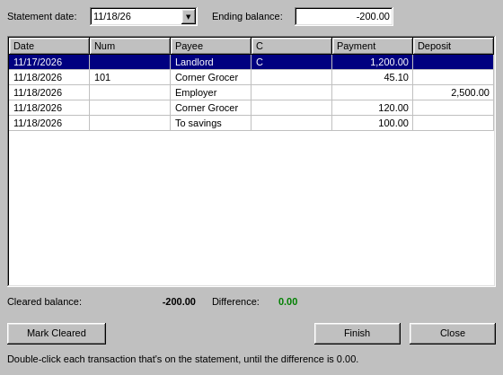

[Contents](index.md) | Previous: [The Account Register](05-register.md) | Next: [Bills and Deposits](07-bills.md)

# Balancing an Account

When a statement comes, you tick off what's on it until the program's
cleared balance agrees with the statement's ending balance. Then those
transactions are marked reconciled, and stay out of the way next time.



A transaction's **Status** goes *Unreconciled* (entered, not seen on a
statement), *Cleared* (ticked), *Reconciled* (a finished statement had
it). The register shows these as blank, `C` and `R`.

## ReconcileForm

**Project > Add Form**:

| Property | Value |
|---|---|
| (Name) | `ReconcileForm` |
| Caption | Balance an Account |
| Width, Height | 560, 418 |

No DataTable: this form shows no single record. It works on many.

| Element | (Name) | Left, Top | Width × Height | Properties |
|---|---|---|---|---|
| Label | `statementLabel` | 8, 12 | 90 × 17 | Caption: Statement date: |
| DateTimePicker (Date) | `statementPicker` | 100, 8 | 120 × 21 | Value: today; AllowBlank: False |
| Label | `endingLabel` | 236, 12 | 90 × 17 | Caption: Ending balance: |
| TextBox | `endingBox` | 328, 8 | 110 × 21 | Alignment: Right |
| DataGrid | `grid` | 8, 40 | 544 × 280 | DataTable: Listing; Columns: Date, Num, Payee, C, Payment, Deposit |
| Label | `clearedCaption` | 8, 330 | 96 × 17 | Caption: Cleared balance: |
| Label | `clearedLabel` | 108, 330 | 110 × 17 | Caption: (blank); Alignment: Right; FontBold: True |
| Label | `differenceCaption` | 236, 330 | 70 × 17 | Caption: Difference: |
| Label | `differenceLabel` | 310, 330 | 242 × 17 | Caption: (blank); FontBold: True |
| Button | `toggleButton` | 8, 360 | 110 × 24 | Caption: Mark Cleared |
| Button | `finishButton` | 350, 360 | 96 × 24 | Caption: Finish; Enabled: False |
| Button | `cancelButton` | 456, 360 | 96 × 24 | Caption: Close |
| Label | `helpLabel` | 8, 394 | 544 × 17 | Caption: Double-click each transaction that's on the statement, until the difference is 0.00. |

`statementPicker` starts on today (**Value** `today`), and can't be left
empty. `finishButton` starts disabled; code enables it when the
difference reaches zero.

**(General)**:

```
readonly property var home: App.form("HomeForm")
property var accountId: null
property real difference: 0

// the transactions not reconciled yet, up to the statement's day
function fill() {
    var account = Db.get("Accounts", accountId), payees = home.names("Payees");
    var cleared = account.OpeningBalance || 0, out = [], day = statementPicker.value || home.today();
    Db.select("Transactions", { where: { Account: accountId }, orderBy: "Date" }).forEach(function (t) {
        if (t.Cleared !== "Unreconciled")
            cleared += t.Amount;
        if (t.Cleared === "Reconciled" || t.Date > day)
            return;
        out.push({ id: t.id, Date: home.showDate(t.Date), Num: t.Number || "", Payee: payees[t.Payee] || t.Memo || "",
                   C: t.Cleared === "Cleared" ? "C" : "", Payment: t.Amount < 0 ? home.fmt(-t.Amount) : "",
                   Deposit: t.Amount >= 0 ? home.fmt(t.Amount) : "" });
    });
    var keep = grid.currentIndex;
    grid.rows = out;
    grid.currentIndex = Math.min(keep, out.length - 1);
    var ending = home.parseMoney(endingBox.text);
    clearedLabel.text = home.fmt(cleared);
    difference = ending === null ? NaN : Math.round((ending - cleared) * 100) / 100;
    differenceLabel.text = ending === null ? "(type the statement's ending balance)" : home.fmt(difference);
    differenceLabel.foreColor = difference === 0 ? "#008000" : "#c00000";
    finishButton.enabled = difference === 0;
    form.title = "Balance " + account.Name;
}

// tick or untick the row that's selected
function toggle() {
    if (grid.currentId === null)
        return;
    var t = Db.get("Transactions", grid.currentId);
    Db.update("Transactions", t.id, { Cleared: t.Cleared === "Cleared" ? "Unreconciled" : "Cleared" });
    fill();
}
```

The form's **load**:

```
accountId = form.args.account;
fill();
```

`endingBox`, **changed**:

```
fill();
```

`statementPicker`, **changed**:

```
fill();
```

`grid`, **rowActivated**:

```
toggle();
```

`toggleButton`, **clicked**:

```
toggle();
```

`finishButton`, **clicked**:

```
var done = 0;
Db.select("Transactions", { where: { Account: accountId, Cleared: "Cleared" } }).forEach(function (t) {
    Db.update("Transactions", t.id, { Cleared: "Reconciled" });
    done += 1;
});
form.msgBox("Balanced: " + done + " transactions are reconciled.", "Balance an Account", "info", ["OK"], function () {
    form.close();
});
```

`cancelButton`, **clicked**:

```
form.close();
```

The cleared balance is the opening balance plus every transaction that
isn't *Unreconciled*. **Finish** only works at a difference of exactly
`0.00`, which is why the amounts are rounded to cents before they're
compared: money added up as fractions can be off by a hair.

A message box doesn't wait for its answer, so what happens after **OK**
(closing the form) is inside the function given to it.

## Into the menu

Under **&Accounts**, after Open Register:

| Menu | Caption | Name | Shortcut | Action |
|---|---|---|---|---|
| **&Accounts** | `&Balance an Account...` | `accountsBalance` |  | (none: its code only) |

No Action again: the code you put in `menu1.itemClicked` last chapter
opens the form for the account that's selected.

## Try it

Select Checking on the Home page, then **Accounts > Balance an
Account...**. Type an **Ending balance** of `954.90`: the difference
shows in red. Double-click the Corner Grocer `45.10` row: it gets a `C`,
the cleared balance becomes `954.90`, the difference `0.00` in green, and
**Finish** comes alive. Finish. In the register that row now has `R`, and
the register's own **Cleared** figure agrees.

[Contents](index.md) | Previous: [The Account Register](05-register.md) | Next: [Bills and Deposits](07-bills.md)
