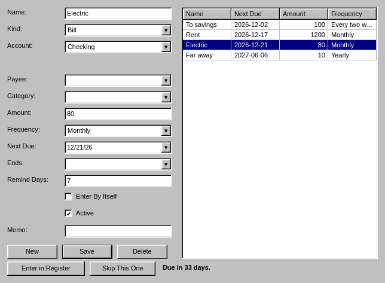

[Contents](index.md) | Previous: [Balancing an Account](06-reconcile.md) | Next: [The Budget](08-budget.md)

# Bills and Deposits

Rent every month, a paycheck every two weeks, a transfer to savings.
Each is entered once here with how often it comes round; the Home page
reminds you when one is near, one click enters it in the register, and
the ones you trust can enter themselves.



## The library's part

In HomeForm's **(General)**, **delete** the stand-in `showBills` from
chapter 3 and add this at the end:

```
// ---- bills and deposits --------------------------------------------------

function nextDue(day, frequency) {
    switch (frequency) {
    case "Weekly": return addDays(day, 7);
    case "Every two weeks": return addDays(day, 14);
    case "Twice a month": return addDays(day, 15);
    case "Monthly": return addMonths(day, 1);
    case "Every three months": return addMonths(day, 3);
    case "Every six months": return addMonths(day, 6);
    case "Yearly": return addMonths(day, 12);
    }
    return "";      // Once
}

// the bills inside their own reminder days, the soonest first: [{ bill, days }]
function billsDue() {
    var out = [];
    Db.select("Bills", { where: { Active: true }, orderBy: "NextDue" }).forEach(function (b) {
        var days = daysBetween(today(), b.NextDue);
        if (days <= (b.RemindDays === null ? 7 : b.RemindDays))
            out.push({ bill: b, days: days });
    });
    return out;
}

// move a bill on to its next day (after it's paid, or to skip one)
function skipBill(id) {
    var b = Db.get("Bills", id), next = nextDue(b.NextDue, b.Frequency);
    if (next === "" || (b.EndDate && next > b.EndDate))
        Db.update("Bills", id, { Active: false });
    else
        Db.update("Bills", id, { NextDue: next });
}

// put a bill in its account's register, then move it on
function enterBill(id) {
    var b = Db.get("Bills", id);
    if (b.id === undefined)
        return false;
    var transfer = b.Kind === "Transfer";
    var r = Db.insert("Transactions", {
        Account: b.Account, Date: b.NextDue, Payee: b.Payee, Category: transfer ? null : b.Category,
        Memo: b.Memo || b.Name, Amount: (b.Kind === "Deposit" ? 1 : -1) * b.Amount,
        TransferAccount: transfer ? b.ToAccount : null, Source: "Bill" });
    if (!r.ok) {
        form.msgBox(b.Name + " wasn't entered:\n" + r.messages.join("\n"), "Bills", "warning");
        return false;
    }
    matchTransfer(r.id);
    skipBill(id);
    return true;
}

function showBills() {
    var due = billsDue();
    billIds = due.map(function (d) { return d.bill.id; });
    billList.items = due.map(function (d) {
        var when = d.days < 0 ? "OVERDUE " + showDate(d.bill.NextDue) : d.days === 0 ? "Today" : showDate(d.bill.NextDue);
        return when + "   " + d.bill.Name + "   " + fmt(d.bill.Amount);
    });
    billsFrame.text = due.length === 0 ? "Bills coming up: none" : "Bills coming up: " + due.length;
}

// once a minute, and when the program starts: the bills that enter themselves
Timer { id: startup; interval: 600; onTriggered: everyMinute() }
Timer { id: minute; interval: 60000; repeat: true; running: true; onTriggered: everyMinute() }
function everyMinute() {
    var entered = 0;
    Db.select("Bills", { where: { Active: true, AutoEnter: true } }).forEach(function (b) {
        // (a bill that fell behind catches up, a payment at a time)
        for (var i = 0; i < 24 && b.Active && b.NextDue <= today(); ++i) {
            if (!enterBill(b.id))
                break;
            entered += 1;
            b = Db.get("Bills", b.id);
        }
    });
    if (entered > 0)
        statusLabel.text = entered + (entered === 1 ? " bill was" : " bills were") + " entered by itself.";
}
```

- **`nextDue`** moves a date on by the bill's frequency. `addMonths`
  keeps to the end of a short month: the 31st of January goes to the
  28th of February.
- **`enterBill`** writes the transaction (a transfer gets its other half
  from `matchTransfer`), then **`skipBill`** moves the bill to its next
  date, or switches it off when it was a one-off or has passed its end.
- **Two Timers**. `minute` runs for as long as the program does and
  calls `everyMinute()` each minute, so a bill that falls due while the
  program is open is entered. `startup` runs it once, just after the
  program starts.

Change the form's **load** to start that timer:

```
seed();
refreshHome();
statusLabel.text = "Welcome to Wayland Money.";
startup.start();
```

`billList`, **doubleClicked**:

```
App.showForm("BillsForm");
```

## BillsForm

Open the **Bills** table and **Project > Add Form for Bills**. Then:

1. The form: **Height** `473`.
2. `grid`: **Columns** `Name`, `NextDue`, `Amount`, `Frequency`;
   **OrderBy** `NextDue`.
3. Add:

| Element | (Name) | Left, Top | Width × Height | Properties |
|---|---|---|---|---|
| Button | `enterButton` | 12, 437 | 130 × 24 | Caption: Enter in Register |
| Button | `skipButton` | 150, 437 | 110 × 24 | Caption: Skip This One |
| Label | `dueLabel` | 272, 441 | 360 × 17 | Caption: (blank); FontBold: True |

**(General)**:

```
readonly property var home: App.form("HomeForm")

function check() {
    if (form.record.Kind === "Transfer" && !form.record.ToAccount) {
        form.msgBox("A transfer needs the account the money goes to.", "Bills", "warning");
        return false;
    }
    return true;
}
```

The form's **current**:

```
if (form.isNew) {
    dueLabel.text = "A new bill: fill it in and press Save.";
} else {
    var days = home.daysBetween(home.today(), form.record.NextDue);
    dueLabel.text = !form.record.Active ? "This one is finished."
                  : days < 0 ? "Overdue by " + (-days) + (days === -1 ? " day." : " days.")
                  : days === 0 ? "Due today." : "Due in " + days + (days === 1 ? " day." : " days.");
}
toAccountLabel.visible = toAccountCombo.visible = form.record.Kind === "Transfer";
```

`kindCombo`, **changed**:

```
toAccountLabel.visible = toAccountCombo.visible = form.record.Kind === "Transfer";
```

`saveButton`, **clicked**:

```
if (check())
    form.save();
```

`enterButton`, **clicked**:

```
if (form.isNew || form.dirty) {
    if (!check() || !form.save())
        return;
}
var id = form.recordId;
if (home.enterBill(id)) {
    form.loadRecord(id);
    dueLabel.text = "Entered in the register. " + dueLabel.text;
}
```

`skipButton`, **clicked**:

```
if (form.isNew)
    return;
var id = form.recordId;
home.skipBill(id);
form.loadRecord(id);
```

`saveButton` already has `form.save();`: replace it with the code above.
The table can't say "To Account is required, but only for a transfer"
(a rule isn't run on an empty field), so `check()` says it.

This form's grid is the plain kind: it lists the Bills table itself, so
the amounts show as the table keeps them (`1200`, not `1,200.00`). That's
the trade: no code, no formatting.

## Into the menu

A new menu **&Bills** after Accounts:

| Menu | Caption | Name | Shortcut | Action |
|---|---|---|---|---|
| **&Bills** | `&Bills && Deposits...` | `billsList` | Ctrl+B | Open a form: BillsForm |

| Caption | Name | Symbol | ToolTip | Action |
|---|---|---|---|---|
| Bills | `billsTool` | ✉ | Bills and deposits | Open a form: BillsForm |

## Try it

**F5**, **Bills > Bills & Deposits...**:

1. **Rent**: Account Checking, Payee Landlord, Category Housing : Rent,
   Amount `1200`, Monthly, **Next Due** yesterday, tick **Enter By
   Itself**, Save. Within a minute the Home page's status line says *1
   bill was entered by itself.*, Checking is 1,200.00 lower, and the
   bill's Next Due has moved on a month.
2. **Electric**: Account Checking, Amount `80`, Monthly, Next Due three
   days from now. It appears on the Home page under **Bills coming up**.
   Select it here and **Skip This One**: next month.
3. **To savings**: Kind Transfer (the **To Account** row appears),
   Account Checking, To Account Savings, `100`, Every two weeks, due
   today. **Enter in Register**: both accounts move.
4. Try an Amount of `-5`, or an **Ends** date before Next Due: refused.

[Contents](index.md) | Previous: [Balancing an Account](06-reconcile.md) | Next: [The Budget](08-budget.md)
