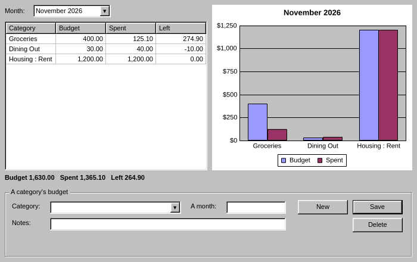

[Contents](index.md) | Previous: [Bills and Deposits](07-bills.md) | Next: [Investments](09-investing.md)

# The Budget

A monthly amount for a category, set beside what was really spent.



## BudgetForm

**Project > Add Form**:

| Property | Value |
|---|---|
| (Name) | `BudgetForm` |
| Caption | Budget |
| DataTable | Budgets |
| Width, Height | 700, 440 |

| Element | (Name) | Left, Top | Width × Height | Properties |
|---|---|---|---|---|
| Frame | `editFrame` | 8, 316 | 684 × 116 | Caption: A category's budget |
| Label | `monthLabel` | 8, 12 | 44 × 17 | Caption: Month: |
| DateTimePicker (Date) | `monthPicker` | 56, 8 | 130 × 21 | Value: today; DateFormat: Custom; CustomDateFormat: MMMM yyyy; AllowBlank: False |
| DataGrid | `grid` | 8, 36 | 340 × 250 | DataTable: Listing; Columns: Category, Budget, Spent, Left |
| Graph | `graph1` | 356, 8 | 336 × 278 |  |
| Label | `totalLabel` | 8, 292 | 684 × 17 | Caption: (blank); FontBold: True |
| Label | `categoryLabel` | 20, 340 | 60 × 17 | Caption: Category: |
| ComboBox | `categoryCombo` | 84, 338 | 220 × 21 | DataField: Category |
| Label | `amountLabel` | 320, 340 | 56 × 17 | Caption: A month: |
| TextBox | `amountBox` | 380, 338 | 100 × 21 | DataField: Amount; Alignment: Right |
| Label | `notesLabel` | 20, 368 | 60 × 17 | Caption: Notes: |
| TextBox | `notesBox` | 84, 366 | 396 × 21 | DataField: Notes |
| Button | `newButton` | 500, 336 | 84 × 24 | Caption: New |
| Button | `saveButton` | 592, 336 | 84 × 24 | Caption: Save; Default: True |
| Button | `deleteButton` | 592, 366 | 84 × 24 | Caption: Delete |

`monthPicker`'s **DateFormat** is *Custom* with **CustomDateFormat**
`MMMM yyyy`, so it reads *November 2026*; any day picked in a month means
that month. `graph1`:

| Graph Editor | Setting |
|---|---|
| Type | Column |
| Data | What code gives it |
| Legend | Bottom |
| Before | `$` |

**(General)**:

```
readonly property var home: App.form("HomeForm")

// each budget beside what was spent in the month the picker shows
function fill() {
    var day = monthPicker.value || home.today();
    var from = home.monthStart(day), to = home.addDays(home.addMonths(from, 1), -1);
    var spent = {}, names = home.names("Categories");
    home.totalsByCategory(from, to).forEach(function (c) { spent[c.category] = -c.total; });
    var out = [], labels = [], budgeted = [], used = [], totalBudget = 0, totalSpent = 0;
    Db.select("Budgets").forEach(function (b) {
        var s = Math.max(0, spent[b.Category] || 0);
        out.push({ id: b.id, Category: names[b.Category] || "", Budget: home.fmt(b.Amount), Spent: home.fmt(s),
                   Left: home.fmt(b.Amount - s) });
        labels.push(names[b.Category] || "");
        budgeted.push(b.Amount);
        used.push(Math.round(s * 100) / 100);
        totalBudget += b.Amount;
        totalSpent += s;
    });
    grid.rows = out;
    graph1.setData(labels, [{ name: "Budget", values: budgeted }, { name: "Spent", values: used }]);
    graph1.title = AppDates.display(from, "Date", "MMMM yyyy", "");
    totalLabel.text = "Budget " + home.fmt(totalBudget) + "   Spent " + home.fmt(totalSpent)
        + "   Left " + home.fmt(totalBudget - totalSpent);
    totalLabel.foreColor = totalSpent > totalBudget ? "#c00000" : "#000000";
}

Timer { id: soon; interval: 300; onTriggered: fill() }
Connections {
    target: Db
    function onChanged(table) {
        if (table === "Budgets" || table === "Transactions" || table === "Splits")
            soon.restart();
    }
}
```

The form's **load**:

```
fill();
```

`monthPicker`, **changed**:

```
fill();
```

`grid`, **rowSelected**:

```
form.loadRecord(grid.currentId);
```

`newButton`, **clicked**:

```
form.newRecord();
grid.currentIndex = -1;
categoryCombo.forceActiveFocus();
```

`saveButton`, **clicked**:

```
form.save();
```

`deleteButton`, **clicked**:

```
if (!form.isNew)
    form.deleteRecord();
```

`fill()` asks the library what was spent in the month
(`home.totalsByCategory`, which already knows about splits and leaves
transfers out) and sets each budget beside it. The graph gets two series,
so each category has a Budget column and a Spent column side by side.

The form has a DataTable (Budgets) and its grid shows Listing, which is
the same arrangement as the register: clicking a row loads that budget
into the boxes at the bottom.

## Into the menu

| Menu | Caption | Name | Shortcut | Action |
|---|---|---|---|---|
| **&Bills** | `B&udget...` | `billsBudget` |  | Open a form: BudgetForm |

| Caption | Name | Symbol | ToolTip | Action |
|---|---|---|---|---|
| Budget | `budgetTool` | ◔ | The budget | Open a form: BudgetForm |

## Try it

**Bills > Budget...**. **New**, Category Groceries, `400`, Save. Then
Dining Out `30` and Housing : Rent `1200`. The grid shows each with what
was spent this month and what's left; a category that's over shows a
negative **Left**, and the total line turns red when the whole budget is
overspent. Try a second budget for Groceries: *There is already a record
with this Category.* Leave the form open and enter a grocery transaction
in a register: the budget follows.

[Contents](index.md) | Previous: [Bills and Deposits](07-bills.md) | Next: [Investments](09-investing.md)
