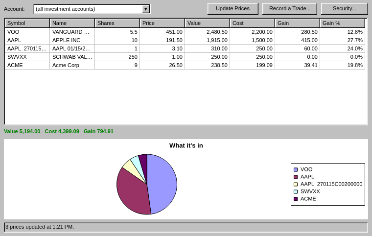
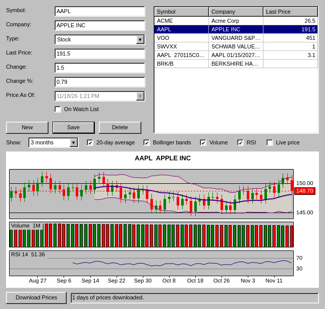
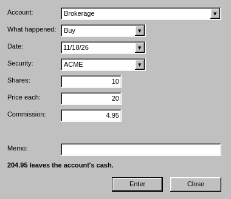

[Contents](index.md) | Previous: [The Budget](08-budget.md) | Next: [Charles Schwab](10-schwab.md)

# Investments

An investment account has cash, like any account, and holdings: so many
shares of a security, worth today's price. This chapter builds the
securities and their price charts, a form to record a trade, and the
portfolio. Everything works by hand first; [chapter 10](10-schwab.md)
then fills the same tables from Schwab.



## The library's part

In HomeForm's **(General)**, **delete** the stand-in `rebuildHoldings`
from chapter 5 and add at the end:

```
// ---- investments ---------------------------------------------------------

// the security with this symbol (made, if it's new): its id
function findSecurity(symbol, company, type) {
    var s = String(symbol).trim().toUpperCase();
    var rows = Db.select("Securities", { where: { Symbol: s } });
    if (rows.length > 0)
        return rows[0].id;
    var r = Db.insert("Securities", { Symbol: s, Company: company || "", Type: type || "Stock" });
    return r.ok ? r.id : null;
}

// every holding's market value, from its security's last price
function revalue() {
    var secs = {};
    Db.select("Securities").forEach(function (s) { secs[s.id] = s; });
    Db.select("Holdings").forEach(function (h) {
        var s = secs[h.Security];
        if (!s || s.LastPrice === null)
            return;
        var v = Math.round(h.Quantity * s.LastPrice * (s.Type === "Option" ? 100 : 1) * 100) / 100;
        if (v !== h.MarketValue)
            Db.update("Holdings", h.id, { MarketValue: v });
    });
}

// an account's holdings, worked out from its trades (average cost).
// A Schwab account's holdings are Schwab's own positions instead.
function rebuildHoldings(accountId) {
    var account = Db.get("Accounts", accountId);
    if (account.id === undefined || account.SchwabHash)
        return;
    var have = {};
    Db.select("Transactions", { where: { Account: accountId }, orderBy: "Date" }).forEach(function (t) {
        if (!t.Security || !t.Action)
            return;
        var h = have[t.Security] || (have[t.Security] = { shares: 0, cost: 0 });
        var q = t.Quantity || 0;
        if (t.Action === "Buy" || t.Action === "Reinvest" || t.Action === "Add Shares") {
            h.shares += q;
            h.cost += q * (t.Price || 0) + (t.Commission || 0);
        } else if (t.Action === "Sell" || t.Action === "Remove Shares") {
            h.cost -= h.shares > 0 ? h.cost * Math.min(1, q / h.shares) : 0;
            h.shares -= q;
        }
    });
    Db.select("Holdings", { where: { Account: accountId } }).forEach(function (h) { Db.remove("Holdings", h.id); });
    Object.keys(have).forEach(function (k) {
        if (Math.abs(have[k].shares) > 0.00005)
            Db.insert("Holdings", { Account: accountId, Security: Number(k), Quantity: have[k].shares,
                                    CostBasis: Math.round(have[k].cost * 100) / 100, AsOf: rightNow() });
    });
    revalue();
}

// a security's price for a day, into its price history
function keepPrice(securityId, day, bar) {
    var rows = Db.select("Prices", { where: { Security: securityId, Day: day } });
    var line = { Security: securityId, Day: day, Open: bar.open, High: bar.high, Low: bar.low,
                 Close: bar.close, Volume: bar.volume === undefined ? null : Math.round(bar.volume) };
    if (rows.length > 0)
        Db.update("Prices", rows[0].id, line);
    else
        Db.insert("Prices", line);
}
```

- **Holdings are worked out, not typed.** `rebuildHoldings` walks an
  account's trades in date order and keeps, for each security, the
  shares held and what they cost (average cost: selling a quarter of the
  shares takes a quarter of the cost with it).
- **`revalue()`** sets each holding's market value from its security's
  last price. An option's price is for one share and a contract is a
  hundred.
- An account's value on the Home page is its cash plus its holdings:
  `balances()` has been adding Holdings in since chapter 3.

## SecuritiesForm

Open the **Securities** table and **Project > Add Form for Securities**.
The top half is as the Studio draws it: the security's fields, New, Save
and Delete, and a grid of the securities. Under it goes a price chart.



1. The form: **Height** `612`.
2. `grid`: **Columns** `Symbol`, `Company`, `LastPrice`.
3. `priceTimePicker`: **Enabled** False.
4. Add:

| Element | (Name) | Left, Top | Width × Height | Properties |
|---|---|---|---|---|
| Label | `rangeLabel` | 12, 276 | 40 × 17 | Caption: Show: |
| ComboBox | `rangeCombo` | 56, 272 | 100 × 21 | List: 1 month, 3 months, 6 months, 1 year, 5 years |
| CheckBox | `averageCheck` | 172, 274 | 108 × 17 | Caption: 20-day average |
| CheckBox | `bandsCheck` | 284, 274 | 108 × 17 | Caption: Bollinger bands |
| CheckBox | `volumeCheck` | 396, 274 | 70 × 17 | Caption: Volume; Value: True |
| CheckBox | `rsiCheck` | 470, 274 | 50 × 17 | Caption: RSI |
| CheckBox | `liveCheck` | 528, 274 | 100 × 17 | Caption: Live price; ToolTipText: Ask Schwab for the price every half minute |
| Graph | `chart` | 12, 300 | 620 × 270 |  |
| Button | `downloadButton` | 12, 578 | 120 × 24 | Caption: Download Prices |
| Label | `statusLabel` | 140, 580 | 492 × 21 | Caption: (blank); BorderStyle: Sunken |

`chart` is a stock graph:

| Graph Editor | Setting |
|---|---|
| Type | Candlestick |
| Data | What code gives it |
| Legend | None |
| Decimals | 2 |
| Candles | Green and red |
| Under them | Volume |

**(General)**:

```
readonly property var home: App.form("HomeForm")
property var ranges: [30, 91, 182, 365, 1826]

// the security's price history as candles
function showChart() {
    if (form.isNew) {
        chart.setData([], []);
        return;
    }
    var from = home.addDays(home.today(), -ranges[Math.max(0, rangeCombo.currentIndex)]);
    var labels = [], bars = { name: form.record.Symbol, open: [], high: [], low: [], close: [], volume: [] };
    Db.select("Prices", { where: { Security: form.recordId, Day: { op: ">=", value: from } }, orderBy: "Day" }).forEach(function (p) {
        labels.push(AppDates.display(p.Day, "Date", "MMM d", ""));
        bars.open.push(p.Open === null ? p.Close : p.Open);
        bars.high.push(p.High === null ? p.Close : p.High);
        bars.low.push(p.Low === null ? p.Close : p.Low);
        bars.close.push(p.Close);
        bars.volume.push(p.Volume || 0);
    });
    chart.title = form.record.Symbol + (form.record.Company ? "  " + form.record.Company : "");
    chart.setData(labels, [bars]);
    showStudies();
    statusLabel.text = labels.length === 0 ? "No prices yet: Download Prices gets them from Schwab." : labels.length + " days of prices.";
}
function showStudies() {
    var over = [], under = [];
    if (averageCheck.checked)
        over.push("SMA 20");
    if (bandsCheck.checked)
        over.push("Bollinger 20 2");
    if (volumeCheck.checked)
        under.push("Volume");
    if (rsiCheck.checked)
        under.push("RSI 14");
    chart.overlays = over;
    chart.studies = under;
}

// a year of daily prices from Schwab, into the Prices table
function download() {
    if (form.isNew)
        return;
    var id = form.recordId, symbol = form.record.Symbol;
    statusLabel.text = "Asking Schwab for " + symbol + "'s prices...";
    home.schwabGet("/marketdata/v1/pricehistory?symbol=" + encodeURIComponent(symbol)
                   + "&periodType=year&period=5&frequencyType=daily&frequency=1", function (ok, data) {
        if (!ok) {
            statusLabel.text = data;
            return;
        }
        var have = {};
        Db.select("Prices", { where: { Security: id } }).forEach(function (p) { have[p.Day] = true; });
        var added = 0, candles = data.candles || [];
        candles.forEach(function (c, i) {
            var day = home.iso(new Date(c.datetime));
            // (the days it has already are left alone, but the last one, which may have moved)
            if (have[day] && i < candles.length - 1)
                return;
            home.keepPrice(id, day, c);
            added += 1;
        });
        // (a security with no price yet gets the last day's close)
        if (candles.length > 0 && Db.get("Securities", id).LastPrice === null)
            Db.update("Securities", id, { LastPrice: candles[candles.length - 1].close, PriceTime: home.rightNow() });
        home.revalue();
        if (form.recordId === id) {
            form.loadRecord(id);
            statusLabel.text = added + " days of prices downloaded.";
        }
    });
}

// the live price, every half minute while Live is ticked
Timer {
    id: live
    interval: 30000
    repeat: true
    running: liveCheck.checked && !form.isNew
    onTriggered: {
        var id = form.recordId;
        home.updateQuotes([Db.get("Securities", id)], function (ok, result) {
            if (!ok) {
                statusLabel.text = result;
                return;
            }
            var s = Db.get("Securities", id);
            if (form.recordId !== id || s.LastPrice === null)
                return;
            chart.tick(AppDates.display(home.today(), "Date", "MMM d", ""), s.LastPrice);
            form.loadRecord(id);
            statusLabel.text = s.Symbol + " " + home.fmt(s.LastPrice) + " at " + Qt.formatTime(new Date(), "h:mm:ss AP");
        });
    }
}
```

The form's **load**:

```
rangeCombo.currentIndex = 3;
if (form.args.security)
    form.loadRecord(form.args.security);
else if (!form.first())
    showChart();
```

The form's **current**:

```
showChart();
```

The form's **saved**:

```
// a price typed in by hand is today's price
if (form.record.LastPrice !== null && form.record.LastPrice !== undefined) {
    var p = Number(form.record.LastPrice);
    var rows = Db.select("Prices", { where: { Security: form.recordId, Day: home.today() } });
    if (rows.length === 0 || rows[0].Close !== p)
        home.keepPrice(form.recordId, home.today(), rows.length === 0 ? { open: p, high: p, low: p, close: p }
            : { open: rows[0].Open, high: Math.max(rows[0].High, p), low: Math.min(rows[0].Low, p), close: p, volume: rows[0].Volume || undefined });
    home.revalue();
    showChart();
}
```

`rangeCombo`, **changed**:

```
showChart();
```

`averageCheck`, **clicked**:

```
showStudies();
```

`bandsCheck`, **clicked**:

```
showStudies();
```

`volumeCheck`, **clicked**:

```
showStudies();
```

`rsiCheck`, **clicked**:

```
showStudies();
```

`downloadButton`, **clicked**:

```
download();
```

`chart`, **clicked**:

```
if (chart.clickedItem)
    statusLabel.text = chart.clickedLabel + ":  open " + home.fmt(chart.clickedItem.open) + "  high " + home.fmt(chart.clickedItem.high)
        + "  low " + home.fmt(chart.clickedItem.low) + "  close " + home.fmt(chart.clickedItem.close);
```

- **`showChart()`** gives the graph its bars from the Prices table:
  `chart.setData(labels, [{ open, high, low, close, volume }])`.
- **The check boxes** set `chart.overlays` (lines over the prices: a
  20-day average, Bollinger bands) and `chart.studies` (panes under
  them: volume, RSI). The Studio's graph works these out itself.
- **A price typed by hand** (Last Price, then Save) becomes today's bar,
  in the form's **saved** event, and every holding is revalued.
- **Download Prices** and **Live price** ask Schwab, through functions
  the next chapter adds to the library. Until then they'll say so in the
  Output window and do nothing.
- In the running program the wheel zooms the chart, dragging goes back
  in time, and resting the pointer on a bar shows its figures.

## TradeForm



**Project > Add Form**:

| Property | Value |
|---|---|
| (Name) | `TradeForm` |
| Caption | Record a Trade |
| DataTable | Transactions |
| Resizable | False |
| Width, Height | 380, 328 |

It's a second form on the Transactions table: a trade is a transaction
with an Action.

| Element | (Name) | Left, Top | Width × Height | Properties |
|---|---|---|---|---|
| Label | `accountLabel` | 12, 14 | 84 × 17 | Caption: Account: |
| ComboBox | `accountCombo` | 100, 12 | 264 × 21 | DataField: Account |
| Label | `actionLabel` | 12, 42 | 84 × 17 | Caption: What happened: |
| ComboBox | `actionCombo` | 100, 40 | 140 × 21 | DataField: Action |
| Label | `dateLabel` | 12, 70 | 84 × 17 | Caption: Date: |
| DateTimePicker (Date) | `datePicker` | 100, 68 | 140 × 21 | DataField: Date |
| Label | `securityLabel` | 12, 98 | 84 × 17 | Caption: Security: |
| ComboBox | `securityCombo` | 100, 96 | 140 × 21 | DataField: Security |
| Label | `quantityLabel` | 12, 126 | 84 × 17 | Caption: Shares: |
| TextBox | `quantityBox` | 100, 124 | 100 × 21 | DataField: Quantity; Alignment: Right |
| Label | `priceLabel` | 12, 154 | 84 × 17 | Caption: Price each: |
| TextBox | `priceBox` | 100, 152 | 100 × 21 | DataField: Price; Alignment: Right |
| Label | `commissionLabel` | 12, 182 | 84 × 17 | Caption: Commission: |
| TextBox | `commissionBox` | 100, 180 | 100 × 21 | DataField: Commission; Alignment: Right |
| Label | `amountLabel` | 12, 210 | 84 × 17 | Caption: Amount: |
| TextBox | `amountBox` | 100, 208 | 100 × 21 | Alignment: Right |
| Label | `memoLabel` | 12, 238 | 84 × 17 | Caption: Memo: |
| TextBox | `memoBox` | 100, 236 | 264 × 21 | DataField: Memo |
| Label | `totalLabel` | 12, 266 | 352 × 17 | Caption: (blank); FontBold: True |
| Button | `enterButton` | 184, 292 | 84 × 24 | Caption: Enter; Default: True |
| Button | `closeButton` | 280, 292 | 84 × 24 | Caption: Close |

**(General)**:

```
readonly property var home: App.form("HomeForm")

// what the trade does to the account's cash
function cashFor() {
    var q = Number(form.record.Quantity) || 0, p = Number(form.record.Price) || 0, fee = Number(form.record.Commission) || 0;
    var typed = home.parseMoney(amountBox.text) || 0;
    switch (form.record.Action) {
    case "Buy": return -(q * p + fee);
    case "Sell": return q * p - fee;
    case "Dividend":
    case "Interest": return Math.abs(typed);
    case "Fee": return -Math.abs(typed);
    }
    return 0;       // Reinvest, Add Shares, Remove Shares: shares move, cash doesn't
}
function showTotal() {
    var action = form.record.Action || "";
    var shares = ["Buy", "Sell", "Reinvest", "Add Shares", "Remove Shares"].indexOf(action) >= 0;
    var typed = ["Dividend", "Interest", "Fee"].indexOf(action) >= 0;
    quantityLabel.visible = quantityBox.visible = priceLabel.visible = priceBox.visible = shares;
    commissionLabel.visible = commissionBox.visible = action === "Buy" || action === "Sell";
    amountLabel.visible = amountBox.visible = typed;
    var cash = Math.round(cashFor() * 100) / 100;
    totalLabel.text = action === "" ? "Choose what happened."
                    : cash < 0 ? home.fmt(-cash) + " leaves the account's cash."
                    : cash > 0 ? home.fmt(cash) + " comes into the account's cash."
                    : "The account's cash doesn't change.";
}
```

The form's **load**:

```
if (form.args.account)
    form.setField("Account", form.args.account);
form.setField("Action", "Buy");
showTotal();
```

`actionCombo`, **changed**:

```
showTotal();
```

`quantityBox`, **changed**:

```
showTotal();
```

`priceBox`, **changed**:

```
showTotal();
```

`commissionBox`, **changed**:

```
showTotal();
```

`amountBox`, **changed**:

```
showTotal();
```

`enterButton`, **clicked**:

```
var account = form.record.Account ? Db.get("Accounts", form.record.Account) : ({});
if (!home.isInvestment(account.Type)) {
    form.msgBox("Choose an Investment or Retirement account.", "Trade", "warning");
    return;
}
if (account.SchwabHash) {
    form.msgBox(account.Name + " is downloaded from Schwab: its trades come from there.", "Trade", "info");
    return;
}
var action = form.record.Action;
if (action !== "Interest" && action !== "Fee" && !form.record.Security) {
    form.msgBox("Choose the security.", "Trade", "warning");
    return;
}
if (["Dividend", "Interest", "Fee"].indexOf(action) < 0 && !(Number(form.record.Quantity) > 0)) {
    form.msgBox("Type how many shares.", "Trade", "warning");
    return;
}
form.setField("Amount", Math.round(cashFor() * 100) / 100);
form.setField("Cleared", "Cleared");
if (!form.record.Memo)
    form.setField("Memo", action + (form.record.Security ? " " + Db.lookupLabel("Securities", form.record.Security) : ""));
// (income and fees get their categories; a buy or a sell isn't spending)
var wanted = action === "Dividend" || action === "Reinvest" ? "Investment Income : Dividends"
           : action === "Interest" ? "Investment Income : Interest" : action === "Fee" ? "Investment Expense : Fees" : "";
var found = wanted === "" ? [] : Db.select("Categories", { where: { Name: wanted } });
form.setField("Category", found.length > 0 ? found[0].id : null);
var accountId = form.record.Account;
if (!form.save())
    return;
home.rebuildHoldings(accountId);
form.msgBox("Entered.", "Trade", "info", ["Another", "Close"], function (answer) {
    if (answer !== 0) {
        form.close();
        return;
    }
    form.newRecord();
    form.setField("Account", accountId);
    form.setField("Action", action);
    amountBox.text = "";
    showTotal();
});
```

`closeButton`, **clicked**:

```
form.close();
```

The form shows only the boxes the chosen action needs: shares and price
for a buy or a sell, a plain amount for a dividend, interest or a fee.
`cashFor()` is what the trade does to the account's cash; the line at
the bottom says it in words before you press Enter.

**Account** lists every account, because a Lookup's list can't be
narrowed; Enter checks that the one chosen is an investment account.

## PortfolioForm

**Project > Add Form**:

| Property | Value |
|---|---|
| (Name) | `PortfolioForm` |
| Caption | Portfolio |
| Width, Height | 760, 482 |

| Element | (Name) | Left, Top | Width × Height | Properties |
|---|---|---|---|---|
| Label | `accountLabel` | 8, 12 | 56 × 17 | Caption: Account: |
| ComboBox | `accountCombo` | 68, 8 | 240 × 21 |  |
| Button | `pricesButton` | 424, 6 | 104 × 24 | Caption: Update Prices |
| Button | `tradeButton` | 536, 6 | 112 × 24 | Caption: Record a Trade... |
| Button | `securityButton` | 656, 6 | 96 × 24 | Caption: Security... |
| DataGrid | `grid` | 8, 36 | 744 × 220 | DataTable: Listing; Columns: Symbol, Name, Shares, Price, Value, Cost, Gain, Percent |
| Label | `totalLabel` | 8, 262 | 744 × 17 | Caption: (blank); FontBold: True |
| Graph | `graph1` | 8, 284 | 744 × 164 |  |
| Label | `statusLabel` | 8, 454 | 744 × 21 | Caption: (blank); BorderStyle: Sunken |

| Graph Editor | Setting |
|---|---|
| Type | Pie |
| Data | What code gives it |
| Title | What it's in |
| Legend | Right |
| Before | `$` |

**(General)**:

```
readonly property var home: App.form("HomeForm")
property var accountIds: []

function fill() {
    var only = accountCombo.currentIndex > 0 ? accountIds[accountCombo.currentIndex - 1] : null;
    var secs = {}, bySecurity = {}, order = [];
    Db.select("Securities").forEach(function (s) { secs[s.id] = s; });
    Db.select("Holdings", { where: only === null ? {} : { Account: only } }).forEach(function (h) {
        var line = bySecurity[h.Security];
        if (!line) {
            line = bySecurity[h.Security] = { security: h.Security, shares: 0, value: 0, cost: 0 };
            order.push(line);
        }
        line.shares += h.Quantity || 0;
        line.value += h.MarketValue || 0;
        line.cost += h.CostBasis || 0;
    });
    order.sort(function (a, b) { return b.value - a.value; });
    var value = 0, cost = 0;
    grid.rows = order.map(function (line) {
        var s = secs[line.security] || {};
        value += line.value;
        cost += line.cost;
        return { id: line.security, Symbol: s.Symbol || "?", Name: s.Company || "",
                 Shares: String(Math.round(line.shares * 10000) / 10000),
                 Price: s.LastPrice === null || s.LastPrice === undefined ? "" : home.fmt(s.LastPrice),
                 Value: home.fmt(line.value), Cost: home.fmt(line.cost), Gain: home.fmt(line.value - line.cost),
                 Percent: line.cost > 0 ? ((line.value - line.cost) / line.cost * 100).toFixed(1) + "%" : "" };
    });
    graph1.setData(order.map(function (line) { return (secs[line.security] || {}).Symbol || "?"; }),
                   [{ name: "Value", values: order.map(function (line) { return Math.round(line.value * 100) / 100; }) }]);
    totalLabel.text = "Value " + home.fmt(value) + "   Cost " + home.fmt(cost) + "   Gain " + home.fmt(value - cost);
    totalLabel.foreColor = value - cost < 0 ? "#c00000" : "#008000";
}

Timer { id: soon; interval: 300; onTriggered: fill() }
Connections {
    target: Db
    function onChanged(table) {
        if (table === "Holdings" || table === "Securities")
            soon.restart();
    }
}
```

The form's **load**:

```
var accounts = Db.select("Accounts", { orderBy: "Name" }).filter(function (a) { return home.isInvestment(a.Type); });
accountIds = accounts.map(function (a) { return a.id; });
accountCombo.items = ["(all investment accounts)"].concat(accounts.map(function (a) { return a.Name; }));
accountCombo.currentIndex = 0;
fill();
```

`accountCombo`, **changed**:

```
fill();
```

`grid`, **rowActivated**:

```
App.openForm("SecuritiesForm", { security: grid.currentId });
```

`pricesButton`, **clicked**:

```
statusLabel.text = "Asking Schwab for prices...";
home.updateQuotes(Db.select("Securities"), function (ok, result) {
    statusLabel.text = ok ? result + " prices updated at " + Qt.formatTime(new Date(), "h:mm AP") + "." : result;
});
```

`tradeButton`, **clicked**:

```
App.openForm("TradeForm", { account: accountCombo.currentIndex > 0 ? accountIds[accountCombo.currentIndex - 1] : null });
```

`securityButton`, **clicked**:

```
App.openForm("SecuritiesForm", { security: grid.currentId });
```

## Into the menu

A new menu **&Investing** after Bills:

| Menu | Caption | Name | Shortcut | Action |
|---|---|---|---|---|
| **&Investing** | `&Portfolio...` | `investPortfolio` | Ctrl+P | Open a form: PortfolioForm |
| **&Investing** | `Record a &Trade...` | `investTrade` |  | (none: its code only) |
| **&Investing** | `&Securities && Prices...` | `investSecurities` |  | Open a form: SecuritiesForm |

*Record a Trade* has no Action: `menu1.itemClicked` opens TradeForm for
the selected account.

| Caption | Name | Symbol | ToolTip | Action |
|---|---|---|---|---|
| Portfolio | `portfolioTool` | ▲ | What the investment accounts hold | Open a form: PortfolioForm |

## Try it

1. In the Brokerage register, a Deposit of `1000`.
2. **Investing > Securities & Prices...**: New, Symbol `ACME`, Company
   `Acme Corp`, Save. Try a symbol of `ab c!`: *A symbol is capitals and
   digits.*
3. Select Brokerage on the Home page, **Investing > Record a Trade...**:
   Buy, ACME, Shares `10`, Price each `20`, Commission `4.95`. The line
   says *204.95 leaves the account's cash.* Enter, Close.
4. **Investing > Portfolio...**: ACME, 10 shares, cost 204.95, no price
   yet.
5. Back in Securities, set ACME's **Last Price** to `26.5` and Save. The
   chart gets its first bar; the portfolio shows a value of 265.00 and a
   gain; the Home page's Brokerage is cash plus holdings.
6. The Brokerage register shows the buy, with its balance in cash and
   **Investments** beside it.

[Contents](index.md) | Previous: [The Budget](08-budget.md) | Next: [Charles Schwab](10-schwab.md)
