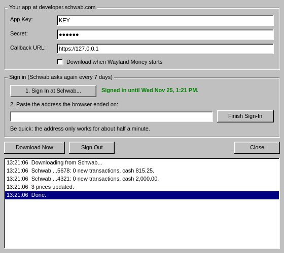
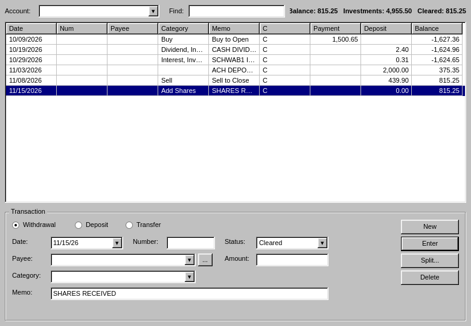

[Contents](index.md) | Previous: [Investments](09-investing.md) | Next: [Reports, Charts and the Loan Planner](11-reports.md)

# Charles Schwab

Money downloaded statements from the bank. Wayland Money downloads from
Charles Schwab, through Schwab's Trader API: your accounts, what each
holds, a year of transactions, and prices.



## Why not Project > APIs

The Studio has **Project > APIs...** for exactly this: describe a web
API and its sign-in once, and use its endpoints as tables. It can't sign
in to Schwab as it stands, for two reasons found while building this:

1. **Schwab only accepts an `https://` callback address** (the address
   the browser is sent back to after you sign in). The Studio's OAuth
   sign-in listens on `http://127.0.0.1` and has no setting for another.
2. **Schwab wants the app's key and secret in an `Authorization: Basic`
   header** when a code is exchanged for tokens. The Studio sends them in
   the body of the request.

So the program signs in with its own code. The Studio's code can do it:
`XMLHttpRequest` makes the requests, `Qt.btoa` builds the Basic header,
and `Qt.openUrlExternally` opens the browser. The one awkward step is the
callback: the browser is sent to `https://127.0.0.1`, where nothing is
listening, so it shows an error page, and you copy the address from its
address bar into the program. (This is how most small Schwab programs do
it.) [The last chapter](14-findings.md) lists both as things for the
Studio to gain.

## Your app at Schwab

Do this first; the approval takes a few days.

1. Make a developer account at
   [developer.schwab.com](https://developer.schwab.com) (it's separate
   from your brokerage sign-in).
2. **Dashboard > Create App**. Add both API products: **Accounts and
   Trading Production** and **Market Data Production**.
3. **Callback URL**: `https://127.0.0.1` exactly, with no `/` at the end.
4. The app starts as *Approved - Pending*. Wait until it says **Ready
   For Use**.
5. Open the app for its **App Key** and **Secret**.

Wayland Money only ever reads. It never places an order.

## The library's part

Add to the end of HomeForm's **(General)**:

```
// ---- Charles Schwab ------------------------------------------------------
// Requests don't wait: each takes a function to call with the answer.

function schwabBase() { return setting("SchwabBase", "https://api.schwabapi.com"); }

// one request: done(ok, data, status)
function httpRequest(method, url, headers, body, done) {
    var xhr = new XMLHttpRequest();
    xhr.onreadystatechange = function () {
        if (xhr.readyState !== XMLHttpRequest.DONE)
            return;
        var data = xhr.responseText;
        try { data = JSON.parse(xhr.responseText); } catch (e) { }
        done(xhr.status >= 200 && xhr.status < 300, data, xhr.status);
    };
    xhr.open(method, url);
    Object.keys(headers).forEach(function (h) { xhr.setRequestHeader(h, headers[h]); });
    if (body)
        xhr.send(body);
    else
        xhr.send();
}

// what went wrong, in words
function schwabError(data, status) {
    if (status === 0)
        return "No answer from Schwab. Is the internet there?";
    if (data && typeof data === "object") {
        if (data.error_description || data.message || data.error)
            return String(data.error_description || data.message || data.error);
        if (data.errors && data.errors.length > 0)
            return String(data.errors[0].detail || data.errors[0].title || data.errors[0].message || "Schwab said " + status);
    }
    return "Schwab said " + status + ".";
}

// ask Schwab's token address for tokens, and keep them: done(ok, why)
function schwabTokens(formBody, done) {
    var basic = Qt.btoa(setting("SchwabKey") + ":" + setting("SchwabSecret"));
    httpRequest("POST", schwabBase() + "/v1/oauth/token",
                { "Authorization": "Basic " + basic, "Content-Type": "application/x-www-form-urlencoded" },
                formBody, function (ok, data, status) {
        if (!ok || !data || !data.access_token) {
            done(false, schwabError(data, status));
            return;
        }
        setSetting("SchwabAccess", data.access_token);
        // (a minute early, so one never runs out on the way)
        setSetting("SchwabAccessUntil", Date.now() + ((data.expires_in || 1800) - 60) * 1000);
        if (data.refresh_token)
            setSetting("SchwabRefresh", data.refresh_token);
        done(true, "");
    });
}

// a token Schwab takes: the one kept, or a new one from the refresh token
function schwabToken(done) {
    if (setting("SchwabAccess") !== "" && Date.now() < Number(setting("SchwabAccessUntil", 0))) {
        done(true, setting("SchwabAccess"));
        return;
    }
    if (setting("SchwabRefresh") === "") {
        done(false, "Not signed in to Schwab yet: Online > Schwab Setup.");
        return;
    }
    schwabTokens("grant_type=refresh_token&refresh_token=" + encodeURIComponent(setting("SchwabRefresh")),
                 function (ok, why) {
        if (ok) {
            done(true, setting("SchwabAccess"));
        } else {
            setSetting("SchwabRefresh", "");
            done(false, "Schwab wants a new sign-in (" + why + "): Online > Schwab Setup.");
        }
    });
}

// GET something from Schwab, signed in: done(ok, data or why)
function schwabGet(path, done) {
    schwabToken(function (ok, token) {
        if (!ok) {
            done(false, token);
            return;
        }
        httpRequest("GET", schwabBase() + path, { "Authorization": "Bearer " + token, "Accept": "application/json" },
                    null, function (ok2, data, status) {
            done(ok2, ok2 ? data : schwabError(data, status));
        });
    });
}

// the latest prices of these securities (rows of Securities): done(ok, how many or why)
function updateQuotes(securities, done) {
    var list = securities.filter(function (s) { return s.Type !== "Option" && s.Type !== "Bond"; });
    if (list.length === 0) {
        done(true, 0);
        return;
    }
    var symbols = list.map(function (s) { return s.Symbol; }).join(",");
    schwabGet("/marketdata/v1/quotes?fields=quote,reference&symbols=" + encodeURIComponent(symbols), function (ok, data) {
        if (!ok) {
            done(false, data);
            return;
        }
        var got = 0;
        list.forEach(function (s) {
            var q = data[s.Symbol] ? data[s.Symbol].quote : null;
            if (!q)
                return;
            var price = q.lastPrice || q.mark || q.nAV || q.closePrice;
            if (!price)
                return;
            var change = { LastPrice: price, Change: q.netChange === undefined ? null : q.netChange,
                           ChangePercent: q.netPercentChange === undefined ? null : q.netPercentChange,
                           PriceTime: rightNow() };
            var ref = data[s.Symbol].reference;
            if (!s.Company && ref && ref.description)
                change.Company = ref.description;
            Db.update("Securities", s.id, change);
            got += 1;
        });
        revalue();
        done(true, got);
    });
}
```

```
// when the program starts: a download, if Schwab Setup says so
Timer {
    interval: 1500
    running: true
    onTriggered: {
        if (setting("SchwabAuto") === "yes" && setting("SchwabRefresh") !== "")
            App.showForm("SchwabForm").syncAll();
    }
}
```

How it's built:

- **Nothing here waits.** `XMLHttpRequest` sends its request and the
  program carries on; the answer comes back later to a function. So
  every one of these takes a function `done` to call with the result,
  and a download is a chain of them.
- **Two tokens.** Schwab gives an *access token* that lasts 30 minutes
  and goes on every request, and a *refresh token* that lasts 7 days and
  gets new access tokens. `schwabToken` hands back the access token it
  has, or quietly gets a new one first. When the refresh token itself
  has run out, it says a new sign-in is needed: Schwab's rule, every
  seven days.
- **`schwabGet(path, done)`** is all any other code needs.
- **`updateQuotes`** asks for many symbols in one request and writes
  each price to its security.

## SchwabForm

**Project > Add Form**:

| Property | Value |
|---|---|
| (Name) | `SchwabForm` |
| Caption | Schwab Setup |
| Resizable | False |
| Width, Height | 560, 500 |

| Element | (Name) | Left, Top | Width × Height | Properties |
|---|---|---|---|---|
| Frame | `setupFrame` | 8, 8 | 544 × 130 | Caption: Your app at developer.schwab.com |
| Frame | `signFrame` | 8, 146 | 544 × 126 | Caption: Sign in (Schwab asks again every 7 days) |
| Label | `keyLabel` | 20, 32 | 90 × 17 | Caption: App Key: |
| TextBox | `keyBox` | 112, 30 | 428 × 21 |  |
| Label | `secretLabel` | 20, 60 | 90 × 17 | Caption: Secret: |
| TextBox | `secretBox` | 112, 58 | 428 × 21 | Password: True |
| Label | `callbackLabel` | 20, 88 | 90 × 17 | Caption: Callback URL: |
| TextBox | `callbackBox` | 112, 86 | 428 × 21 |  |
| CheckBox | `autoCheck` | 112, 114 | 300 × 17 | Caption: Download when Wayland Money starts |
| Button | `connectButton` | 20, 168 | 170 × 24 | Caption: 1. Sign In at Schwab... |
| Label | `stateLabel` | 200, 172 | 340 × 17 | Caption: (blank); FontBold: True |
| Label | `pasteLabel` | 20, 200 | 400 × 17 | Caption: 2. Paste the address the browser ended on: |
| TextBox | `pasteBox` | 20, 220 | 400 × 21 |  |
| Button | `finishButton` | 428, 218 | 112 × 24 | Caption: Finish Sign-In |
| Label | `noteLabel` | 20, 248 | 520 × 17 | Caption: Be quick: the address only works for about half a minute. |
| Button | `syncButton` | 8, 280 | 120 × 24 | Caption: Download Now |
| Button | `signOutButton` | 136, 280 | 90 × 24 | Caption: Sign Out |
| Button | `closeButton` | 462, 280 | 90 × 24 | Caption: Close |
| ListBox | `logList` | 8, 312 | 544 × 180 |  |

`secretBox` has **Password** True: dots for what's typed.

**(General)**:

```
readonly property var home: App.form("HomeForm")
property bool busy: false
// (each account's cash, as Schwab has it, while a download is under way)
property var cashNow: ({})
readonly property var kinds: ({ EQUITY: "Stock", COLLECTIVE_INVESTMENT: "ETF", MUTUAL_FUND: "Mutual Fund",
                                FIXED_INCOME: "Bond", OPTION: "Option", CASH_EQUIVALENT: "Money Market" })
readonly property var allTypes: ["TRADE", "RECEIVE_AND_DELIVER", "DIVIDEND_OR_INTEREST", "ACH_RECEIPT",
    "ACH_DISBURSEMENT", "CASH_RECEIPT", "CASH_DISBURSEMENT", "ELECTRONIC_FUND", "WIRE_OUT", "WIRE_IN",
    "JOURNAL", "MEMORANDUM", "MARGIN_CALL", "MONEY_MARKET", "SMA_ADJUSTMENT"]

function say(text) {
    var lines = logList.items.slice();
    lines.push(Qt.formatTime(new Date(), "hh:mm:ss") + "  " + text);
    logList.items = lines;
    logList.currentIndex = lines.length - 1;
}
function round2(n) { return Math.round(n * 100) / 100; }

function showState() {
    var signedIn = home.setting("SchwabRefresh") !== "";
    if (!signedIn) {
        stateLabel.text = "Not signed in.";
        stateLabel.foreColor = "#c00000";
    } else {
        // Schwab's sign-in lasts seven days
        var until = new Date(Number(home.setting("SchwabSignedIn", Date.now())) + 7 * 86400000);
        stateLabel.text = "Signed in until " + Qt.formatDateTime(until, "ddd MMM d, h:mm AP") + ".";
        stateLabel.foreColor = "#008000";
    }
    syncButton.enabled = signedIn && !busy;
    signOutButton.enabled = signedIn;
}

// ---- signing in -----------------------------------------------------------

function keepSetup() {
    home.setSetting("SchwabKey", keyBox.text.trim());
    home.setSetting("SchwabSecret", secretBox.text.trim());
    home.setSetting("SchwabCallback", callbackBox.text.trim());
    home.setSetting("SchwabAuto", autoCheck.checked ? "yes" : "no");
}

// step 1: Schwab's own sign-in page, in the browser
function openSignIn() {
    if (keyBox.text.trim() === "" || secretBox.text.trim() === "" || callbackBox.text.trim() === "") {
        form.msgBox("Type the App Key, the Secret and the Callback URL of your app at developer.schwab.com.", "Schwab", "warning");
        return;
    }
    keepSetup();
    Qt.openUrlExternally(home.schwabBase() + "/v1/oauth/authorize?client_id=" + encodeURIComponent(keyBox.text.trim())
                         + "&redirect_uri=" + encodeURIComponent(callbackBox.text.trim()));
    say("The browser is opening Schwab. Sign in there, then copy the address it ends on and paste it below.");
    pasteBox.text = "";
    pasteBox.forceActiveFocus();
}

// step 2: the address the browser ended on has the code; swap it for tokens
function finishSignIn() {
    var pasted = pasteBox.text.trim(), found = /[?&]code=([^&#]+)/.exec(pasted);
    var code = found ? decodeURIComponent(found[1]) : decodeURIComponent(pasted);
    if (code === "") {
        form.msgBox("Paste the whole address the browser ended on: it starts with your Callback URL and has code= in it.",
                    "Schwab", "warning");
        return;
    }
    keepSetup();
    say("Finishing the sign-in...");
    home.schwabTokens("grant_type=authorization_code&code=" + encodeURIComponent(code)
                      + "&redirect_uri=" + encodeURIComponent(callbackBox.text.trim()), function (ok, why) {
        if (!ok) {
            say("The sign-in didn't work: " + why);
            say("(The code only lasts about 30 seconds: sign in again and paste it straight away.)");
            return;
        }
        home.setSetting("SchwabSignedIn", Date.now());
        pasteBox.text = "";
        say("Signed in.");
        showState();
        syncAll();
    });
}

// ---- downloading ------------------------------------------------------------

function finish(problem) {
    busy = false;
    if (problem)
        say(problem);
    else
        home.setSetting("SchwabLastSync", home.rightNow());
    home.refreshHome();
    showState();
}

// everything: the accounts, what they hold, their transactions, then prices
function syncAll() {
    if (busy)
        return;
    busy = true;
    showState();
    say("Downloading from Schwab...");
    home.schwabGet("/trader/v1/accounts/accountNumbers", function (ok, numbers) {
        if (!ok) {
            finish(numbers);
            return;
        }
        linkAccounts(numbers);
        home.schwabGet("/trader/v1/accounts?fields=positions", function (ok2, accounts) {
            if (!ok2) {
                finish(accounts);
                return;
            }
            var ids = [];
            cashNow = ({});
            accounts.forEach(function (entry) {
                var id = takeAccount(entry);
                if (id !== null)
                    ids.push(id);
            });
            takeTransactions(ids, 0, function () {
                home.updateQuotes(Db.select("Securities"), function (ok3, result) {
                    say(ok3 ? result + " prices updated." : "Prices: " + result);
                    finish("");
                    say("Done.");
                });
            });
        });
    });
}

// Schwab's accounts, matched to ours by account number (made, if they're new)
function linkAccounts(numbers) {
    numbers.forEach(function (n) {
        var number = String(n.accountNumber);
        var rows = Db.select("Accounts", { where: { AccountNumber: number } });
        if (rows.length > 0) {
            if (rows[0].SchwabHash !== n.hashValue)
                Db.update("Accounts", rows[0].id, { SchwabHash: n.hashValue });
            return;
        }
        var r = Db.insert("Accounts", { Name: "Schwab ..." + number.slice(-4), Type: "Investment", Institution: "Charles Schwab",
                                        AccountNumber: number, SchwabHash: n.hashValue, OpeningBalance: 0 });
        say(r.ok ? "New account: Schwab ..." + number.slice(-4) + " (rename it in Accounts > Account List)."
                 : "Account ..." + number.slice(-4) + " wasn't added: " + r.messages.join(" "));
    });
}

// one account of Schwab's answer: its positions become our Holdings
function takeAccount(entry) {
    var sa = entry.securitiesAccount;
    if (!sa)
        return null;
    var rows = Db.select("Accounts", { where: { AccountNumber: String(sa.accountNumber) } });
    if (rows.length === 0)
        return null;
    var account = rows[0], stamp = home.rightNow(), held = 0;
    Db.select("Holdings", { where: { Account: account.id } }).forEach(function (h) { Db.remove("Holdings", h.id); });
    (sa.positions || []).forEach(function (p) {
        var ins = p.instrument || {}, shares = (p.longQuantity || 0) - (p.shortQuantity || 0);
        if (!ins.symbol || shares === 0)
            return;
        var type = kinds[ins.assetType] || "Other", each = type === "Option" ? 100 : 1;
        var security = home.findSecurity(ins.symbol, ins.description, type);
        if (security === null) {
            say("Skipped " + ins.symbol + ": Securities won't take that symbol.");
            return;
        }
        Db.insert("Holdings", { Account: account.id, Security: security, Quantity: shares,
                                CostBasis: round2((p.averagePrice || 0) * shares * each),
                                MarketValue: round2(p.marketValue || 0), AsOf: stamp });
        if (p.marketValue)
            Db.update("Securities", security, { LastPrice: Math.round(p.marketValue / shares / each * 10000) / 10000, PriceTime: stamp });
        held += p.marketValue || 0;
    });
    // its cash: what the account is worth, less what it holds
    var now = sa.currentBalances || {}, start = sa.initialBalances || {}, all = entry.aggregatedBalance || {};
    var worth = all.liquidationValue !== undefined ? all.liquidationValue
              : now.liquidationValue !== undefined ? now.liquidationValue : start.liquidationValue;
    var cash = worth !== undefined ? worth - held
             : now.cashBalance !== undefined ? now.cashBalance
             : now.totalCash !== undefined ? now.totalCash : (start.cashBalance || 0);
    var kept = cashNow;
    kept[account.id] = round2(cash);
    cashNow = kept;
    return account.id;
}

// each account's transactions, one account after another
function takeTransactions(ids, i, done) {
    if (i >= ids.length) {
        done();
        return;
    }
    var account = Db.get("Accounts", ids[i]);
    // from a week before the last download (the first time: as far back as Schwab goes, a year)
    var from = account.LastSync ? home.addDays(account.LastSync, -7) : home.addDays(home.today(), -364);
    var path = "/trader/v1/accounts/" + account.SchwabHash + "/transactions?startDate="
             + encodeURIComponent(home.toDate(from).toISOString()) + "&endDate=" + encodeURIComponent(new Date().toISOString())
             + "&types=" + allTypes.join(",");
    home.schwabGet(path, function (ok, list) {
        if (!ok) {
            say(account.Name + ": " + list);
        } else {
            var added = 0, sum = 0;
            list.forEach(function (t) {
                if (takeTransaction(account, t))
                    added += 1;
            });
            // the opening balance is whatever makes the cash come out as Schwab has it
            Db.select("Transactions", { where: { Account: account.id } }).forEach(function (t) { sum += t.Amount; });
            Db.update("Accounts", account.id, { OpeningBalance: round2(cashNow[account.id] - sum), LastSync: home.rightNow() });
            say(account.Name + ": " + added + " new " + (added === 1 ? "transaction" : "transactions")
                + ", cash " + home.fmt(cashNow[account.id]) + ".");
        }
        takeTransactions(ids, i + 1, done);
    });
}

// one of Schwab's transactions into our table (false: it's there already, or isn't one of ours)
function takeTransaction(account, t) {
    if (t.status && t.status !== "VALID")
        return false;
    var key = String(t.activityId);
    if (Db.count("Transactions", { SchwabId: key }) > 0)
        return false;
    var amount = round2(t.netAmount || 0), item = null, fees = 0;
    (t.transferItems || []).forEach(function (it) {
        var ins = it.instrument || {};
        if (it.feeType)
            fees += Math.abs(it.cost || it.amount || 0);
        else if (ins.symbol && ins.assetType !== "CURRENCY" && item === null)
            item = it;
    });
    var record = { Account: account.id, Date: String(t.tradeDate || t.time || home.today()).substring(0, 10),
                   Memo: String(t.description || t.type || "").substring(0, 120), Amount: amount,
                   Cleared: "Cleared", Source: "Schwab", SchwabId: key };
    var action = "";
    if (t.type === "TRADE" && item)
        action = (amount !== 0 ? amount < 0 : item.amount > 0) ? "Buy" : "Sell";
    else if (t.type === "RECEIVE_AND_DELIVER" && item)
        action = item.amount >= 0 ? "Add Shares" : "Remove Shares";
    else if (t.type === "DIVIDEND_OR_INTEREST")
        action = /interest|\bint\b/i.test(t.description || "") ? "Interest" : "Dividend";
    if (action === "" && amount === 0)
        return false;
    if (action !== "") {
        record.Action = action;
        if (item) {
            var ins = item.instrument;
            record.Security = home.findSecurity(ins.symbol, ins.description, kinds[ins.assetType] || "Other");
            if (action !== "Dividend" && action !== "Interest") {
                record.Quantity = Math.abs(item.amount || 0);
                record.Price = item.price || 0;
            }
        }
        if (fees > 0)
            record.Commission = round2(fees);
        var wanted = action === "Dividend" ? "Investment Income : Dividends" : action === "Interest" ? "Investment Income : Interest" : "";
        var found = wanted === "" ? [] : Db.select("Categories", { where: { Name: wanted } });
        if (found.length > 0)
            record.Category = found[0].id;
    }
    var r = Db.insert("Transactions", record);
    if (!r.ok)
        say("Not taken: " + record.Memo + " (" + r.messages.join(" ") + ")");
    return r.ok;
}
```

The form's **load**:

```
keyBox.text = home.setting("SchwabKey");
secretBox.text = home.setting("SchwabSecret");
callbackBox.text = home.setting("SchwabCallback", "https://127.0.0.1");
autoCheck.checked = home.setting("SchwabAuto") === "yes";
showState();
```

`connectButton`, **clicked**:

```
openSignIn();
```

`finishButton`, **clicked**:

```
finishSignIn();
```

`pasteBox`, **accepted**:

```
finishSignIn();
```

`autoCheck`, **clicked**:

```
home.setSetting("SchwabAuto", autoCheck.checked ? "yes" : "no");
```

`syncButton`, **clicked**:

```
syncAll();
```

`signOutButton`, **clicked**:

```
home.setSetting("SchwabAccess", "");
home.setSetting("SchwabRefresh", "");
home.setSetting("SchwabAccessUntil", 0);
say("Signed out: the tokens are forgotten.");
showState();
```

`closeButton`, **clicked**:

```
form.close();
```

### What a download does

`syncAll()` makes five kinds of request, in order:

| Request | What comes back | What's done with it |
|---|---|---|
| `GET /trader/v1/accounts/accountNumbers` | Each account's number and a *hash* of it | Matched to Accounts by **Account Number**; a new one is made as *Schwab ...1234*. The hash is kept in **Schwab Link**: Schwab wants it, not the number, in every other address. |
| `GET /trader/v1/accounts?fields=positions` | Each account's balances and positions | The account's Holdings are replaced with Schwab's positions; each security gets a price. |
| `GET /trader/v1/accounts/{hash}/transactions` | The transactions between two dates | Each new one becomes a Transaction, marked Cleared, with Schwab's id. |
| `GET /marketdata/v1/quotes` | The latest price of each symbol | Securities' Last Price and Change; every holding revalued. |
| `GET /marketdata/v1/pricehistory` | Daily bars for one symbol | (From SecuritiesForm's **Download Prices**:) the Prices table. |

The details that matter:

- **Transactions** are asked for from a week before the last download
  (the first time, 364 days: Schwab allows a year at a time). The dates
  go as `2026-11-18T08:00:00.000Z`, which is what a JavaScript date's
  `toISOString()` gives. The overlap doesn't make duplicates, because
  **Schwab Id** is No Duplicates and `takeTransaction` looks first.
- **What kind of transaction** comes from Schwab's `type`: a `TRADE` is
  a Buy or a Sell with its security, shares, price and fees; a
  `DIVIDEND_OR_INTEREST` gets its income category; deposits, withdrawals
  and wires are plain transactions for you to categorize. Ones still
  `PENDING` are left for next time.
- **The cash is made to agree.** Schwab says what the account is worth;
  less what it holds, that's its cash. The download can't see
  transactions older than a year, so it sets the account's **Opening
  Balance** to whatever makes the register's balance come out at that
  cash. The register's last line always matches Schwab.

## Into the Home page

`syncButton`, **clicked** (the menu and the tool bar already call the
same thing, in the code from chapter 5):

```
App.showForm("SchwabForm").syncAll();
```

A new menu **&Online** after Investing:

| Menu | Caption | Name | Shortcut | Action |
|---|---|---|---|---|
| **&Online** | `&Download from Schwab` | `onlineSync` | F9 | (none: its code only) |
| **&Online** | `Schwab &Setup...` | `onlineSetup` |  | Open a form: SchwabForm |

| Caption | Name | Symbol | ToolTip | Action |
|---|---|---|---|---|
| Download | `syncTool` | ⇩ | Download from Schwab (F9) | (none: its code only) |

## The first sign-in

1. **Online > Schwab Setup...**. Paste the **App Key** and **Secret**;
   the Callback URL is already `https://127.0.0.1`.
2. **1. Sign In at Schwab...**. The browser opens Schwab's own sign-in
   page. Sign in with your brokerage name and password, tick the accounts
   to share, and **Allow**.
3. The browser is sent to `https://127.0.0.1/?code=...` and says it can't
   connect. That's expected. **Copy the whole address** from the address
   bar.
4. Back in Schwab Setup, paste it and **Finish Sign-In**. Be quick: the
   code in that address only works for about half a minute.
5. The log says *Signed in.*, and the first download starts by itself:
   your accounts appear, then their transactions, then prices.



Then: rename the new accounts in **Accounts > Account List** (and set a
Retirement account's Type). From now on **F9** downloads. Tick
**Download when Wayland Money starts** to have it happen by itself.

After seven days a download says *Schwab wants a new sign-in*: steps 2 to
4 again. The line under the button says when that will be.

## Keeping it safe

- The App Key, the Secret and the tokens are kept in the **Settings**
  table, in the program's database file, as plain text. Anyone who can
  read that file can read your Schwab accounts until the refresh token
  runs out. Keep the file to yourself; don't send `money.db` or
  `data.db` to anyone, and don't put it in a shared folder.
- **Sign Out** forgets the tokens at once.
- The program asks Schwab only to read. Even so, treat the Secret as a
  password: if it gets out, make a new one at developer.schwab.com.

## When something isn't right

| The log says | What it means |
|---|---|
| *Unauthorized*, at Finish Sign-In | The App Key or Secret is wrong, or the app isn't **Ready For Use** yet. |
| *Bad authorization code...* or similar | The pasted code was too old (over half a minute), or it was used already. Sign in again. |
| *Schwab wants a new sign-in* | The seven days are up. |
| *No answer from Schwab* | No internet, or Schwab is down. |
| *Schwab said 400* on transactions | Schwab didn't like the dates or the account. Sign out and in again so the account hashes are fresh. |
| *Skipped ...: Securities won't take that symbol* | A symbol with a character the Securities table's Pattern doesn't allow. Widen the Pattern. |

## What was checked, and what wasn't

This chapter's code was run against a stand-in for Schwab
(`tools/mock_schwab.py`) that is strict about the things Schwab is strict
about: the Basic header, the form fields, the hash in the address, the
date format, the one-year limit. The requests it received are what
Schwab's API is documented to want. From the program, a real request to
`api.schwabapi.com` without a token got Schwab's own *401 Unauthorized*
back, so the connection itself works from a Studio program.

It was **not** run against a real Schwab account: that needs your app
and your sign-in. The names of the fields in Schwab's answers come from
Schwab's published API as other programs use it. If a download leaves
something blank, these are the places to look, in `SchwabForm` and the
library:

- an account's worth: `aggregatedBalance.liquidationValue`, then
  `currentBalances.liquidationValue`, `initialBalances.liquidationValue`;
- a position: `longQuantity`, `shortQuantity`, `averagePrice`,
  `marketValue`, `instrument.symbol`, `instrument.assetType`;
- a transaction: `activityId`, `type`, `status`, `tradeDate`,
  `netAmount`, `description`, `transferItems`;
- a quote: `quote.lastPrice` (then `mark`, `nAV`, `closePrice`),
  `quote.netChange`, `quote.netPercentChange`;
- price history: `candles`, each with `open`, `high`, `low`, `close`,
  `volume` and `datetime` (milliseconds).

To see exactly what Schwab sent, put `console.log(JSON.stringify(data))`
in `schwabGet` and run from the Studio: it prints in the Output window.

[Contents](index.md) | Previous: [Investments](09-investing.md) | Next: [Reports, Charts and the Loan Planner](11-reports.md)
