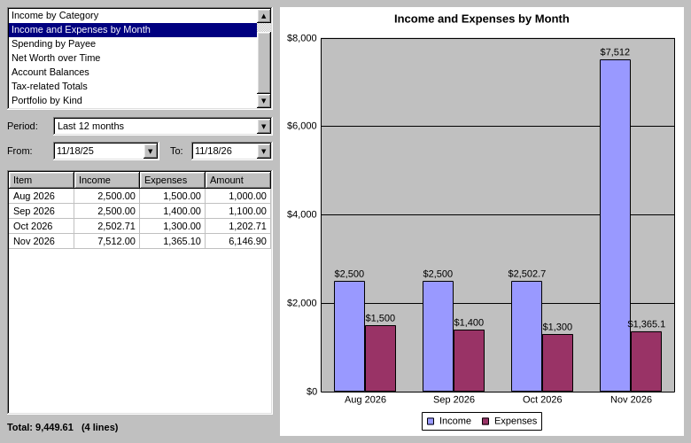
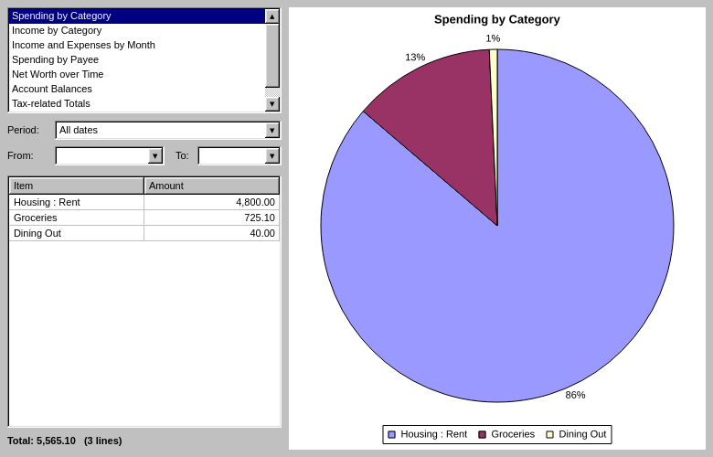
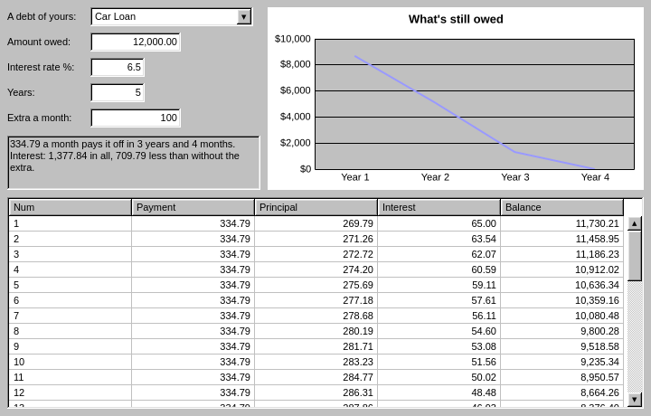

[Contents](index.md) | Previous: [Charles Schwab](10-schwab.md) | Next: [The Advisor](12-advisor.md)

# Reports, Charts and the Loan Planner

## ReportsForm

Eight reports from one form: pick one from the list, pick a period, and
the figures are in a grid on the left and a graph on the right.



**Project > Add Form**:

| Property | Value |
|---|---|
| (Name) | `ReportsForm` |
| Caption | Reports and Charts |
| Width, Height | 780, 500 |

| Element | (Name) | Left, Top | Width × Height | Properties |
|---|---|---|---|---|
| ListBox | `reportList` | 8, 8 | 300 × 116 | List: Spending by Category, Income by Category, Income and Expenses by Month, Spending by Payee, Net Worth over Time, Account Balances, Tax-related Totals, Portfolio by Kind |
| Label | `periodLabel` | 8, 136 | 48 × 17 | Caption: Period: |
| ComboBox | `periodCombo` | 60, 132 | 248 × 21 | List: This month, Last month, This year, Last year, Last 12 months, All dates |
| Label | `fromLabel` | 8, 164 | 48 × 17 | Caption: From: |
| DateTimePicker (Date) | `fromPicker` | 60, 160 | 120 × 21 |  |
| Label | `toLabel` | 192, 164 | 20 × 17 | Caption: To: |
| DateTimePicker (Date) | `toPicker` | 216, 160 | 92 × 21 |  |
| DataGrid | `grid` | 8, 192 | 300 × 276 | DataTable: Listing; Columns: Item, Amount |
| Label | `totalLabel` | 8, 476 | 300 × 17 | Caption: (blank); FontBold: True |
| Graph | `graph1` | 316, 8 | 456 × 484 |  |

`reportList`'s **List** is the eight report names and `periodCombo`'s the
six periods, one on each line, spelled as in the table: the code chooses
by name.

| Graph Editor | Setting |
|---|---|
| Type | Pie |
| Data | What code gives it |
| Legend | Bottom |
| Before | `$` |
| Values on the graph | On |

**(General)**:

```
readonly property var home: App.form("HomeForm")

function setPeriod() {
    var t = home.today(), year = t.substring(0, 4), from = "", to = t;
    switch (periodCombo.text) {
    case "This month": from = home.monthStart(t); break;
    case "Last month": from = home.addMonths(home.monthStart(t), -1); to = home.addDays(home.monthStart(t), -1); break;
    case "This year": from = year + "-01-01"; break;
    case "Last year": from = (Number(year) - 1) + "-01-01"; to = (Number(year) - 1) + "-12-31"; break;
    case "Last 12 months": from = home.addMonths(t, -12); break;
    default: to = "";       // All dates
    }
    fromPicker.value = from;
    toPicker.value = to;
}

function run() {
    var name = reportList.text, from = fromPicker.value || "0000-01-01", to = toPicker.value || "9999-12-31";
    var rows = [], labels = [], values = [], series = null, type = "Column", columns = ["Item", "Amount"], total = 0;
    function line(item, amount) {
        rows.push({ id: rows.length + 1, Item: item, Amount: home.fmt(amount) });
        labels.push(item);
        values.push(Math.round(amount * 100) / 100);
        total += amount;
    }
    if (name === "Spending by Category" || name === "Income by Category" || name === "Tax-related Totals") {
        var taxed = {};
        Db.select("Categories", { where: { TaxRelated: true } }).forEach(function (c) { taxed[c.id] = true; });
        var list = home.totalsByCategory(from, to);
        if (name === "Income by Category")
            list.reverse();
        list.forEach(function (c) {
            if (name === "Spending by Category" && c.total < 0)
                line(c.name, -c.total);
            else if (name === "Income by Category" && c.total > 0)
                line(c.name, c.total);
            else if (name === "Tax-related Totals" && taxed[c.category])
                line(c.name, c.total);
        });
        type = name === "Tax-related Totals" ? "Bar" : "Pie";
    } else if (name === "Income and Expenses by Month") {
        var months = {}, order = [];
        Db.select("Transactions", { orderBy: "Date" }).forEach(function (t) {
            if (t.Date < from || t.Date > to || !home.isFlow(t))
                return;
            var m = t.Date.substring(0, 7);
            if (!months[m]) {
                months[m] = { income: 0, spent: 0 };
                order.push(m);
            }
            if (t.Amount > 0)
                months[m].income += t.Amount;
            else
                months[m].spent -= t.Amount;
        });
        columns = ["Item", "Income", "Expenses", "Amount"];
        series = [{ name: "Income", values: [] }, { name: "Expenses", values: [] }];
        order.forEach(function (m) {
            var label = AppDates.display(m + "-01", "Date", "MMM yyyy", "");
            rows.push({ id: rows.length + 1, Item: label, Income: home.fmt(months[m].income), Expenses: home.fmt(months[m].spent),
                        Amount: home.fmt(months[m].income - months[m].spent) });
            labels.push(label);
            series[0].values.push(Math.round(months[m].income * 100) / 100);
            series[1].values.push(Math.round(months[m].spent * 100) / 100);
            total += months[m].income - months[m].spent;
        });
    } else if (name === "Spending by Payee") {
        var payees = home.names("Payees"), sums = {};
        Db.select("Transactions").forEach(function (t) {
            if (t.Date < from || t.Date > to || !home.isFlow(t) || t.Amount >= 0)
                return;
            var who = payees[t.Payee] || "(no payee)";
            sums[who] = (sums[who] || 0) - t.Amount;
        });
        Object.keys(sums).sort(function (a, b) { return sums[b] - sums[a]; }).slice(0, 15).forEach(function (who) { line(who, sums[who]); });
        type = "Bar";
    } else if (name === "Net Worth over Time") {
        Db.select("WorthHistory", { orderBy: "Day" }).forEach(function (w) {
            if (w.Day >= from && w.Day <= to)
                line(home.showDate(w.Day), w.Worth);
        });
        total = values.length > 0 ? values[values.length - 1] : 0;
        type = "Line";
    } else if (name === "Account Balances") {
        var b = home.balances();
        Db.select("Accounts", { orderBy: "Name" }).forEach(function (a) {
            if (!a.Closed)
                line(a.Name, b[a.id].value);
        });
        type = "Bar";
    } else if (name === "Portfolio by Kind") {
        var kindOf = {}, worth = {};
        Db.select("Securities").forEach(function (s) { kindOf[s.id] = s.Type; });
        Db.select("Holdings").forEach(function (h) {
            var k = kindOf[h.Security] || "Other";
            worth[k] = (worth[k] || 0) + (h.MarketValue || 0);
        });
        Object.keys(worth).sort(function (a, c) { return worth[c] - worth[a]; }).forEach(function (k) { line(k, worth[k]); });
        type = "Doughnut";
    }
    grid.columns = columns;
    grid.rows = rows;
    graph1.graphType = type;
    graph1.title = name;
    graph1.setData(labels, series || [{ name: name, values: values }]);
    totalLabel.text = (name === "Net Worth over Time" ? "Latest: " : "Total: ") + home.fmt(total)
        + "   (" + rows.length + (rows.length === 1 ? " line)" : " lines)");
}
```

The form's **load**:

```
periodCombo.currentIndex = 2;
setPeriod();
var wanted = reportList.items.indexOf(form.args.report || "");
reportList.currentIndex = wanted >= 0 ? wanted : 0;
run();
```

`reportList`, **changed**:

```
run();
```

`periodCombo`, **changed**:

```
setPeriod();
run();
```

`fromPicker`, **changed**:

```
run();
```

`toPicker`, **changed**:

```
run();
```

`graph1`, **clicked**:

```
// a slice or a bar: the transactions behind it
if (graph1.clickedIndex >= 0 && (reportList.text === "Spending by Category" || reportList.text === "Income by Category"
                                 || reportList.text === "Spending by Payee"))
    App.openForm("FindForm", { text: graph1.clickedLabel, from: fromPicker.value, to: toPicker.value });
```

One function, `run()`, makes every report the same way: it builds the
rows and the graph's labels and values, then hands them over. What
changes from report to report is three things code can set while the
program runs:

- **the grid's columns**: `grid.columns = ["Item", "Income", "Expenses",
  "Amount"]` for the monthly report, two columns for the rest;
- **the graph's type**: `graph1.graphType = "Pie"`, `"Bar"`, `"Line"`,
  `"Doughnut"`;
- **one series or two**: the monthly report gives the graph Income and
  Expenses side by side.

| Report | What it adds up | Graph |
|---|---|---|
| Spending by Category | What went out, by category (splits by their parts) | Pie |
| Income by Category | What came in | Pie |
| Income and Expenses by Month | Both, a month at a time | Columns |
| Spending by Payee | The fifteen payees paid the most | Bars |
| Net Worth over Time | The WorthHistory table | Line |
| Account Balances | Every open account today | Bars |
| Tax-related Totals | The categories ticked Tax-related | Bars |
| Portfolio by Kind | Holdings by the security's type | Doughnut |

Transfers and trades are left out of income and spending (`home.isFlow`):
moving money between your own accounts, or into shares, isn't either.

**Clicking a slice or a bar** of the first two reports, or of Spending by
Payee, opens Find with that name and the report's dates: the
transactions behind the figure. That's `graph1.clickedLabel`, and
FindForm reading `form.args`.



## PlannerForm

What a debt costs, and what paying a little more does to it.



**Project > Add Form**:

| Property | Value |
|---|---|
| (Name) | `PlannerForm` |
| Caption | Loan Planner |
| Width, Height | 720, 460 |

| Element | (Name) | Left, Top | Width × Height | Properties |
|---|---|---|---|---|
| Label | `accountLabel` | 8, 12 | 90 × 17 | Caption: A debt of yours: |
| ComboBox | `accountCombo` | 100, 8 | 180 × 21 |  |
| Label | `amountLabel` | 8, 40 | 90 × 17 | Caption: Amount owed: |
| TextBox | `amountBox` | 100, 36 | 100 × 21 | Alignment: Right |
| Label | `rateLabel` | 8, 68 | 90 × 17 | Caption: Interest rate %: |
| TextBox | `rateBox` | 100, 64 | 60 × 21 | Alignment: Right |
| Label | `yearsLabel` | 8, 96 | 90 × 17 | Caption: Years: |
| TextBox | `yearsBox` | 100, 92 | 60 × 21 | Text: 30; Alignment: Right |
| Label | `extraLabel` | 8, 124 | 90 × 17 | Caption: Extra a month: |
| TextBox | `extraBox` | 100, 120 | 100 × 21 | Alignment: Right |
| Label | `resultLabel` | 8, 150 | 280 × 60 | Caption: (blank); WordWrap: True; BorderStyle: Sunken |
| Graph | `graph1` | 296, 8 | 416 × 202 |  |
| DataGrid | `grid` | 8, 218 | 704 × 234 | DataTable: Listing; Columns: Num, Payment, Principal, Interest, Balance |

| Graph Editor | Setting |
|---|---|
| Type | Line |
| Data | What code gives it |
| Title | What's still owed |
| Legend | None |
| Before | `$` |
| Markers | Off |

**(General)**:

```
readonly property var home: App.form("HomeForm")
property var debtIds: []

function work() {
    var amount = home.parseMoney(amountBox.text), rate = Number(rateBox.text), years = Number(yearsBox.text);
    var extra = home.parseMoney(extraBox.text) || 0;
    if (amount === null || amount <= 0 || rateBox.text.trim() === "" || isNaN(rate) || rate < 0 || !(years > 0)) {
        resultLabel.text = "Type what's owed, the interest rate and how many years.";
        grid.rows = [];
        graph1.setData([], []);
        return;
    }
    var months = Math.round(years * 12), r = rate / 100 / 12;
    var payment = r === 0 ? amount / months : amount * r / (1 - Math.pow(1 + r, -months));
    var owed = amount, interest = 0, rows = [], labels = [], left = [], month = 0;
    while (owed > 0.005 && month < 1200) {
        month += 1;
        var i = owed * r, p = Math.min(owed, payment + extra - i);
        owed -= p;
        interest += i;
        rows.push({ id: month, Num: String(month), Payment: home.fmt(p + i), Principal: home.fmt(p), Interest: home.fmt(i),
                    Balance: home.fmt(owed) });
        if (month % 12 === 0 || owed <= 0.005) {
            labels.push("Year " + Math.ceil(month / 12));
            left.push(Math.round(owed));
        }
    }
    grid.rows = rows;
    graph1.setData(labels, [{ name: "Still owed", values: left }]);
    var plain = payment * months - amount;
    resultLabel.text = home.fmt(payment + extra) + " a month pays it off in " + Math.floor(month / 12) + " years"
        + (month % 12 ? " and " + (month % 12) + " months" : "") + ". Interest: " + home.fmt(interest) + " in all"
        + (extra > 0 ? ", " + home.fmt(plain - interest) + " less than without the extra." : ".");
}
```

The form's **load**:

```
var b = home.balances(), names = [];
Db.select("Accounts", { orderBy: "Name" }).forEach(function (a) {
    if (home.isDebt(a.Type) && !a.Closed) {
        debtIds.push(a.id);
        names.push(a.Name);
    }
});
accountCombo.items = names;
work();
```

`accountCombo`, **changed**:

```
var a = Db.get("Accounts", debtIds[accountCombo.currentIndex]);
amountBox.text = home.fmt(-home.balances()[a.id].value);
rateBox.text = a.InterestRate === null ? "" : String(a.InterestRate);
work();
```

`amountBox`, **changed**:

```
work();
```

`rateBox`, **changed**:

```
work();
```

`yearsBox`, **changed**:

```
work();
```

`extraBox`, **changed**:

```
work();
```

Choosing one of your own debts fills in what's owed (from its balance)
and its rate (from the account's Interest Rate). The schedule is worked
out a month at a time: the month's interest, what's left of the payment
for the principal, the balance after. Every box's **changed** event runs
it again, so the answer follows as you type.

## Into the Home page

`spendingGraph`, **clicked** (the pie on the Home page opens the report
it's a small copy of):

```
App.openForm("ReportsForm", { report: "Spending by Category" });
```

A new menu **&Reports** after Investing:

| Menu | Caption | Name | Shortcut | Action |
|---|---|---|---|---|
| **&Reports** | `&Reports && Charts...` | `reportsList` |  | Open a form: ReportsForm |
| **&Reports** | `&Loan Planner...` | `reportsPlanner` |  | Open a form: PlannerForm |

| Caption | Name | Symbol | ToolTip | Action |
|---|---|---|---|---|
| Reports | `reportsTool` | ▥ | Reports and charts | Open a form: ReportsForm |

## Try it

**Reports > Reports & Charts...**. Go down the list. Change the period to
*Last 12 months*, then *All dates* (both dates go blank). Click the
biggest slice of Spending by Category: Find opens on it.

**Reports > Loan Planner...**: choose Car Loan, **Years** `5`: *234.79 a
month pays it off in 5 years. Interest: 2,087.63 in all.* Type `100` in
**Extra a month**: 3 years and 4 months, and 709.79 less interest.

[Contents](index.md) | Previous: [Charles Schwab](10-schwab.md) | Next: [The Advisor](12-advisor.md)
