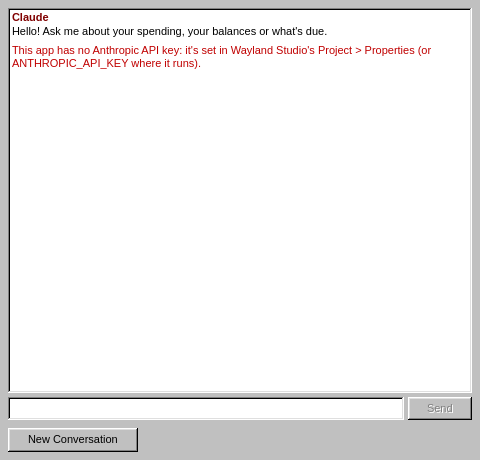

[Contents](index.md) | Previous: [Reports, Charts and the Loan Planner](11-reports.md) | Next: [Finishing: the Menu, the Program, the Test](13-finish.md)

# The Advisor

Money had an Advisor that noticed things about your accounts. Ours is an
**AIChat** element: Claude, on a form, answering questions from your own
figures. *What did I spend on groceries last month? Which bills are due
this week? What's my net worth?*



It needs an Anthropic API key and the internet. Skip this chapter and
the rest of the program is unaffected.

## The key

**Project > Properties...**, **AI Chat (Claude)**, **API key**. Type
`${env:ANTHROPIC_API_KEY}` rather than the key itself: the key is then
read from that environment variable where the program runs, and isn't
written into the project or into the program you make. **Test** says
whether it works.

## AdvisorForm

**Project > Add Form**:

| Property | Value |
|---|---|
| (Name) | `AdvisorForm` |
| Caption | Advisor |
| Width, Height | 480, 460 |

| Element | (Name) | Left, Top | Width × Height | Properties |
|---|---|---|---|---|
| AIChat | `chat1` | 8, 8 | 464 × 412 | Instructions: You are the Advisor in Wayland Money, a personal finance program. You help the person understand their own money: what they spend, what they owe, what's due, how their investments are doing. Use the tools for figures instead of adding up records yourself: spending_by_category, account_balances and bills_due. Amounts are US dollars; in the Transactions table a negative Amount is money going out. Keep answers short and plain. Give figures, not investment recommendations: you are not a licensed adviser, and say so if asked what to buy or sell.; Greeting: Hello! Ask me about your spending, your balances or what's due.; FormAccess: False |
| Button | `newButton` | 8, 428 | 130 × 24 | Caption: New Conversation |

The properties that decide what Claude may do:

| Property | Set to | Why |
|---|---|---|
| DataAccess | Read (as it starts) | It can look up records. It can't add, change or delete them. |
| FormAccess | False | It can't fill in forms or press buttons. An adviser reads the books; it doesn't write in them. |
| ApiAccess | False (as it starts) | It can't make requests of web APIs. |
| ConfirmChanges | True (as it starts) | Would ask before any change, if it could make one. |

**Instructions** is what Claude is told about its job, in your words. As
written above: it's the Advisor in a personal finance program, it should
use its tools for figures, a negative Amount is money going out, and it
gives figures, not investment recommendations.

## Tools of its own

With DataAccess Read, Claude can already find and read records. But
"what did I spend on groceries" would mean reading every transaction and
adding them up itself, which is slow, costs more, and can go wrong. The
library already does that sum correctly. So the form gives Claude three
tools that call it. The form's **load**:

```
chat1.addTool("spending_by_category",
    "What was spent and earned in each category between two days (transfers and trades left out). "
    + "Use it for any question about spending, income, or where the money went.",
    { from: { type: "string", description: "The first day, as YYYY-MM-DD." },
      to: { type: "string", description: "The last day, as YYYY-MM-DD." } },
    function (input) {
        return home.totalsByCategory(input.from, input.to).map(function (c) {
            return { category: c.name, kind: c.kind, total: Math.round(c.total * 100) / 100 };
        });
    });
chat1.addTool("account_balances",
    "Every open account with its type and what it's worth today, and the net worth. "
    + "Use it for questions about balances, debts or net worth.",
    {},
    function () {
        var b = home.balances(), w = home.netWorth();
        return { accounts: Db.select("Accounts", { orderBy: "Name" }).filter(function (a) { return !a.Closed; }).map(function (a) {
                     return { name: a.Name, type: a.Type, cash: Math.round(b[a.id].cash * 100) / 100,
                              investments: Math.round(b[a.id].holdings * 100) / 100 };
                 }),
                 assets: Math.round(w.assets * 100) / 100, liabilities: Math.round(w.liabilities * 100) / 100,
                 netWorth: Math.round(w.net * 100) / 100 };
    });
chat1.addTool("bills_due",
    "The bills and deposits coming up (or overdue), the soonest first. Use it when asked what's due.",
    {},
    function () {
        return home.billsDue().map(function (d) {
            return { name: d.bill.Name, kind: d.bill.Kind, amount: d.bill.Amount, due: d.bill.NextDue, daysFromToday: d.days };
        });
    });
```

`newButton`, **clicked**:

```
chat1.clear();
```

**(General)**:

```
readonly property var home: App.form("HomeForm")
```

Each `addTool` gives a name, a description that says **when to use it**
(Claude decides from this), what it takes, and the function. The
function returns plain values: Claude is told them and answers in words.

## Into the menu

A **&Help** menu at the end:

| Menu | Caption | Name | Shortcut | Action |
|---|---|---|---|---|
| **&Help** | `Ask the &Advisor...` | `helpAdvisor` | F2 | Open a form: AdvisorForm |

| Caption | Name | Symbol | ToolTip | Action |
|---|---|---|---|---|
| Advisor | `advisorTool` | ✦ | Ask the Advisor | Open a form: AdvisorForm |

## Try it

**F2**. Ask: *How much did I spend this month, and on what?* A grey line
shows the tool it used (*spending_by_category*), then the answer. Ask
what's due this week; ask it to delete a transaction (it will say it
can't).

## Before you rely on it

- **What's sent to Anthropic**: your question, the Instructions, the
  names of your tables and fields, and whatever the tools return or
  Claude reads: category totals, account names and balances, bills,
  transactions it looks up. That is your financial data leaving your
  computer. If that's not acceptable, leave this form out.
- It's billed to the key's account, by use.
- Claude can be wrong, and it isn't a licensed adviser. It's for *what
  do my figures say*, not *what should I buy*.
- This form was checked to compile and open, and its tools return the
  right figures when called. It wasn't run against Claude itself (that
  needs a key); the AIChat element has the Studio's own tests.

[Contents](index.md) | Previous: [Reports, Charts and the Loan Planner](11-reports.md) | Next: [Finishing: the Menu, the Program, the Test](13-finish.md)
