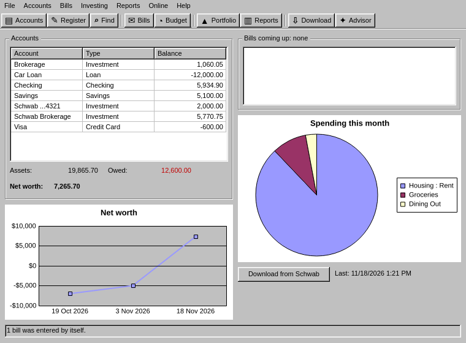

# Building Wayland Money

A complete guide to building a personal finance program in Wayland Studio,
in the manner of Microsoft Money: accounts and their registers, payees and
categories, split transactions and transfers, balancing against a
statement, bills and deposits that come round, a budget, investments with
price charts, reports, a loan planner, an AI advisor, and accounts
downloaded from **Charles Schwab**.

It is also a test. Wayland Money uses nearly everything Wayland Studio can
do, on a real job, and the last chapter writes down what that showed:
where the Studio carried the work by itself, where code had to work
around it, and what it can't do yet.

## Contents

1. [The Plan](01-plan.md): what Money did and what we'll build, what you
   need, and the new project.
2. [The Tables](02-tables.md): all thirteen tables, field by field, with
   their rules.
3. [The Home Page](03-home.md): the startup form, the graphs, and the
   library of code every other form uses.
4. [Accounts, Payees and Categories](04-accounts.md): three forms the
   Studio draws for you.
5. [The Account Register](05-register.md): entering transactions, the
   running balance, transfers, splits, and Find.
6. [Balancing an Account](06-reconcile.md): ticking off a statement.
7. [Bills and Deposits](07-bills.md): what comes round, reminders, and
   bills that enter themselves.
8. [The Budget](08-budget.md): a month's budget beside what was spent.
9. [Investments](09-investing.md): securities, trades, holdings, the
   portfolio, and candlestick charts.
10. [Charles Schwab](10-schwab.md): your developer app, signing in, and
    downloading accounts, positions, transactions and prices.
11. [Reports, Charts and the Loan Planner](11-reports.md).
12. [The Advisor](12-advisor.md): Claude, answering from your own figures.
13. [Finishing](13-finish.md): the whole menu, Make Program, where the
    data lives, and the test to run at the end.
14. [What This Build Showed](14-findings.md): what was used, what was
    worked around, and what the Studio is missing.

## The finished program

The whole project is in this guide's folder: `sample/money.w95proj`. Open
it in the Studio (**File > Open Project...**) to compare with yours at any
point, or press **F5** to run it. Every table of fields and elements and
every piece of code in these chapters was written out from that project,
and that project is the one that was run and checked (see
[how](13-finish.md#how-this-guide-was-checked)).

## How long it takes

A day or two of steady work for all of it. Chapters 1 to 5 make a program
you can already keep a checking account in; each chapter after that adds
one thing and leaves the program working. **Start your Schwab developer
registration before anything else** ([chapter 10](10-schwab.md#your-app-at-schwab)):
Schwab takes a few days to approve an app, and the rest of the guide
doesn't need it.

## Reading this guide

It opens in the Markdown Reader: click a link to go to a chapter, **Back**
(Alt+Left) to return. Names of menus, buttons and properties are in
**bold**; what you type, and code, are in `this type`. The Studio's own
manual (press **F1** in the Studio) describes each element and property
in full; this guide says what to set them to.
