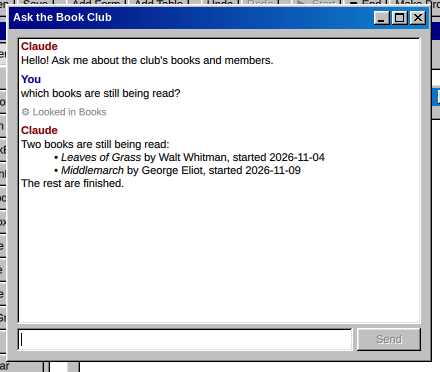
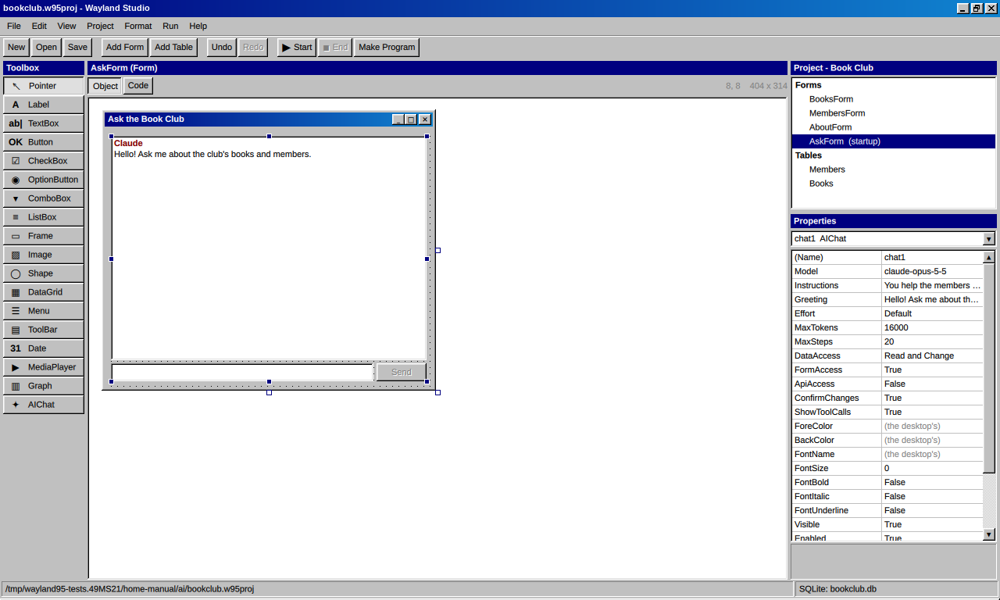
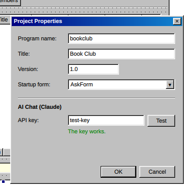
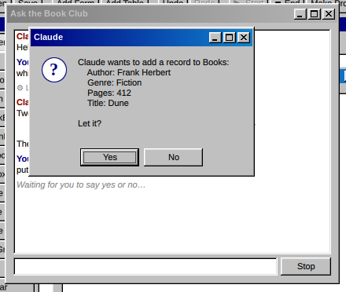
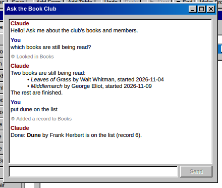

[Contents](index.md) | Previous: [Writing Code](code.md) | Next: [Running and Making Programs](running.md)

# An AI Chat in Your App

The **AIChat** element puts a chat with Claude, Anthropic's AI, on a
form. The person using your app types a question or asks for something to
be done; Claude answers, and it can use your app to do it: look up
records, add and change them (through your tables' rules), fill in a form
and save it, open forms, and call your APIs. You decide which of these it
may do, and whether the person is asked first.



It needs two things: the internet where the app runs, and an **Anthropic
API key** (from [console.anthropic.com](https://console.anthropic.com)),
which you give the project once in **Project > Properties...** (see
[The key](#the-key)). What the chat uses is billed to the key's account.

## Adding one

Pick **AIChat** in the Toolbox and draw it on a form (or double-click it:
320 by 260 in the middle). It's the conversation, a box to type in and a
**Send** button (**Stop** while Claude is answering; **Esc** does the
same). Answers appear as they're written, with Markdown: **bold**,
*italics*, lists.



| Property | What it is |
|---|---|
| Model | Which Claude answers: **claude-opus-5-5** (the most capable, and the default), **claude-sonnet-5-5**, **claude-haiku-5-5** (the quickest and cheapest), **claude-fable-5-2**. |
| Instructions | What Claude should know and how it should behave, in your words: *You help the club's members keep track of what they read. Keep answers to a few lines.* |
| Greeting | What the chat says first (only shown; Claude doesn't see it). |
| Effort | How hard Claude thinks before answering: **Low** is quicker and cheaper, **Max** the most thorough. **Default**: the model's own. |
| MaxTokens | The longest an answer can be, in tokens (a token is about ¾ of a word). |
| MaxSteps | The most tools Claude can use for one message before it stops and asks to go on. |
| DataAccess | **None**, **Read** (the default), or **Read and Change**: what Claude may do with your tables. |
| FormAccess | Claude can read and fill in the app's open forms, click their buttons, save, move between records and open forms. |
| ApiAccess | Claude can make requests of the project's APIs (**Project > APIs...**). |
| ConfirmChanges | Ask the person before each change Claude makes (on by default). |
| ShowToolCalls | A grey line in the chat for each tool Claude uses: *⚙ Looked in Books*. |

Its colors and font are the usual ones (**ForeColor**, **BackColor** for
the conversation, **FontName**...).

## The key

The key is the project's, not the chat's: **Project > Properties...**,
**AI Chat (Claude)**, **API key**. Every chat in the app uses it, and the
person using the app is never asked for one.



**Test** asks Anthropic whether the key works (it costs nothing): *The key
works.* in green, or what's wrong in red. What you can put there:

- **The key itself** (`sk-ant-...`). It's kept in the project file and put
  inside programs made from it, so anyone with the project or the program
  has it: fine for your own programs, not for ones you give away.
- **`${env:NAME}`**: the key is read from that environment variable where
  the program runs (each computer sets its own), and isn't in the project.
- **Nothing**: the same, with `ANTHROPIC_API_KEY`.

The field shows dots, except while you type in it and for an
`${env:...}` name.

With no key, the chat says so in red when the app starts (and again if
someone sends a message), naming Project > Properties; nothing is sent.
`chat1.hasKey` tells code whether there is one.

## What Claude can do

Claude is told the app's name, the form it's on, today's date, your
tables and their fields, and your **Instructions**. To do anything more it
uses tools, which the chat's settings give it:

| Setting | Tools |
|---|---|
| DataAccess Read | list the tables and fields; find records (by field values, by text, sorted, a page at a time); read a record |
| DataAccess Read and Change | ...and add, change and delete records |
| FormAccess | list the forms; read a form (its record, what's unsaved, what validation refused, every element and its value); set a field; put a value in an element; click a button; save, start a new record, show a record, go to the first, previous, next or last, delete, reset, close another form; open a form |
| ApiAccess | a request of one of the project's APIs (its sign-in is added) |

Changes go through your tables, so their rules apply: a record a
Validation Rule refuses isn't written, and Claude is told why (it usually
tries again, or asks). A form Claude fills in shows it as it happens, and
the form's own code runs as it would for the person: **clicked** for a
button, **changed** for a box.

### Asking first

With **ConfirmChanges** (the default), each change waits for the person:
a record added, changed or deleted, a form saved or a record deleted from
it, and an API called with anything but GET.



**Yes** does it; **No** doesn't, and Claude is told the person said no.
Reading never asks. Clicking a button doesn't either: it does what the
button's code does, so give a chat **FormAccess** only on forms whose
buttons you'd let it press.



## Tools of your own

Your app can give Claude tools of its own, in code (the form's **load**
is a good place):

```
chat1.addTool("days_overdue", "How many days a member's books are overdue. Use it when someone asks about late books.",
    { member: { type: "string", description: "The member's name." } },
    function (input) {
        var m = Db.select("Members", { where: { Name: input.member } });
        if (m.length === 0)
            throw new Error("There's no member called " + input.member);
        return { member: input.member, days: overdue(m[0].id) };   // (overdue: a function of yours, in General)
    });
```

- the name: letters, digits and `_`;
- what it's for, and **when to use it**: Claude decides from this;
- what it takes: each input's `type` (`"string"`, `"number"`,
  `"integer"`, `"boolean"`, `"object"`, `"array"`) and `description`
  (or a whole JSON Schema, `{ type: "object", properties: ..., required: [...] }`);
- the function: it gets the input and returns what Claude is told (text,
  a number, an object or a list). `throw` tells Claude what went wrong.

The input is checked against what you said it takes before your function
runs. `chat1.removeTool("days_overdue")` takes it away again.

## In code

| | |
|---|---|
| `chat1.send("text")` | Send a message, as if the person typed it (false while Claude is answering). |
| `chat1.clear()` | A new conversation. |
| `chat1.cancel()` | Stop the answer under way. |
| `chat1.busy` | True while Claude is answering. |
| `chat1.lastReply` | Claude's last answer (its text). |
| `chat1.lastTool` | The last tool Claude used: `{ name, input, result, isError }`. |
| `chat1.errorString` | What went wrong last. |
| `chat1.messages` | The conversation, as Anthropic's API has it. |
| `chat1.usage` | Tokens so far: `{ input, output }`. |
| `chat1.hasKey` | Whether the app has a key (the project's, or `ANTHROPIC_API_KEY`). |

Events: **replied** (an answer is finished: `chat1.lastReply`),
**toolUsed** (after each tool: `chat1.lastTool`), **failed** (no key, no
internet, a refusal: `chat1.errorString`).

```
// replied: read the answer out in the status bar
statusLabel.text = chat1.lastReply.split("\n")[0];
```

## Good to know

- **What's sent to Anthropic**: the conversation, your Instructions, the
  names of your tables, fields and forms, and whatever Claude reads with
  its tools (the records it looks up). Keep that in mind for private data.
- **When something goes wrong**, the chat says so in red: a key that
  wasn't accepted, no internet, Claude busy (it tries again twice first).
  The message you sent goes back in the box, to send again.
- **A request Claude's safety checks decline** is retried on the model
  Anthropic recommends for it (not for Haiku, which has none). If that
  declines too, the chat says *Claude can't help with that request.*
- **Long conversations** cost more (each message sends the whole
  conversation, though most of it is read from Anthropic's cache):
  `chat1.clear()`, or a **New** button that calls it, starts again.
- Claude can be wrong. With **ConfirmChanges** on, nothing is changed
  without the person seeing it first.

[Contents](index.md) | Previous: [Writing Code](code.md) | Next: [Running and Making Programs](running.md)
