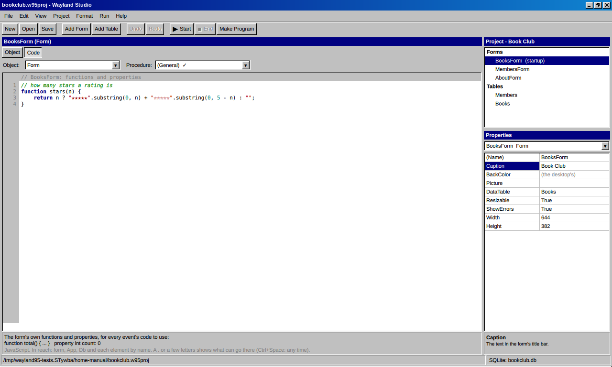
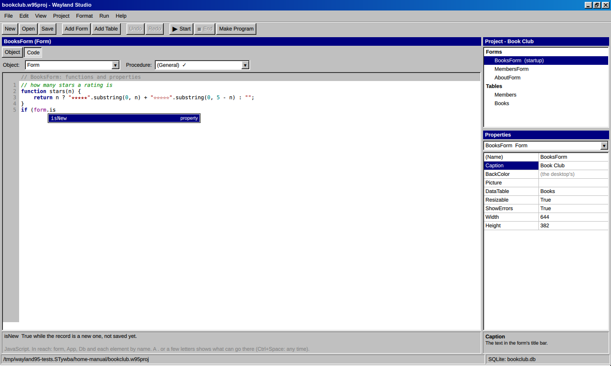

[Contents](index.md) | Previous: [Forms and Elements](forms.md) | Next: [An AI Chat in Your App](ai-chat.md)

# Writing Code

Code is JavaScript, and it runs when something happens: a button is
clicked, a form opens, a record is saved. Each element's events, and the
form's, have code of their own. Much of an app needs none (a form for a
table, menus that open forms and save records); code is for what's
particular to yours.

## The code window

**F7** (or **View > Code**, or double-click an element) opens it.



- **Object**: *Form*, or one of its elements.
- **Procedure**: that object's events. The ones with code have a `✓`.
  The form's **(General)** holds its own functions and properties, which
  every event's code can use.
- Above the code, in grey, what it's the body of:
  `function saveButton_clicked() {`.
- Under it: what the event is for, and what code can reach.

The code is kept when you change the event or the object, save, or run.
**Tab** puts in four spaces; **Enter** starts the next line where this
one starts (and one step in after `{`).

### Colours

Keywords are bold dark blue (`function`, `if`, `return`), `true`,
`false` and `null` blue, comments green, strings red, numbers teal, and
what the code can reach (`form`, `App`, `Db`, `AppDates`, the form's
elements) purple.

### What can come next

As you type, a list offers what can go there:



- after `form.`, `App.`, `Db.` or `AppDates.`, their functions and
  properties; after an element's name and a dot, that element's;
- after `form.record.`, the fields of the form's table;
- inside the quotes of `Db.select("`, `Db.insert("`... the tables; of
  `App.openForm("`, the forms; of `form.setField("`, the fields; of
  `menu1.setEnabled("`, the menu's items;
- after two letters of a name: your (General) functions and properties,
  the event's variables, the elements, and the keywords.

**Up** and **Down** choose, **Enter** or **Tab** puts it in (a function
with its parentheses, the cursor between them), **Escape** closes the
list, and **Ctrl+Space** opens it any time. The line under the code says
what the chosen one takes and does.

## What code can use

Everything on the form is in reach by its name, and so are:

### form

The form the code is on.

| | |
|---|---|
| `form.record` | The record showing: `form.record.Title`. |
| `form.errors` | What validation refused, by field: `form.errors.Title`. |
| `form.recordId` | The id of the record showing (`null` for a new one). |
| `form.isNew` | True while the record is a new one, not saved yet. |
| `form.dirty` | True when the record was changed since it was loaded or saved. |
| `form.table` | The form's DataTable. |
| `form.title` | The text in its title bar. |
| `form.args` | What `App.openForm("Name", args)` gave it. |
| `form.save()` | Insert or update the record; `false` if validation refused it. |
| `form.newRecord()` | An empty record: the fields' defaults. |
| `form.reset()` | The form as it opened: a new record of the defaults, no errors marked, and the elements without a DataField as the Properties window set them. |
| `form.loadRecord(id)` | Show the record with this id; `false` if there's none. |
| `form.deleteRecord()` | Delete the record showing. |
| `form.first()`, `previous()`, `next()`, `last()` | Move through the records. |
| `form.setField("Name", value)` | Change one field of the record. |
| `form.fieldInfo("Name")` | A field's description: `{ name, type, label, required... }`. |
| `form.msgBox(text, title, icon, buttons, callback)` | A message box (below). |
| `form.runAction("openForm", "MembersForm")` | What a menu item's Action does. |
| `form.close()` | Close the form. |

### App

The program.

| | |
|---|---|
| `App.openForm("Name", args)` | Open a form. It gets `args` as `form.args`. |
| `App.showForm("Name")` | Bring an open form to the front, or open it. |
| `App.form("Name")` | An open form (`null` if it isn't open). |
| `App.msgBox(text, title, icon, buttons, callback)` | A message box. |
| `App.quit()` | End the program. |
| `App.name`, `App.title`, `App.version`, `App.formNames` | The program's own. |
| `App.testing` | True while a test runs it (Claude's `run_test`): its message boxes and file boxes are answered by the test, and its MediaPlayers make no sound. |

### Files and folders

The Win95 **Open**, **Select Folder** and **Save As** boxes, and what's in
a folder. Like a message box, a box doesn't wait: what to do with the
answer goes in its function.

| | |
|---|---|
| `App.chooseFile(options, function (path) { })` | The Open box: one file (`""` if it was cancelled). |
| `App.chooseFiles(options, function (paths) { })` | The Open box: several, with **Ctrl** and **Shift** (`[]` if cancelled). |
| `App.chooseFolder(options, function (path) { })` | Select Folder. |
| `App.chooseSaveFile(options, function (path) { })` | Save As (it asks before replacing a file). |
| `App.listFiles(folder, patterns, recursive)` | The paths of the files in a folder that match (`"*.mp3 *.flac"`), and in its folders too with `recursive` true; in order, the way people count (`2` before `10`); 20000 at most. |
| `App.fileInfo(path)` | `{ exists, isFile, isDir, path, name, baseName, suffix, folder, size, modified }`. |
| `App.readTags(path, function (tags) { })` | A sound's or video's own tags, without playing it: `{ ok, title, artist, album, albumArtist, genre, trackNumber, year, duration, hasVideo, coverArt, error }` (`duration` in milliseconds; `coverArt` the picture inside it, as a file an Image shows). Several wait their turn. |

The options, all of them optional: `title` (the box's), `folder` (where
it starts: `~/Music`; blank, the home folder), `filters` (the **Files of
type** list: `["Music (*.mp3 *.flac)", "All Files (*.*)"]`), and for Save
As, `name` (a name to start with) and `suffix` (added if none is typed:
`"m3u"`). A path can start with `~`.

```
App.chooseFolder({ title: "Add a Folder", folder: "~/Music" }, function (folder) {
    if (folder === "")
        return;
    App.listFiles(folder, "*.mp3 *.flac *.ogg", true).forEach(function (path) {
        App.readTags(path, function (t) {
            Db.insert("Songs", { File: path, Title: t.title || App.fileInfo(path).baseName, Artist: t.artist });
        });
    });
});
```

### Db

The database. Every write goes through the table's rules.

| | |
|---|---|
| `Db.select("Books", options)` | Records, as a list. |
| `Db.get("Books", id)` | One record (`{}` if there's none). |
| `Db.count("Books", where)` | How many (that match). |
| `Db.insert("Books", record)` | Validate, then add: `{ ok, id, errors, messages }`. |
| `Db.update("Books", id, record)` | Validate, then change those fields. |
| `Db.remove("Books", id)` | Delete (refused while a Lookup elsewhere points at it). |
| `Db.validate("Books", record)` | Check a record without writing it: `{ ok, errors }`. |
| `Db.defaults("Books")` | A new record of the fields' defaults. |
| `Db.lookupChoices("Members")` | `[{ id, label }]`, as a Lookup lists them. |
| `Db.tableInfo("Books")`, `Db.fieldInfo("Books", "Title")` | Descriptions. |
| `Db.callApi("shop", "GET", "/me", body)` | A request of one of the project's APIs, signed in: `{ ok, status, data, error }`. |
| `Db.signIn("shop")`, `Db.signOut("shop")` | Sign in to an API now (OAuth), or forget its sign-in. |

`select`'s options:

```
Db.select("Books", {
    where: { Genre: "Fiction", Pages: { op: ">=", value: 300 } },
    search: "le guin",          // text in any text field
    orderBy: "Title",
    descending: false,
    limit: 10,
    offset: 0
});
```

`where`'s tests: a value (equal to it), `null` (empty), or `{ op, value }`
with `op` one of `=`, `<>`, `<`, `<=`, `>`, `>=`, `like` (`%` for any
text: `{ op: "like", value: "The%" }`).

### AppDates

Dates and times. They're kept as `2026-11-17`, `14:30:00` and
`2026-11-17T14:30:00`.

| | |
|---|---|
| `AppDates.stored("today+7", "Date")` | Anything that's a date as it's kept (mode: `"Date"`, `"Time"`, `"Date and Time"`). |
| `AppDates.display(value, mode, dateFormat, timeFormat)` | As it shows: `AppDates.display("2026-11-17", "Date", "MMMM d, yyyy", "")`. |
| `AppDates.read(text, mode, dateFormat, timeFormat)` | Typed text as it's kept (`""` if it can't be read). |
| `AppDates.toZone(value, mode, "Europe/London")`, `fromZone(...)` | The time in another zone, and back. |

### The elements

Each element's properties (the names the Properties window uses, in
code-style: `text`, `enabled`, `visible`, `backColor`...) can be read and
set, and some have more:

| Element | In code |
|---|---|
| any | `visible`, `enabled`, `toolTip`, `x`, `y`, `width`, `height`, `error` (what validation refused for its field), `forceActiveFocus()` |
| TextBox | `text`, `selectAll()` |
| Label | `text`, `shown` (what it shows) |
| CheckBox | `checked`, `toggle()` |
| OptionButton | `checked`, `choose()` |
| ComboBox, ListBox | `items`, `currentIndex`, `text`, `value`, `choose(index)`; ComboBox `openList()` |
| DataGrid | `rows`, `currentIndex`, `currentRow`, `currentId`, `refresh()`, `select(index)`, `search`, `orderBy` |
| Menu, ToolBar | `item`, `setEnabled(name, on)`, `setChecked(name, on)`, `setText(name, text)`, `itemNamed(name)` |
| DateTimePicker | `value`, `text`, `date`, `clear()`, `setToday()`, `step(n)`, `openCalendar()` |
| Graph | `refresh()`, `setData(labels, series)`, `itemAt(x, y)`, `labels`, `series`, `graphType`, `title`, `legend`, `stacked`, `showValues`, `plotColor`; stock graphs: `tick(label, price, volume)`, `addBar(label, open, high, low, close, volume)`, `indicator(name)`, `maxBars`, `overlays`, `studies` ([Stock graphs](forms.md#stock-graphs)); in clicked: `clickedLabel`, `clickedValue`, `clickedSeries`, `clickedIndex`, `clickedItem` |
| AIChat | `send(text)`, `clear()`, `cancel()`, `addTool(name, description, inputs, function)`, `removeTool(name)`, `busy`, `lastReply`, `lastTool`, `errorString`, `messages`, `usage` ([An AI Chat in Your App](ai-chat.md)) |
| MediaPlayer | `play()`, `pause()`, `stop()`, `toggle()`, `seek(ms)`, `source`, `isPlaying`, `position` and `duration` (milliseconds), `volume`, `muted`, `loop`, `hasVideo`, `title`, `errorString`, `clock(ms)` (`"3:05"`); its tags `artist`, `album`, `albumArtist`, `genre`, `trackNumber`, `year`, `coverArt`; what the sound's doing `levels`, `peaks`, `level`, `waveform`; `mediaKeys`; the equalizer `equalizer`, `eqGains`, `eqPreamp`, `eqFrequencies`, `eqPresets`, `eqPresetNow`, `setEqGain(band, dB)`, `applyEqPreset(name)` |
| Equalizer | `player`, `target` (the MediaPlayer) |
| Visualizer | `player`, `style`, `bars`, `analyzer` |
| Slider | `value`, `min`, `max` |
| Timer | `interval`, `enabled`, `start()`, `stop()`, `restart()`, `running`, `count` |

### Message boxes

```
form.msgBox("Delete this book?", "Delete", "question", ["Yes", "No"], function (answer) {
    if (answer === 0)          // the first button
        form.deleteRecord();
});
```

The icon is `"info"`, `"question"`, `"warning"` or `"error"`. The code
after `msgBox` doesn't wait for the answer: what to do with it goes in
the function, which gets the number of the button pressed.

## Examples

**Total the pages read**, in a button's clicked code:

```
var books = Db.select("Books", { where: { Finished: { op: "<>", value: null } } });
var pages = 0;
books.forEach(function (b) { pages += b.Pages || 0; });
form.msgBox(books.length + " books finished, " + pages + " pages.", "So far");
```

**Search as you type**: a TextBox `searchBox`, in its changed code:

```
grid.search = searchBox.text;
```

**Open a form on a record**: in a grid's rowActivated code,
`App.openForm("BookForm", { id: grid.currentId });`, and in BookForm's
load code:

```
if (form.args.id)
    form.loadRecord(form.args.id);
```

**Fill in a field before saving**: in a Save button's clicked code:

```
if (form.isNew && !form.record.Started)
    form.setField("Started", AppDates.stored("today", "Date"));
form.save();
```

**Say what's wrong your way**: in the form's validationFailed code:

```
var first = Object.keys(form.errors)[0];
statusLabel.text = form.errors[first];
```

**Play a sound when a record is saved**: a MediaPlayer `chime` (Visible
False, its Source a short sound), and in the form's saved code:
`chime.play();`. A song from a field: `player1.source = form.record.File;
player1.play();`.

**A clock**: a Timer `clock` (Interval 1000), and in its timer code:

```
timeLabel.text = new Date().toLocaleTimeString();
```

**Ask an API for something that isn't a table**:

```
var r = Db.callApi("shop", "POST", "/orders/" + form.record.id + "/ship", { carrier: "post" });
if (!r.ok)
    form.msgBox(r.error, "Shipping", "warning");
else
    statusLabel.text = "Tracking number " + r.data.tracking;
```

**A form that remembers**: in (General), `property int visits: 0`, and
in load, `visits += 1;`.

## When code goes wrong

A mistake in code is said in the Output window when it runs, named by
form, event and line: `BooksForm, saveButton.clicked, line 2: ...`. Run
**Check for Problems** to find the ones that stop a form from opening at
all, before you start it.

[Contents](index.md) | Previous: [Forms and Elements](forms.md) | Next: [An AI Chat in Your App](ai-chat.md)
