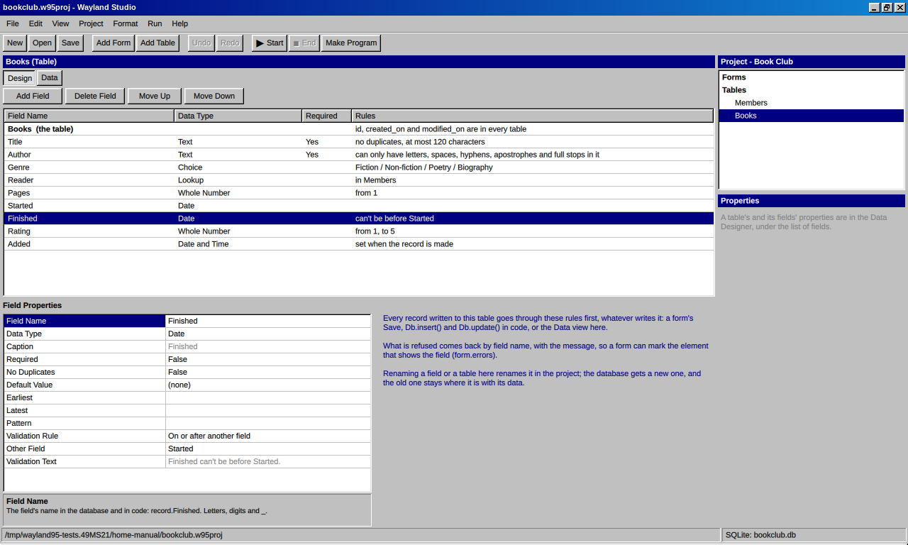
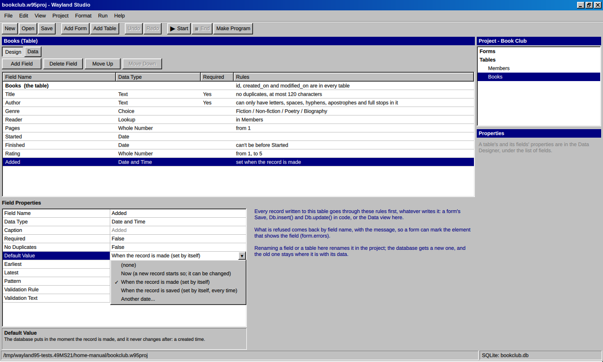
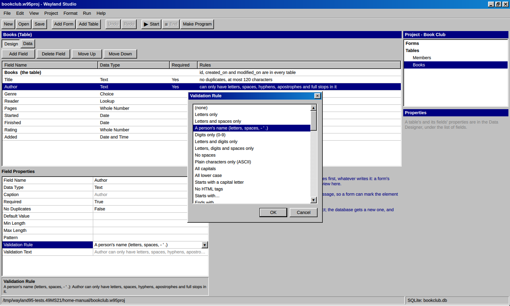
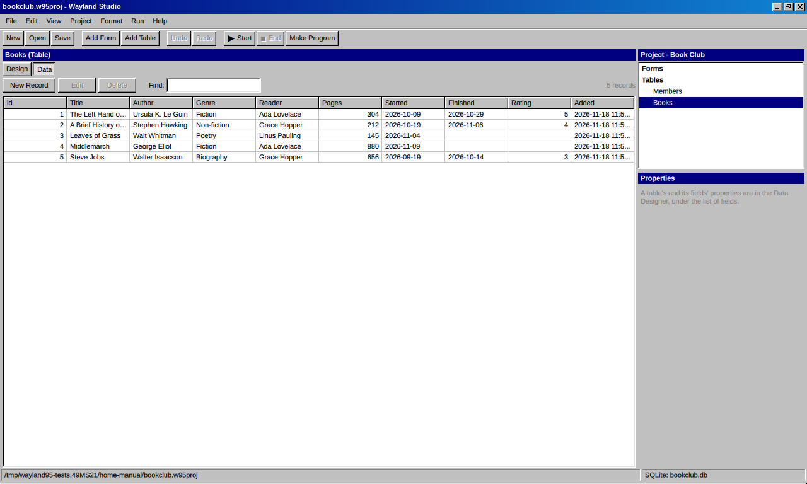
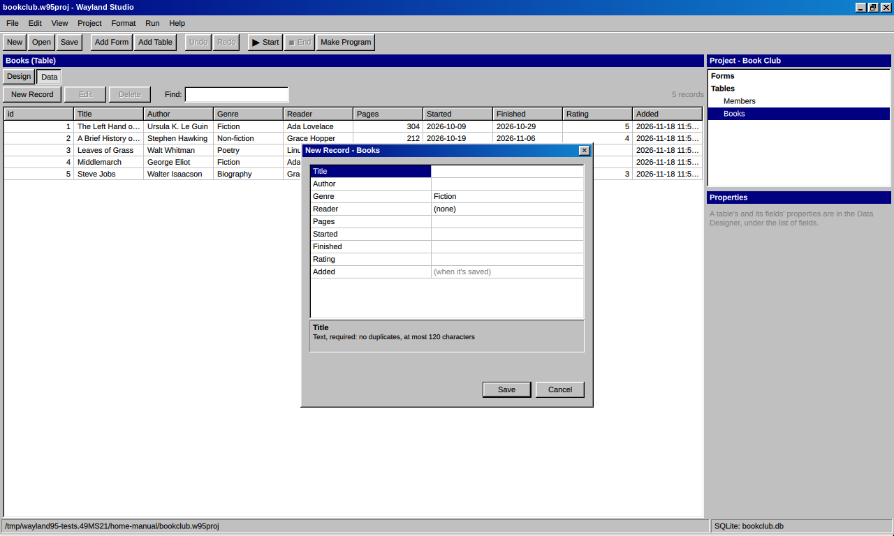
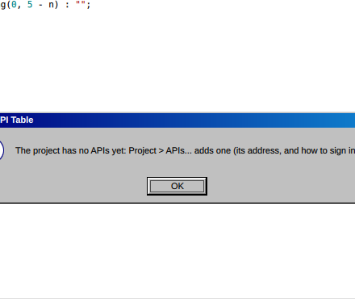

[Contents](index.md) | Previous: [The Studio Window](the-studio.md) | Next: [Forms and Elements](forms.md)

# The Data Designer

An app's data is kept in tables. The Data Designer is where you say what
a table holds (its fields) and what it will and won't take (their rules).
Click a table in the Project window to open it; **Project > Add Table**
makes one.

At the top: **Design** (the fields) and **Data** (the records). Under them
the list of fields (the first row is the table itself), and under that the
selected field's properties.

## The rules are the table's

Every record written to a table goes through its rules first, whatever
writes it: a form's Save, `Db.insert()` and `Db.update()` in code, or the
Data view. A record that breaks a rule isn't written, and what's wrong
comes back by field, so a form can mark the element that shows each field
in red, with the message as its tool tip. Put a rule in the table once,
and every form and every line of code gets it.

## The table's properties

- **Table Name**: the name in the database and in code
  (`Db.select("Books")`). Letters, digits and `_`, starting with a letter.
- **Caption**: what to call it where people read it.

Every table also has `id` (its records' numbers, given by the database),
`created_on` and `modified_on` (set by the database when a record is made
and changed). They aren't in the list, but code can read them.

## Fields

**Add Field** adds one at the end (a Text field, Field1...); **Delete Field**,
**Move Up** and **Move Down** do what they say. Renaming a field or a
table renames it everywhere in the project (forms' DataFields, grids'
columns, rules that name it). The database gets a new field, and the old
one stays where it is with its data.

### Data types

| Type | Holds | Shown on a form by |
|---|---|---|
| Text | A line of text, up to 255 characters (Max Length to change it). | TextBox |
| Long Text | Several lines, any length. | TextBox (MultiLine) |
| Whole Number | A number with no fraction. | TextBox |
| Decimal | A number with a fixed count of decimal places (Decimal Places, 2 if blank). | TextBox |
| Floating Point | A number with a fraction, as the computer rounds it. | TextBox |
| Currency | An amount of money (4 decimal places kept). | TextBox |
| Yes/No | Yes or No. | CheckBox |
| Date | A day. | DateTimePicker |
| Time | A time of day. | DateTimePicker |
| Date and Time | A day and a time. | DateTimePicker |
| Choice | One of a list you give (Choices). | ComboBox |
| Lookup | A record of another table (Lookup Table): its id. | ComboBox (shows the record's first text field) |
| E-mail | An e-mail address (checked). | TextBox |
| URL | A web address (checked). | TextBox |
| Phone | A telephone number (checked). | TextBox |

Values are kept in their types: a number field holds numbers, a date is
kept as `2026-11-17`, a time as `14:30:00`, a date and time as
`2026-11-17T14:30:00`. Typing `11/17/2026` or `2:30 PM` is fine: the
table reads it.

### Field properties

Each type has the properties that suit it:

| Property | What it does |
|---|---|
| Field Name | The name in the database and in code: `record.Title`. |
| Data Type | See above. Changing it clears the properties the new type has no use for. |
| Caption | What messages call the field ("Title is required."). Blank: its name. |
| Required | The record is refused while this is empty (a Yes/No: while it's No). |
| No Duplicates | The record is refused if another one already has this value. |
| Default Value | What a new record starts with. |
| Min Length, Max Length | The fewest and most characters (text). |
| Minimum, Maximum | The smallest and largest value (numbers). |
| Earliest, Latest | The first and last date or time allowed; `today` works. |
| Decimal Places | Digits kept after the point (Decimal). |
| Choices | The values to choose from, one on each line (Choice). |
| Lookup Table | The table whose records it chooses from (Lookup). |
| Pattern | A regular expression the whole value has to match: `[A-Z]{2}-[0-9]{3}`. |
| Validation Rule | A rule from a list (below). |
| Validation Text | What to say when the Validation Rule or the Pattern isn't met. |

### Default values for dates and times

A Date, Time or Date and Time field's **Default Value** is a list:

- **Today** (or **Now**): a new record starts with it, and it can be
  changed.
- **When the record is made (set by itself)**: the database puts in the
  moment the record is first saved, and it never changes after. Use it for
  a created time.
- **When the record is saved (set by itself, every time)**: the database
  puts in the moment, every time the record is saved. Use it for a last
  changed time.
- **Another date...**: one you type, under it. It can be a date
  (`2030-01-01`), or from now: `today+7` (a week from today),
  `today-1w`, `now+2h` (two hours from now), `now+30m`.

A field the database sets by itself is never "required" of what's written,
and what a form or code gives for it is ignored. A form shows it, but it
can't be changed there.

## Validation Rules

A field's **Validation Rule** is picked from a list of over a hundred,
the ones that suit its type:

Some need a value of their own, which goes in the row that appears under
the rule: the text a value has to start with, how many days, which other
field. Each has its own message, shown in grey under **Validation Text**
and said when the rule isn't met; type your own there to say it your way.
Leave the rule at **(none)** for no rule. A value that's empty isn't
checked (that's **Required**'s job), except by the rules about being
empty.

**Custom expression...** is for anything else: an expression that has to
be true, with `value` the field's value and `record` the whole record:
`value <= 50 || record.Kind === "Family"`.

The whole list:

#### Characters

| Rule | For | Its value |
|---|---|---|
| Letters only | Text, Long Text | — |
| Letters and spaces only | Text, Long Text | — |
| A person's name (letters, spaces, - ' .) | Text, Long Text | — |
| Digits only (0-9) | Text, Long Text, E-mail, URL, Phone | — |
| Letters and digits only | Text, Long Text | — |
| Letters, digits and spaces only | Text, Long Text | — |
| No spaces | Text, Long Text, E-mail, URL, Phone | — |
| Plain characters only (ASCII) | Text, Long Text, E-mail, URL, Phone | — |
| All capitals | Text, Long Text | — |
| All lower case | Text, Long Text, E-mail, URL, Phone | — |
| Starts with a capital letter | Text, Long Text | — |
| One line only | Long Text | — |
| No HTML tags | Text, Long Text | — |

#### What's in it

| Rule | For | Its value |
|---|---|---|
| Starts with… | Text, Long Text, E-mail, URL, Phone | Starts With: some text |
| Ends with… | Text, Long Text, E-mail, URL, Phone | Ends With: some text |
| Contains… | Text, Long Text, E-mail, URL, Phone | Has To Contain: some text |
| Doesn't contain… | Text, Long Text, E-mail, URL, Phone | Can't Contain: some text |
| One of a list… | Text, Long Text, E-mail, URL, Phone | Allowed Values: a list (one per line) |
| Not one of a list… | Text, Long Text, E-mail, URL, Phone | Refused Values: a list (one per line) |
| Exactly N characters | Text, Long Text, E-mail, URL, Phone | Length: a whole number |
| At least N words | Text, Long Text | Fewest Words: a whole number |
| At most N words | Text, Long Text | Most Words: a whole number |

#### Internet

| Rule | For | Its value |
|---|---|---|
| E-mail address | Text, Long Text | — |
| Web address (http:// or https://) | Text, Long Text, URL | — |
| Secure web address (https://) | Text, Long Text, URL | — |
| Domain name | Text, Long Text | — |
| IPv4 address | Text, Long Text | — |
| IPv6 address | Text, Long Text | — |
| IP address (v4 or v6) | Text, Long Text | — |
| MAC address | Text, Long Text | — |
| User name (3-32 letters, digits, . _ -) | Text, Long Text | — |
| Strong password | Text, Long Text | — |
| Slug (lower-case words with dashes) | Text, Long Text | — |
| Identifier (letters, digits, _) | Text, Long Text | — |
| UUID | Text, Long Text | — |
| Hexadecimal | Text, Long Text | — |
| Colour code (#RRGGBB) | Text, Long Text | — |
| JSON | Text, Long Text | — |

#### Telephones and places

| Rule | For | Its value |
|---|---|---|
| Phone number (US and Canada) | Text, Phone | — |
| Phone number (international, +country code) | Text, Phone | — |
| ZIP code (US) | Text, Long Text | — |
| Postal code (Canada) | Text, Long Text | — |
| Postcode (UK) | Text, Long Text | — |
| Postal code (5 digits: DE, FR, IT, ES...) | Text, Long Text | — |
| Postcode (4 digits: AU, NZ, AT, CH, BE...) | Text, Long Text | — |
| Country code (ISO, 2 letters) | Text, Long Text | — |
| Language code (ISO, 2 or 3 letters) | Text, Long Text | — |
| Currency code (ISO, 3 letters) | Text, Long Text | — |

#### Numbers with a check in them

| Rule | For | Its value |
|---|---|---|
| Card number (with its check digit) | Text, Long Text | — |
| IBAN (international bank account) | Text, Long Text | — |
| SWIFT/BIC code | Text, Long Text | — |
| Bank routing number (US ABA) | Text, Long Text | — |
| Social Security number (US) | Text, Long Text | — |
| Employer ID number (US EIN) | Text, Long Text | — |
| ISBN (10 or 13 digits) | Text, Long Text | — |
| Barcode (EAN-8, UPC-A, EAN-13, GTIN-14) | Text, Long Text | — |
| Vehicle identification number (VIN) | Text, Long Text | — |

#### Numbers

| Rule | For | Its value |
|---|---|---|
| More than zero | numbers | — |
| Zero or more | numbers | — |
| Less than zero | numbers | — |
| Not zero | numbers | — |
| More than… | numbers | More Than: a number |
| Less than… | numbers | Less Than: a number |
| Not equal to… | numbers | Can't Be: a number |
| A multiple of… | numbers | Multiple Of: a number |
| A whole number | Decimal, Floating Point, Currency | — |
| At most N decimal places | Decimal, Floating Point, Currency | Decimal Places: a whole number |
| An even number | Whole Number | — |
| An odd number | Whole Number | — |
| A percentage (0 to 100) | numbers | — |
| A fraction (0 to 1) | Decimal, Floating Point, Currency | — |
| Latitude (-90 to 90) | Decimal, Floating Point, Currency | — |
| Longitude (-180 to 180) | Decimal, Floating Point, Currency | — |
| A year (four digits) | Whole Number | — |
| A month (1 to 12) | Whole Number | — |
| A day of the month (1 to 31) | Whole Number | — |
| A network port (1 to 65535) | Whole Number | — |

#### Dates

| Rule | For | Its value |
|---|---|---|
| In the past | Date, Date and Time | — |
| Not in the future | Date, Date and Time | — |
| In the future | Date, Date and Time | — |
| Not in the past | Date, Date and Time | — |
| Today | Date | — |
| Within the last N days | Date, Date and Time | Days: a whole number |
| Within the next N days | Date, Date and Time | Days: a whole number |
| At least N years ago (an age) | Date, Date and Time | Years: a whole number |
| At most N years ago (an age) | Date, Date and Time | Years: a whole number |
| A weekday (Monday to Friday) | Date, Date and Time | — |
| A weekend (Saturday or Sunday) | Date, Date and Time | — |
| The first day of a month | Date, Date and Time | — |
| The last day of a month | Date, Date and Time | — |

#### Times

| Rule | For | Its value |
|---|---|---|
| On the hour | Time, Date and Time | — |
| Every N minutes | Time, Date and Time | Minutes: a whole number |
| Working hours (9:00 to 17:00) | Time, Date and Time | — |

#### Another field

| Rule | For | Its value |
|---|---|---|
| The same as another field | any | Other Field: another field |
| Different from another field | any | Other Field: another field |
| More than another field | numbers | Other Field: another field |
| At least another field | numbers | Other Field: another field |
| Less than another field | numbers | Other Field: another field |
| At most another field | numbers | Other Field: another field |
| After another field | Date, Time, Date and Time | Other Field: another field |
| On or after another field | Date, Time, Date and Time | Other Field: another field |
| Before another field | Date, Time, Date and Time | Other Field: another field |
| On or before another field | Date, Time, Date and Time | Other Field: another field |
| Required when another field is filled in | any | When Filled In: another field |
| Required when another field is empty | any | When Empty: another field |
| Only when another field is filled in | any | Only With: another field |

#### Written out

| Rule | For | Its value |
|---|---|---|
| Custom expression… | any | Expression: an expression |
## The Data view

**Data** shows the table's records, in the database the project is set to
use. The first time, if the database doesn't have the project's tables (or
their newer fields) yet, the Studio says what it will do and asks:
**Yes** makes them. It never deletes a table or a field, or changes one's
type.

- **New Record**, **Edit** (or double-click a row) and **Delete** change
  the records; **Find** shows only the ones with that text in them.
- The record dialog has a row for each field. What the table's rules
  refuse is said in red under it, and the first field refused is
  selected.

## A database that's there already

To build forms around a database that has its tables and records already
(one another program uses, a server's), point the project at it
(**Project > Database...**), then **Project > Import Tables...**. (After
choosing another database, the Studio offers this itself if the database
has tables the project doesn't.)

The dialog lists the database's tables that aren't in the project, with
how many fields and records each has: tick the ones to bring in. With
**Make a form for each table** ticked, each one also gets a form, as
**Add Form for** makes. Nothing in the database is changed: its records
stay where they are, and the forms show them straight away.

Each table comes in as the database has it:

- **Its key** is its own: `customer_id`, numbered by the database, or a
  key that's typed in, like a product code (then it's a field, Required
  and No Duplicates). In code, `record.id` is its value either way, and
  `form.loadRecord(id)`, `Db.get("products", "A-1")` take it. The table's
  properties say what its key is. A table with no key in the database
  (several columns, or none) can be read and added to, but not changed:
  SQLite's own row number is used there instead.
- **Its fields** get the type that suits each column (a `VARCHAR(80)` is
  Text with a Max Length of 80, a `DECIMAL(10,2)` a Decimal with 2
  places, a `TIMESTAMP` a Date and Time, a MySQL `ENUM` a Choice...). A
  `NOT NULL` column with no default is Required, a `UNIQUE` one No
  Duplicates, and a plain `DEFAULT` the Default Value (`CURRENT_TIMESTAMP`
  is Now).
- **A foreign key** to another table's key is a **Lookup** of that table:
  a form shows it as a list of that table's records, by their first text
  field.
- **A name code can't use** (`Full Name`, `Order Lines`) is made into one
  (`Full_Name`); the database's name is kept beside it (the field's
  Caption, so messages say "Full Name is required.").
- **Binary columns** (pictures and files kept in the database) are left
  out: the dialog says which.
- The tables don't get `created_on` and `modified_on` unless they have
  both already.

Renaming an imported table or field changes what code calls it, not the
database's name. A field added to an imported table is added to the
database's table, as for any other.

## Web APIs as tables

A table can be a web API's endpoint instead of the database's: its records
are the API's, read and written over the internet, and to forms, grids,
Lookups and code it's a table like any other.

### The APIs and their sign-in

**Project > APIs...** lists the project's APIs (**Add**, **Remove**). For
each one:

- **Name**: what tables and code call it (`Db.callApi("shop", ...)`).
- **Base URL**: the address its endpoints are under:
  `https://api.example.com/v1`.
- **Headers**: any it wants on every request, one on each line:
  `Accept-Language: en`.
- **Sign-in**, and what that one needs:
  - **None**.
  - **API key**: the key's name and value, sent in a header
    (`X-Api-Key: ...`) or the query string (`?api_key=...`).
  - **User name and password (Basic)**.
  - **Token (Bearer)**: `Authorization: Bearer ...`.
  - **OAuth 2.0**, with its **Token URL**, **Client ID**, **Client
    secret** and **Scope**, and one of three grants: **Client
    credentials** (the app signs in as itself), **Password** (a user name
    and password typed here), or **Authorization code** (the user signs
    in in the browser: the program opens the API's **Authorize URL**, and
    the browser comes back to it on `http://127.0.0.1` with PKCE; the
    **Redirect port** is that port, blank for any free one).
- **Test** asks the API for **Test with** (a path, like `/me`) with
  what's typed, and says what it answered. **Sign In** and **Sign Out**
  are OAuth's: Sign Out forgets the tokens, so the next request signs in
  again.

OAuth's tokens are refreshed when they run out, and kept for the user
in the program's data folder (readable by them alone), not in the project.

Any value can be `${env:NAME}`: that environment variable, when the app
runs. A secret written that way isn't kept in the project, or in a
program made from it; one typed in is, as a database's password is.

### Adding an endpoint as a table

**Project > Add API Table...**:

- **API**, and the **Endpoint**: its path after the API's address,
  `/products`. **Query** is added to every list it gets (`per_page=100`).
- **Read** gets its records and makes the table's fields from them:
  numbers, Yes/No, dates and times (an API's are usually UTC: they're
  shown in this computer's time), e-mail addresses, web addresses, text.
  A record inside a record (`"vendor": {"name": ...}`) gives fields of
  its own (`vendor_name`, its **JSON Path** `vendor.name`). **Records
  at** is where the list is in the answer (found by itself when it's
  `data`, `items`, `results`...), **Id** the field that tells the records
  apart (`id`, `uuid`...).
- What can be done: **Add** (POST), **Change** (PATCH, or PUT: the whole
  record), **Delete**; and **Make a form for it**.

It shows in the Project window with its API's name beside it. Its
properties (in the Data Designer) are all of these again, and each field
has its **JSON Path** and **Read Only** (one the API sets itself, like an
updated time: shown, never sent; Read picks them out by their names).

### How it works

- Reading the table gets the endpoint's list (`GET /products`), kept for
  three seconds so a form moving through it doesn't ask each time;
  `where`, `search`, `orderBy` and `limit` are done on the list.
- Adding a record is `POST /products` with it as JSON (its fields at
  their JSON paths), changing one `PATCH` (what changed) or `PUT` (the
  whole record) `/products/id`, deleting one `DELETE /products/id`.
- The table's rules (Required, No Duplicates, Validation Rules...) are
  checked first, as for any table; then what the API refuses comes back
  as the error, with what it said: `api.example.com said 422: price
  can't be negative`.
- A Lookup can be of an API's table: its list is that table's records.
- Requests wait for their answer, as the database's do (a program's
  window waits with them).
- One list, as the API gives it: an API that pages its lists shows the
  first page; its **Query** can ask for more (`per_page=100`).

## Where the data is kept

**Project > Database...**:

- **SQLite**: a file of its own, beside the project (nothing to set up).
  A program made from the project keeps its file in
  `~/.local/share/<its name>`.
- **MySQL or MariaDB**, **PostgreSQL**: a server's database. Give the
  host (blank: this computer's server, through its socket), port,
  database, user and password. **Test Connection** tries it.

The same project runs on any of the three. The password is kept in the
project as it's typed, and in programs made from it.

[Contents](index.md) | Previous: [The Studio Window](the-studio.md) | Next: [Forms and Elements](forms.md)
