[Contents](index.md) | Next: [The Studio Window](the-studio.md)

# Building Your First App

This chapter builds the Book Club: an app to keep track of the books a
club's members are reading. It has two tables (Members and Books), a form
for each, a menu and a tool bar, a little code, and at the end a program
of its own. It takes about half an hour. The finished app is in
**Help > Open the Book Club Sample** if you want to compare.

## 1. A new project

Start Wayland Studio from **Start > Programs > Programming > Wayland
Studio**. It opens on a new project, *Project1*, with one empty form,
Form1.

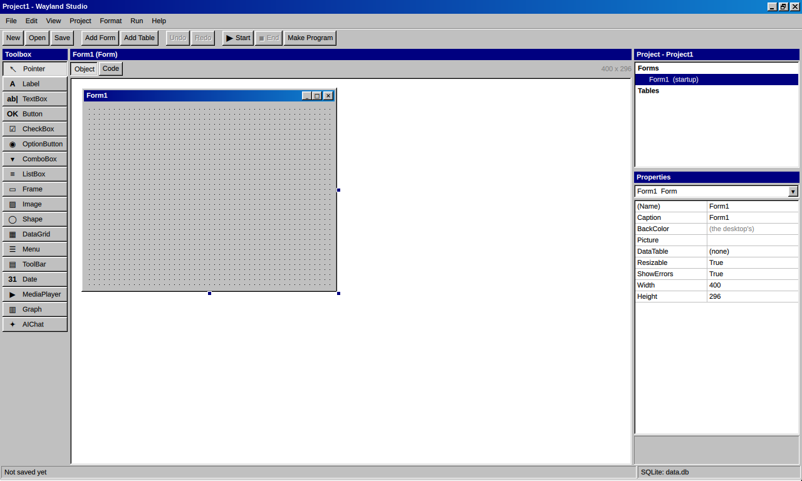

The window has the **Toolbox** on the left (the elements you can put on a
form), the form you're designing in the middle, the **Project** window at
the top right (the project's forms and tables) and the **Properties**
window under it (whatever is selected). [The Studio Window](the-studio.md)
describes every part.

Save the project now, so it has a folder: **File > Save Project As...**,
make a folder *Book Club* in your home folder, and save it there as
`bookclub`. The project is one file, `bookclub.w95proj`; the database (a
SQLite file, `data.db`) is made beside it the first time it's needed.

Give the program its name: **Project > Properties...**. **Program name**
is the name of the program file you'll make at the end (small letters,
digits, `-` and `_`), **Title** what people see.

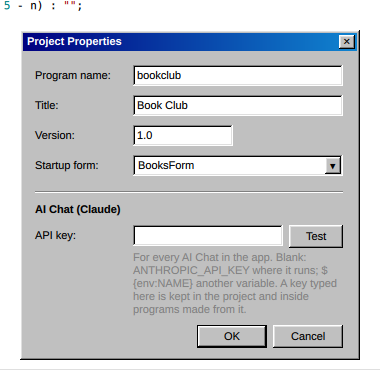

## 2. The tables

An app's data is kept in tables, as in a spreadsheet: each record is a row
and each field a column. Every table also has three fields of its own:
`id` (the record's number), `created_on` and `modified_on`.

### Members

**Project > Add Table** makes a table and opens it in the **Data
Designer**. In its properties (under the list of fields), set **Table
Name** to `Members`. A new table starts with one field, Name (Text,
Required); press **Add Field** twice for the other two, and set them up:
select a field in the list, and change its properties below.

| Field Name | Data Type | Properties |
|---|---|---|
| Name | Text | Required: True, No Duplicates: True, Max Length: 60 |
| Email | E-mail | Caption: E-mail, No Duplicates: True |
| Joined | Date | Default Value: Today |

The **Caption** is what messages call the field ("E-mail is required.").
**Required** refuses a record without it, **No Duplicates** one with the
same value as another record.

### Books

Add another table, `Books` (rename its first field, Name, to Title):

| Field Name | Data Type | Properties |
|---|---|---|
| Title | Text | Required, No Duplicates, Max Length: 120 |
| Author | Text | Required, Validation Rule: A person's name |
| Genre | Choice | Choices: Fiction, Non-fiction, Poetry, Biography; Default Value: Fiction |
| Reader | Lookup | Lookup Table: Members |
| Pages | Whole Number | Minimum: 1 |
| Started | Date | |
| Finished | Date | Validation Rule: On or after another field, Other Field: Started |
| Rating | Whole Number | Minimum: 1, Maximum: 5 |
| Added | Date and Time | Default Value: When the record is made |

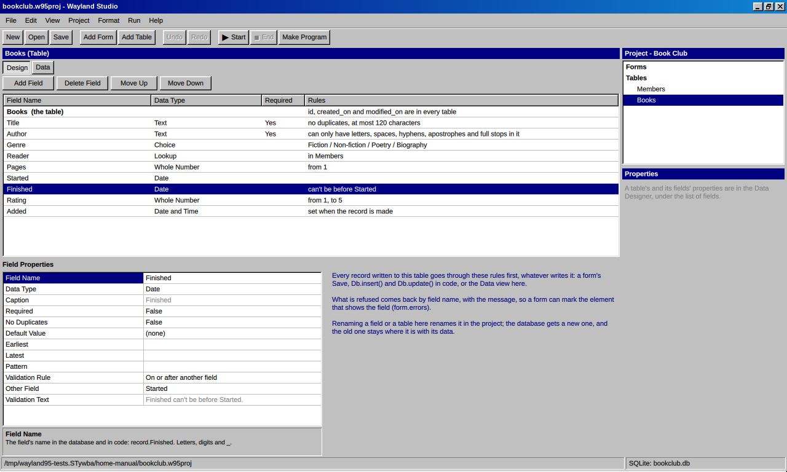

A few of these are worth a closer look:

- A **Choice** field is one of a list you give (**Choices**: one on each
  line). A **Lookup** field is a record of another table: Reader holds
  the id of one of the Members, and a form shows it as the member's name.
- The **Validation Rule** is picked from a list for the field's type:
  over a hundred of them, from *Letters only* to *UK postcode*, *In the
  past* and *More than another field*. Each says what's wrong in its own
  words, shown in grey under **Validation Text**; type your own there if
  you like.

  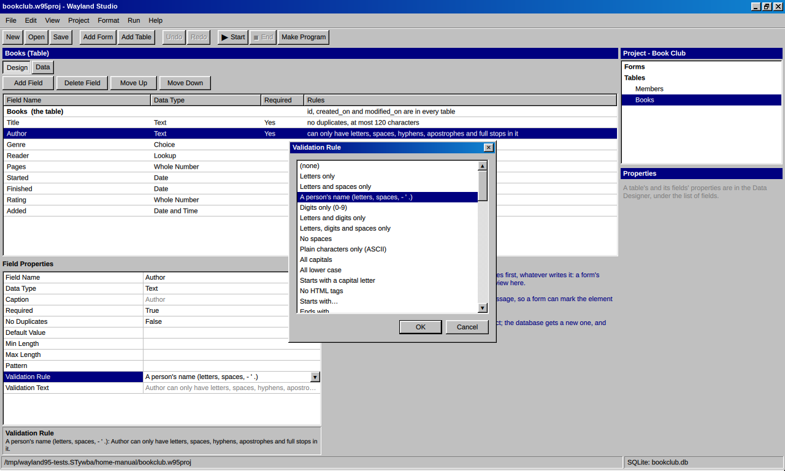

- A date's **Default Value** is a list too. *When the record is made* is
  filled in by the database itself, the moment a record is first saved,
  and never changes after: a created time. (*When the record is saved*
  changes every time the record is saved: a last-changed time.)

  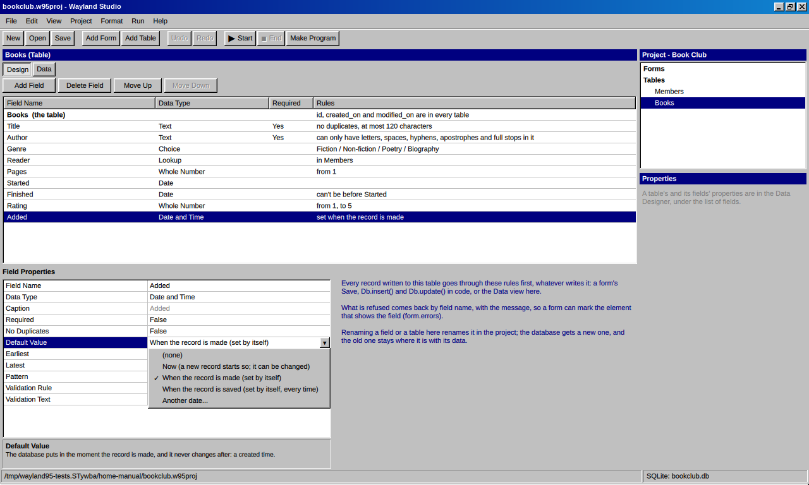

The **Rules** column of the list sums up each field's rules.

### Some records

Click **Data** (at the top of the Data Designer) to see the table's
records. The first time, the Studio offers to make the tables in the
database: press **Yes**. **New Record** adds one: each field is a row to
type in, and what the table's rules refuse is said in red under the
fields when you press **Save**.

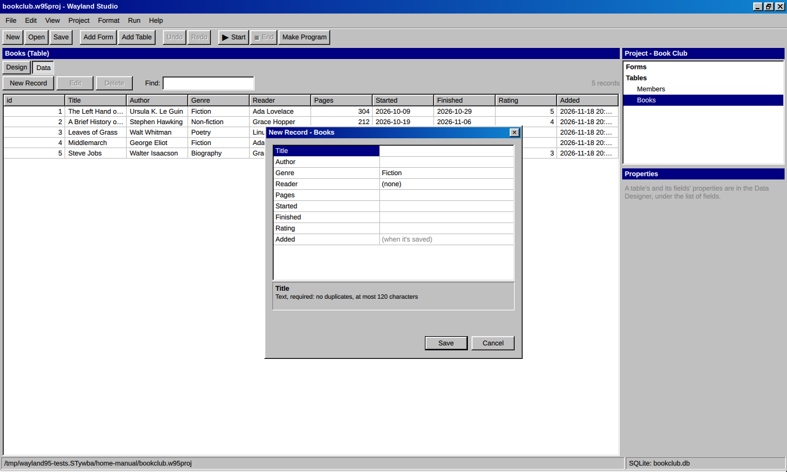

Add two or three members, then a few books. The records are the
database's, not the project's: the forms you make next show them, and so
will your program.

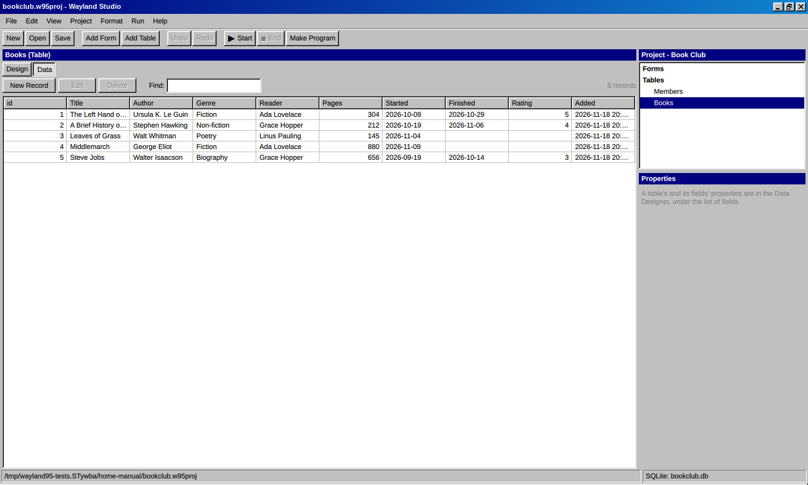

## 3. A form for each table

With Members open in the Data Designer, choose **Project > Add Form for
Members**. The Studio draws a form for it: a label and a box for each
field, a grid listing the records, and **New**, **Save** and **Delete**
buttons with their code. Do the same for Books (select it in the Project
window first).

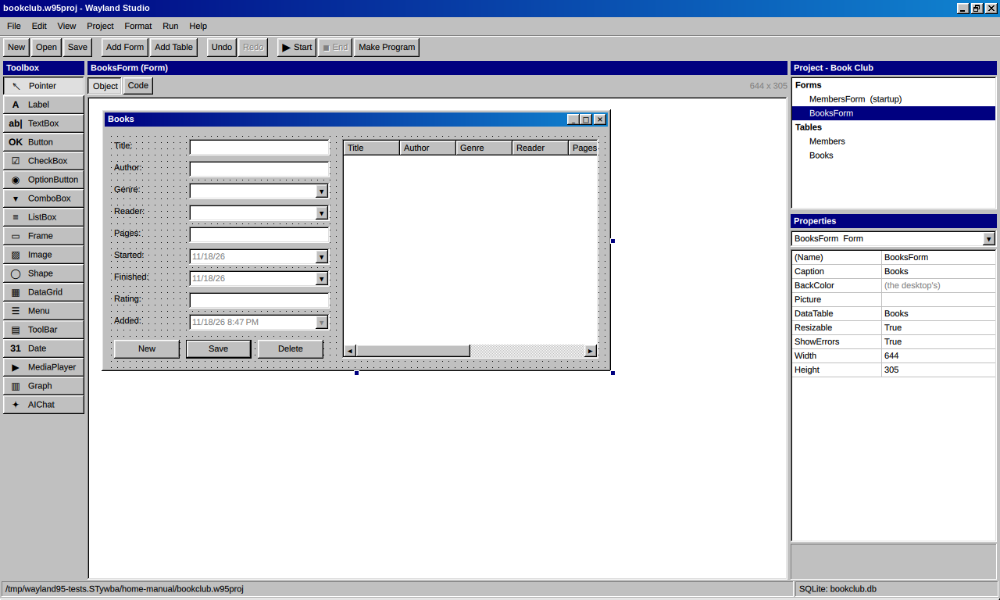

Each element shows a field because of its **DataField** property; the
form's **DataTable** (click the form's empty space or its title to see its
properties) is the table it shows. Each kind of field gets the element
that suits it: a box for text and numbers, a list for a Choice or a
Lookup, a check box for Yes/No, and a date picker (with a calendar) for a
date.

Now you can delete Form1 (select it in the Project window, then **Project
> Remove Form1**), and make BooksForm the one the program opens with:
**Project > Properties...**, **Startup form**: BooksForm.

## 4. Run it

Press **F5** (or **Start** on the tool bar). The Studio saves the project,
checks it and runs it: BooksForm opens in a window of its own. Click a row
in the grid and the form shows that book; change it and press **Save**;
**New** for a new one. Started and Finished have a calendar under their
**▼**.

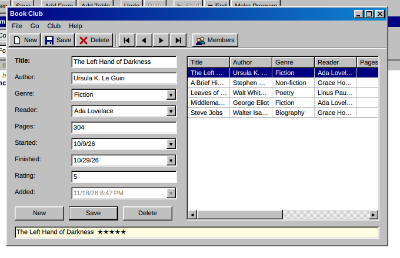

Try **New**, then **Save** with nothing filled in: the table's rules
refuse it, and say why. The fields they refused are marked in red, and
the message is their tool tip.

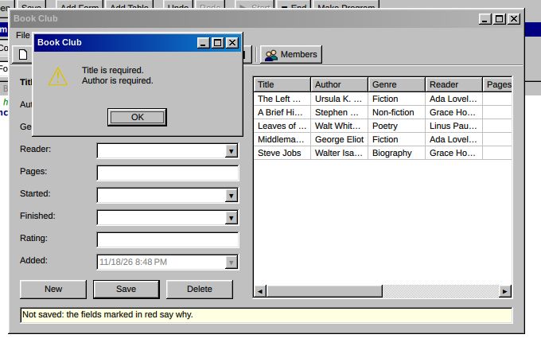

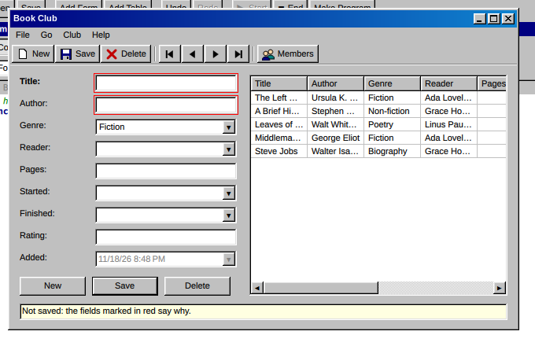

Close the window (or **Run > End**) to come back to the Studio.

## 5. A menu and a tool bar

Open BooksForm (click it in the Project window). In the Toolbox,
double-click **Menu**: a menu bar goes across the top of the form, and
everything on the form moves down to make room. Its **Menus** property
(in the Properties window; press **F4** on it, or click its **...**) opens
the **Menu Editor**:

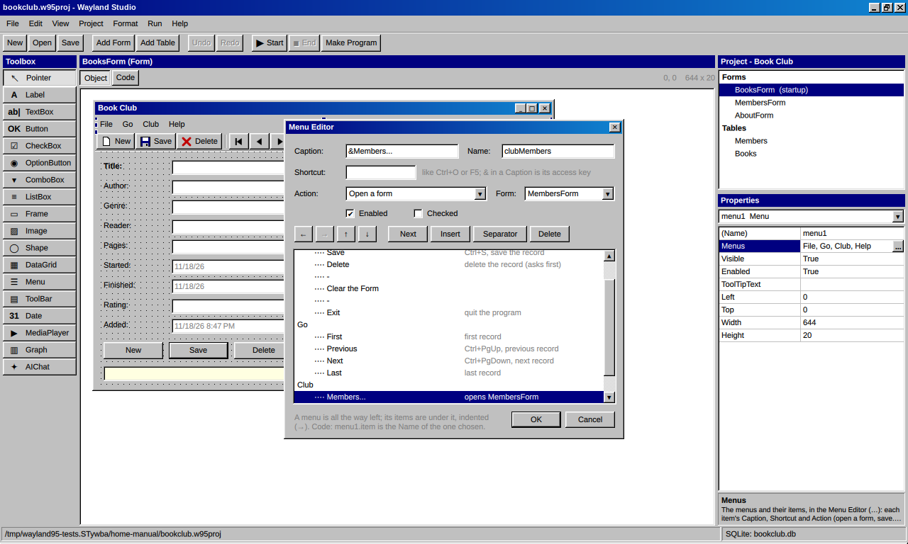

Menus are all the way to the left of the list, and their items are under
them, indented (the **→** and **←** buttons move an item in and out).
Make these:

- **&File**: **&New Book** (Shortcut `Ctrl+N`, Action *New record*),
  **&Save** (`Ctrl+S`, *Save the record*), **&Delete** (*Delete the
  record*), a separator, **E&xit** (*Quit the program*).
- **&Go**: **&First**, **&Previous**, **&Next**, **&Last** (the *First
  record*... actions).
- **&Club**: **&Members...**, with the Action *Open a form* and the Form
  *MembersForm*.

An `&` marks the letter that's underlined: Alt+F opens the File menu. The
**Action** is what the item does without any code: open a form (or bring
it to the front if it's open already), save, go to the next record, quit...
*Open a form* is how a menu opens your other forms.

Then double-click **ToolBar** in the Toolbox. Its **Buttons** open the
same editor: give each button a **Caption**, an **Icon** (**Choose…**
shows Wayland 95's icons: New, Save, Delete, First, Previous, Next, Last,
People...), a **ToolTip**, and an **Action**: New, Save, Delete, the four
moves, and Members (*Open a form*, MembersForm). The four moves need no
Caption: their icons say it.

Press **F5**: the menu and the buttons work.

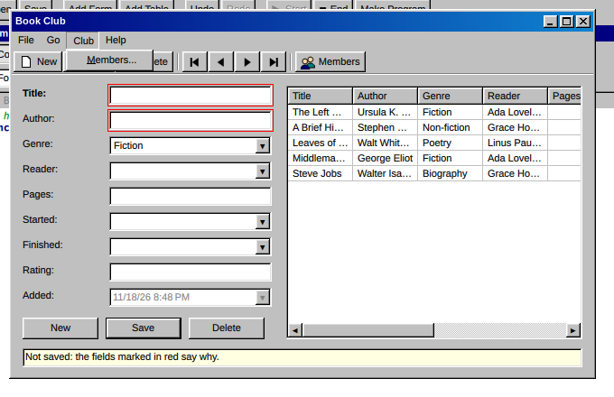

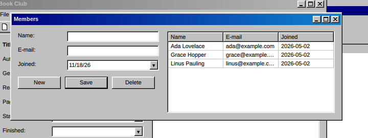

## 6. A little code

Everything so far was done without code. Code is for what's particular to
your app. Put a **Label** at the bottom of BooksForm (click **Label** in
the Toolbox, then drag out where it goes), name it `statusLabel` (its
**(Name)**, at the top of its properties), clear its **Caption**, and set
its **BorderStyle** to Sunken.

Now select the form (click its title) and press **F7**: the code window.
The **Object** list says *Form*; the **Procedure** list has the form's
events. Choose **(General)**, where the form's own functions go, and type:

```
// how many stars a rating is
function stars(n) {
    return n ? "★★★★★".substring(0, n) + "☆☆☆☆☆".substring(0, 5 - n) : "";
}
```

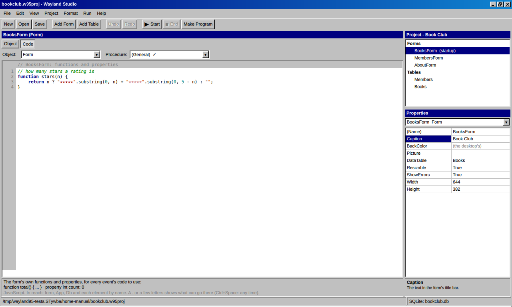

Choose the **current** event (a record is showing: a saved one, or a new
one) and type:

```
if (form.isNew)
    statusLabel.text = "A new book: fill it in and press Save.";
else
    statusLabel.text = form.record.Title + "  " + stars(form.record.Rating);
```

As you type, the code is coloured, and a list offers what can come next:
after `form.` the form's functions and properties, after `form.record.`
the table's fields, after a few letters every name that starts so. **Up**
and **Down** choose, **Enter** puts it in.

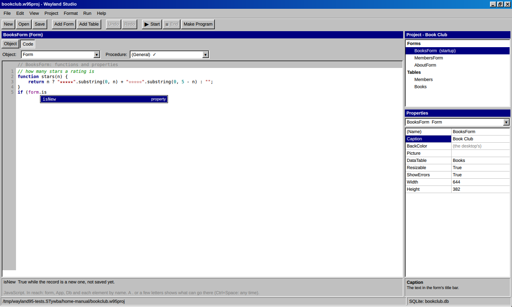

And in **saved**: `statusLabel.text = "Saved " + form.record.Title + ".";`

Press **F5**: the line at the bottom follows the book that's showing.


## 7. An About box

**Project > Add Form** makes Form1 again: name it `AboutForm`, set its
**Caption** to *About Book Club*, its **Resizable** to False, and make it
small (drag its corner). Put a **Label** on it with the app's name, and an
**OK** button (its **Default** True, so Enter presses it) whose **clicked**
code is `form.close();`. Then add **&Help > &About Book Club** to the
menu, with the Action *Open a form*, AboutForm.

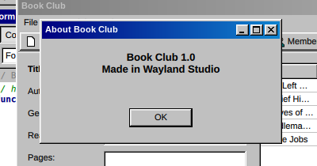

## 8. A program of its own

**Make Program** (on the tool bar, or **File > Make Program...**) asks
where to put the program, and makes it: one file, `bookclub`, that runs by
itself on any Wayland 95. Double-click it in the file manager, or put it
on the desktop.

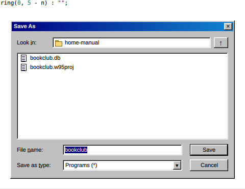

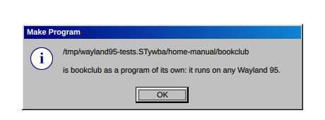

The program keeps its own database, in `~/.local/share/bookclub`: the
records you typed in the Studio's Data view stay with the project, and
the program starts with empty tables (or its own records, from the second
time it's run). [Running and Making Programs](running.md) says more.

## Where next

- [The Data Designer](data-designer.md) has every field type and rule.
- [Forms and Elements](forms.md) has every element and its properties.
- [Writing Code](code.md) has everything code can use, and examples.

[Contents](index.md) | Next: [The Studio Window](the-studio.md)
