[Contents](index.md) | Previous: [The Data Designer](data-designer.md) | Next: [Writing Code](code.md)

# Forms and Elements

A form is one window of your app. You draw it in the form designer, out of
elements from the Toolbox, and set each one up in the Properties window.
What you see on the canvas is drawn by the same code the program uses, so
it's what you get.

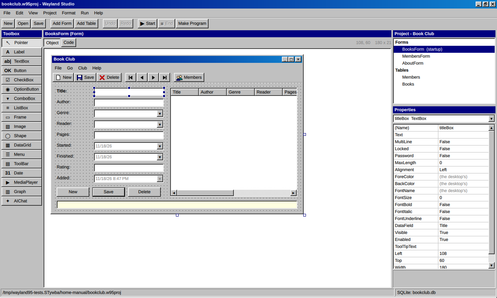

## Designing a form

- **Putting an element on the form**: click it in the Toolbox, then drag
  out the box it goes in on the form. Or double-click it in the Toolbox
  for one in the middle of the form.
- **Selecting**: click an element. **Ctrl+click** adds one to the
  selection (or takes it out); drag a box on the form's empty space for
  every element inside it. The selected element shows small black
  handles; the last one selected is the one the Properties window shows.
- **Moving**: drag it, or press the arrow keys. It lands on the grid's
  dots (8 pixels apart; **View** has 4 and 16); hold **Alt** while
  dragging to place it freely.
- **Sizing**: drag a handle, or **Shift**+arrow keys. The form's own
  handles (at its right and bottom edges) size the form.
- **Delete**, **Cut**, **Copy**, **Paste**, **Undo**: the Edit menu, or
  their keys. A pasted element gets a name of its own.
- **Lining up**: select several, then the **Format** menu.
- **Right-click** an element for **View Code**, **Bring to Front**,
  **Send to Back**, and the edit commands.
- **Double-click** an element to write the code for its first event.

An element that isn't **Visible** is still shown on the canvas, hatched,
so you can select it.

## The form's properties and events

Click the form's empty space (or its title) to select it.

| Property | What it is |
|---|---|
| (Name) | The form's name: `App.openForm("BooksForm")`. |
| Caption | The text in its title bar. |
| BackColor | Its colour. Blank: the desktop's. |
| Picture | A picture, tiled behind its elements. |
| DataTable | The table whose records it shows, one at a time, in its elements with a DataField. |
| Resizable | Whether its window's size can be changed. |
| ShowErrors | When Save is refused, a message box lists what's wrong (the elements are marked in red either way). |
| Width, Height | Its size inside the frame. |

Its events (in the code window, Object *Form*): **load** (it has opened),
**current** (another record is showing, or a new one), **saved**,
**validationFailed** (Save was refused: `form.errors` has why),
**unload** (it's closing). **(General)** holds the form's own functions
and properties.

## Forms and data

Give a form a **DataTable** and its elements a **DataField**, and they
show and edit the form's record: one record of the table at a time.
**Project > Add Form for** (a table) draws all of it for you.

- An element with a DataField shows that field of the record, and what's
  typed or picked in it goes into the record.
- **Save** (`form.save()`) sends the record through the table's rules. If
  they refuse it, the elements of the fields that were refused get a red
  frame, with the message as their tool tip.
- A **DataGrid** on the form lists the table; choosing a row shows that
  record.

Each kind of field has the element that suits it: see the table in [The
Data Designer](data-designer.md).

## Properties every element has

| Property | What it is |
|---|---|
| (Name) | What code calls it: `nameBox.text`. Starts with a small letter. |
| Visible | Whether it's shown. Code can change it: `nameBox.visible = false`. |
| Enabled | Whether it can be used (it's drawn grey when it can't). |
| ToolTipText | What it says when the pointer rests on it. |
| Left, Top, Width, Height | Where it is on the form, and its size. |

Most also have **ForeColor**, **BackColor**, **FontName**, **FontSize**,
**FontBold**, **FontItalic** and **FontUnderline** (blank or 0: the
desktop's), and the ones that can show a field have **DataField**.

## The elements

### Label

Text on the form. **Caption**, **Alignment** (Left, Center, Right),
**WordWrap**, **BorderStyle** (None, Single, Sunken). Event: **clicked**.

With a **DataField**, a label shows that field's value instead of its
Caption: on the canvas it says `[field]`. For a caption beside a box,
leave the label's DataField blank and give the box one.

### TextBox

A box to type in. **Text**, **MultiLine** (several lines, with a scroll
bar), **Locked** (it can be read and copied but not changed),
**Password** (dots for what's typed), **MaxLength** (0: no limit),
**Alignment**. Events: **changed** (the text was edited), **accepted**
(Enter was pressed), **gotFocus**, **lostFocus**.

### Button

A push button. **Caption**, **Icon** (one of Wayland 95's icons, left of
the Caption, or alone with no Caption: **…** opens the Icon chooser,
below), **Default** (the button Enter presses: drawn with a black frame).
Event: **clicked**.

### CheckBox

A box to tick. **Caption**, **Value** (ticked or not). With a DataField,
it shows a Yes/No field. Event: **clicked**.

### OptionButton

One of a group of round buttons, of which one is chosen. **Caption**,
**Value**, **Group** (option buttons with the same Group clear each
other), **OptionValue** (what a DataField gets when this one is chosen;
blank: the Caption). Event: **clicked**.

### ComboBox

A drop-down list. **List** (the items, one on each line), **ListIndex**
(the item chosen to start with: 0 is the first, -1 none). With a
DataField the list comes from the field: a Choice field's choices, a
Lookup's records (the field then holds the chosen record's id), Yes/No.
Event: **changed**.

### ListBox

A list, several items showing. **List**, **ListIndex**. Events:
**changed**, **doubleClicked**.

### Frame

A captioned frame, to group elements. **Caption**. It's drawn behind the
others: elements on it don't move with it unless you select them too.

### Image

A picture. **Picture** (a file: it's put inside the program when it's
made), **SizeMode** (Stretch, Fit, Center, Tile), **BorderStyle**,
**BackColor**. Event: **clicked**.

### Shape

**Shape** (Rectangle, Rounded Rectangle, Oval, Horizontal Line, Vertical
Line), **FillColor**, **BorderColor**, **BorderWidth**. Drawn behind the
others.

### DataGrid

The records of a table in rows. **DataTable** (blank: the form's),
**Columns** (the fields to show, in order; blank: all), **Search** (only
records with this text in a text field), **OrderBy** (the field to sort
by), **FollowForm** (choosing a row shows that record in the form, when
the grid lists the form's own DataTable). Events: **rowSelected**
(`grid.currentRow` is the record, `grid.currentId` its id),
**rowActivated** (a row was double-clicked).

The grid reads its table when the form opens, and again whenever the
table changes, whoever changed it.

A column is as wide as you say: put its width in pixels after its name
and a colon in **Columns** (`Title:180`, `Length:48`). The columns with
no width share what's left between them (72 pixels each at least); with
more than fits, a scroll bar goes across under them.

### Menu and ToolBar

A **Menu** is the form's menu bar; a **ToolBar** a row of buttons. Both go
across the top of the form, the Menu first: adding one moves everything on
the form down to make room (and deleting it moves them back). A form can
have one Menu, and as many tool bars as you like.

The Menu's **Menus** and the ToolBar's **Buttons** open the **Menu
Editor** (F4, or their **...**):

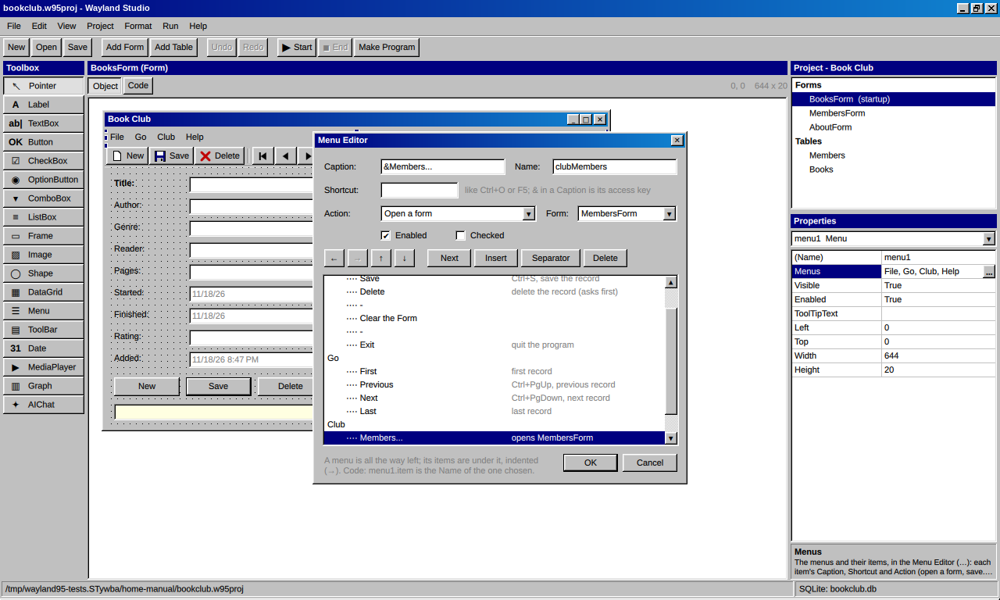

- The list at the bottom has the menus all the way left and their items
  under them, indented. **→** and **←** move an item in and out, **↑** and
  **↓** up and down. **Next** goes to the next one (or makes a new one at
  the end), **Insert** puts a new one before the selected one,
  **Separator** a line after it, **Delete** takes it away.
- **Caption**: what it says. An `&` before a letter underlines it, and
  Alt and that letter opens the menu (`&File`: Alt+F).
- **Name**: what code calls it (blank: made from the Caption).
- **Shortcut** (a menu item): keys that choose it from anywhere in the
  form: `Ctrl+O`, `F5`, `Ctrl+Shift+S`.
- **Icon**, **Symbol**, **Picture** and **ToolTip** (a tool button):
  **Choose…** picks one of Wayland 95's icons (below); or a character
  like `✔` (**Symbol**), or a picture file of your own; and what it says
  when the pointer rests on it. A Picture is shown if there is one, else
  the Icon, else the Symbol. The ToolBar's **ShowCaptions** shows the
  Caption beside it; a button with no Caption shows the icon alone.
- **Enabled**, and **Checked** (a menu item: a tick by it; a tool button:
  pushed in).
- **Action**: what it does, with no code:

| Action | What it does |
|---|---|
| (none: its code only) | Nothing but the itemClicked event. |
| Open a form | Opens the form chosen under **Form**; if it's open already, brings it to the front. |
| Close this form | Closes the form. |
| New record | `form.newRecord()` |
| Save the record | `form.save()` |
| Delete the record (asks first) | Asks, then `form.deleteRecord()`. |
| First record, Previous record, Next record, Last record | Moves through the records. |
| Quit the program | `App.quit()` |

After the Action, the element's **itemClicked** event runs, with
`menu1.item` (or `toolBar1.item`) the chosen item's Name:

```
if (menu1.item === "fileClear")
    form.reset();
```

Code can change items: `menu1.setEnabled("fileSave", false)`,
`menu1.setChecked("viewGrid", true)`, `menu1.setText("fileOpen", "&Open
Recent")`; the same for a ToolBar's buttons. An item that opens a form
that isn't in the project is a problem Start and Make Program name.

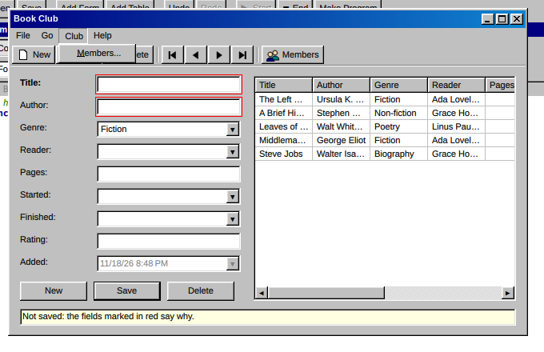

#### The Icon chooser

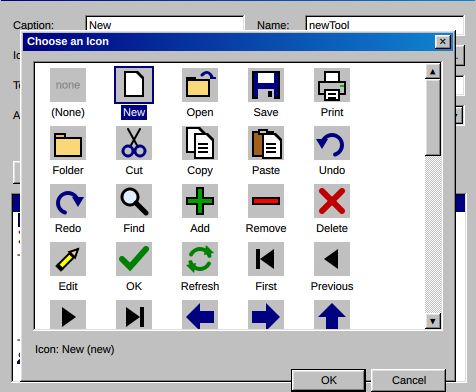

Wayland 95 has its own small icons, drawn the Windows 95 way: New, Open,
Save, Print, Cut, Copy, Paste, Undo, Find, Add, Delete, the record moves
(First, Previous, Next, Last), Help, People, Mail, Calendar, Chart,
Money and more. **Choose…** in the Menu Editor, or **…** on a Button's
**Icon**, shows them all: click one and **OK** (or double-click it).
**(None)** takes the icon away. A disabled button draws its icon grey,
as Windows 95 did. They come with the app when it's made into a program;
there's nothing to copy.

### DateTimePicker

A date, a date and a time, or a time (**Mode**). Type it in, or pick it:
**▼** (or **F4**) drops a month calendar for a date: today is circled in
red, days it can't be are grey, **Today** and **None** are under it, and
for a date and time there's a time to set under the days. A time has **▲**
and **▼**. **Up** and **Down** step a day (or, for a time, MinuteStep
minutes).

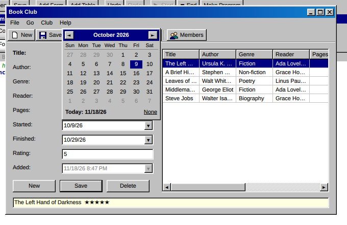

| Property | What it is |
|---|---|
| Mode | Date, Date and Time, or Time. |
| Value | What it starts with: `2030-01-01`, `14:30`, or from now: `today`, `today+7`, `now+2h`. Blank: nothing (or its DataField's). |
| DateFormat | How the date shows: the computer's **Short** or **Long** way, a pattern (each shown with today in it: `dd/MM/yyyy`, `MMMM d, yyyy`...), or **Custom**. |
| TimeFormat | **Short**, **Long**, `h:mm AP` (12-hour), `HH:mm` (24-hour), with seconds, or **Custom**. |
| CustomDateFormat | With Custom: `d` `dd` (day), `ddd` `dddd` (its name), `M` `MM` `MMM` `MMMM` (month), `yy` `yyyy` (year). |
| CustomTimeFormat | With Custom: `h` `hh` (12-hour, with `AP`) or `H` `HH` (24-hour), `mm`, `ss`, `AP`. |
| EarliestDate, LatestDate | The first and last day it can be: `2024-01-01`, `today`, `today+90`. With a DataField, blank is the field's own Earliest and Latest. |
| EarliestTime, LatestTime | The time of day it can be between: `09:00` to `17:30`. |
| MinuteStep | How far ▲▼ move a time: 15 is :00, :15, :30, :45. |
| TimeZone | Show and pick the time in another zone (a list of them); the value stays this computer's time. |
| FirstDayOfWeek | Sunday, Monday or Saturday. |
| AllowBlank | Whether it can be left empty. |

With a DataField it edits a Date, Time or Date and Time field. Event:
**changed** (`datePicker1.value` is the value as it's kept, `.text` as it
shows, `.date` a JavaScript Date).

### MediaPlayer

Sound or video. It plays MP3, WAV, FLAC, OGG, M4A/AAC and Opus sound, and
MP4, WebM, MKV, AVI and MOV video (whatever this computer's FFmpeg plays).
A video shows in it; a sound shows ♪ and its title. With **ShowControls**,
Win95's **▶**, **❚❚** and **■** are under it, with a bar showing where it
is (drag or click it to go there), the time, and a speaker to mute it.
Click the picture, or press **Space**, to play and pause; **Left** and
**Right** go back and on five seconds.

| Property | What it is |
|---|---|
| Source | The file (**...** picks one: Sound and Video), or a web address typed in (`https://...`). |
| Embed | Put the file inside the program when it's made (the default). A big video makes a big program: set it to False and the program plays the file from where it is. |
| AutoPlay | Start playing when the form opens. |
| Loop | Start again at the end, for ever. |
| Volume | How loud, 0 to 100. |
| Mute | No sound. |
| ShowControls | The buttons, the bar and the time under it. False: only the picture. |
| FillMode | How a video fits: Fit (all of it), Stretch (to the shape), Crop (filled, the edges cut). |
| Equalizer | Its sound through the equalizer (below). |
| EqPreset | The equalizer's bands to start with: Flat, Rock, Pop, Jazz, Classical, Dance, Metal, Bass Boost, Treble Boost, Vocal, Loudness, Headphones. |
| EqPreamp | The equalizer's preamp, -12 to +12 dB. |
| MediaKeys | The keyboard's **Play/Pause**, **Next**, **Previous** and **Stop** keys, and the sound menu (click the speaker by the clock), control it, and show what it's playing. |

Make it small (just its controls) for a sound; set **Visible** to False
for one that plays with no player to see, like a sound when a record is
saved. With a **DataField** it plays the file that field holds (a path or
a web address). Events: **started**, **paused**, **stopped**,
**finished** (it played to the end), **failed** (`player1.errorString`
says why), **loaded** (the file is open: its length and tags are known)
and **positionChanged** (it moved on: several times a second while it
plays). With **MediaKeys**, **nextTrack** and **previousTrack**: the Next
or Previous key, or the sound menu's ⏭ or ⏮, was pressed; what's next is
the app's to say (`player1.source = ...; player1.play();`).

With MediaKeys on, the desktop sees the player as it sees Firefox or
VLC playing: the media keys go to whichever program is playing (the one
that started last, if several are), and the sound menu shows its title,
artist and cover beside the volume, with **⏮ ⏯ ⏭** and **Show the
Player**. A program with several MediaPlayers can have MediaKeys on more
than one; leave it off for a sound that only marks something happening.

Once a file's loaded, its own tags are in code: `player1.title`,
`artist`, `album`, `albumArtist`, `genre`, `trackNumber` and `year`
(empty, or 0, for a tag it hasn't), and `player1.coverArt`: the picture
inside the file (an album's cover), as a file an **Image** can show. In
the player's loaded code: `coverImage.picture = player1.coverArt;`. To read a file's tags without
playing it, `App.readTags` ([Writing Code](code.md#files-and-folders)).
Wayland 95 reads tags through Qt, which takes a year only from a whole
date (`1986-06-29`, not `1986`), and a track number only when it's on
its own (`3`, not `3/8`).

### Visualizer

What a **MediaPlayer** on the form is playing, as it plays, the way a
music player's display shows it:

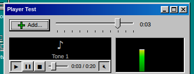

| Property | What it is |
|---|---|
| Player | The MediaPlayer whose sound it shows (a list of the form's). Renaming the MediaPlayer renames it here too. |
| Style | **Spectrum**: a bar for each band of notes, the low ones on the left. **Oscilloscope**: the wave itself. **Meter**: how loud, across. |
| Bars | How many bars Spectrum has (1 to 64). |
| ShowPeaks | A line over each bar where it last reached, falling slowly. |
| ForeColor | The bars' and the wave's color. Blank: green, then yellow and red at the top, as a meter's. |
| BackColor | Behind them. Blank: black. |
| PeakColor | The peaks' color. Blank: grey. |
| BorderStyle | None, Single, or Sunken (the default). |

It moves while the sound plays, even with the player muted, and falls
away when it stops. Its event is **clicked** (to change its Style, say).
The numbers it draws are the MediaPlayer's, for code of your own:
`player1.levels` (a list of the bands, low to high, each 0 to 1),
`player1.peaks`, `player1.level` (how loud, 0 to 1) and
`player1.waveform` (64 points, -1 to 1).

### Equalizer

A MediaPlayer's equalizer, the way a music player has one: **On**, a list
of **presets** and **Flat**, the **preamp**, and a slider for each of ten
bands, from 31 Hz (the deepest bass) to 16 kHz (the top of the treble),
each from -12 to +12 dB.

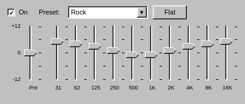

| Property | What it is |
|---|---|
| Player | The MediaPlayer it's the equalizer of. |
| ShowPresets | The preset list and the Flat button across its top. |
| ShowPreamp | The preamp's slider, left of the bands. |

What it changes is the MediaPlayer's: its **Equalizer**, its bands and
its preamp, so a player can have them set in the Properties window
(**Equalizer**, **EqPreset**, **EqPreamp**) or by code with no Equalizer
on the form at all:

```
player1.equalizer = true;
player1.applyEqPreset("Bass Boost");
player1.setEqGain(9, 4);               // 16 kHz up 4 dB
player1.eqGains = [6, 5, 3, 0, 0, 0, 0, 2, 4, 5];
```

`player1.eqPresetNow` is the preset the bands are now (`Custom` when
they're none). Its event is **changed**: something on it was changed.
To keep someone's equalizer for the next time, save
`JSON.stringify(player1.eqGains)` in a table in the changed code, and set
it back in the form's load code.

With the equalizer on, the sound comes out about a tenth of a second
after the picture (it goes through the filters first): no one hears it
in music, but a video's lips may look a little early. The Visualizer
shows the sound as it comes out of the equalizer.

### Slider

Win95's trackbar: a value from **Min** to **Max**, dragged, clicked on
its groove, or moved with the arrow keys (**SmallChange** at a time;
**Page Up** and **Page Down** by **LargeChange**; **Home** and **End** to
the ends). **Value** is where it starts; **TickCount** the tick marks
under it (0: none); **Orientation** across or up and down (the top is
Max). With a **DataField** it shows and changes a number field. Its event
is **changed**: it was moved (`slider1.value`).

A volume control: Min 0, Max 100, and in its changed code
`player1.volume = volumeSlider.value;`.

### Timer

Runs its **timer** event every **Interval** milliseconds (1000 is once a
second) while it's **Enabled**. Like Visual Basic's, it's a stopwatch on
the form in the Studio, and the program doesn't show it. Code starts and
stops it: `timer1.enabled = false`, `timer1.start()`, `timer1.stop()`;
`timer1.count` is how many times it's gone off since it started.

A clock that shows where a song is: a Timer with Interval 500, and in its
timer code `timeLabel.text = player1.clock(player1.position);`.

### Graph

A graph of a table's records (or of what code gives it): columns, bars,
lines, areas, a pie, a doughnut or a scatter of points, drawn the way a
Windows 95 spreadsheet drew them. When you put one on a form, the **Graph
Editor** opens to say what it is; later, its **Graph** property (**...**
or **F4**) opens it again. Its three pages are on the left, and on the
right a preview, with the table's records if the database has some
(made-up values if it hasn't).

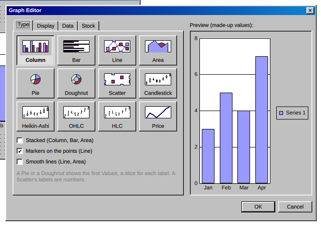

**Type**: click a picture (double-click: and on to Data). **Stacked** puts
columns, bars or areas on top of each other instead of side by side;
**Markers** and **Smooth lines** are for lines.

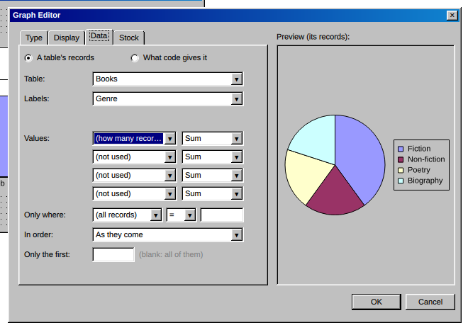

**Data**: where the numbers come from.

| Setting | What it is |
|---|---|
| Table | The table whose records it shows. |
| Labels | The field the records are grouped by: a column, bar, point or slice for each value it has (Genre: Fiction, Poetry...). *(all the records together)*: one. |
| Dates by | For a date field as the labels: each date, or a day, month or year at a time. |
| Values | Up to four series, each a number field and how its records are summed up: **Sum**, **Average**, **Least**, **Most** or **Count** (how many have one); or *(how many records)*. A pie shows the first. |
| Only where | Only the records whose field is (=), isn't (≠), is more or less than, has (some text in it), is blank or isn't blank. |
| In order | As they come, by label (A to Z, or Z to A), or by the first Values (smallest or biggest first). |
| Only the first | That many, after they're in order: the top five. Blank: all. |

**What code gives it** instead: the form's code says what it shows,
`graph1.setData(labels, series)` (see below).

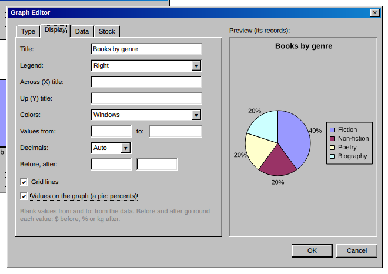

**Display**: how it looks.

| Setting | What it is |
|---|---|
| Title | Over the graph. |
| Legend | The box saying which color is which: on the right, under it, over it, or none. |
| Across (X) title, Up (Y) title | Under the graph, and up its left side. |
| Colors | Windows (a spreadsheet's), Bright (the 16 colors), Pastel, Grays. |
| Values from, to | Where the value axis starts and ends. Blank: from the data. |
| Decimals, Before, after | How values are written: `$` before, `%` or ` kg` after. |
| Grid lines | Lines across at each step of the value axis. |
| Values on the graph | Each value written by its column or point; a pie's percents. |

Its colors are in the **Properties** window, not the Graph Editor:
**BackColor** is the color around the graph (its titles, axes and legend
sit on it) and **PlotColor** the color behind its columns, lines and
candles. Left blank, they're the desktop's: the graph is the color of
the form, and its plot the color of a list box, and they change with the
desktop's color scheme (Control Panel > Display). **ForeColor** is its
text's.

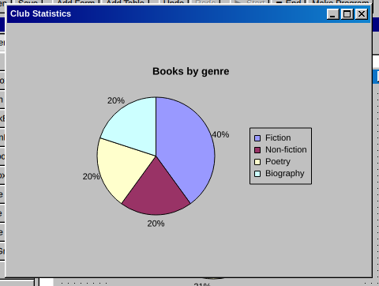

When the app runs, the graph reads its table when the form opens, and
again whenever a record of that table is added, changed or deleted
(by a form, by code or by the AI chat). Resting the pointer on a column,
point or slice shows its value. Clicking one runs its **clicked** event:

```
// clicked: the books of the genre clicked, in the grid
grid.search = graph1.clickedLabel;
```

`graph1.clickedLabel`, `clickedValue`, `clickedSeries` (its series' name)
and `clickedIndex` say which (`clickedIndex` is -1 when the click wasn't
on one).

In code, a graph can also be given its data, or changed:

```
// load: last week's takings, from an API
graph1.setData(["Mon", "Tue", "Wed"], [{ name: "Takings", values: [120, 95, 140] }]);
graph1.graphType = "Line";      // Column, Bar, Line, Area, Pie, Doughnut, Scatter (or a stock graph's)
graph1.title = "This week";
graph1.plotColor = "#ffffcc";   // behind the columns (backColor: around them; "": the desktop's)
graph1.refresh();               // read its table again
```

A list of numbers is one series: `graph1.setData(["a", "b"], [3, 5])`.
**Check for Problems** names a graph whose table, or one of whose fields,
isn't in the project.

#### Stock graphs

**Candlestick**, **Heikin-Ashi**, **OHLC**, **HLC** and **Price** (on the
Type page's last row) draw prices: a bar for each label, with its open,
high, low and close. A candle is white when the price went up and black
when it went down (or green and red); Heikin-Ashi candles are each the
average of their own bar and the one before, which smooths a trend;
OHLC and HLC draw each bar as a line from its low to its high, with ticks
for the open and the close; Price is a line through the closes. The
values axis is on the right, with the last close marked on it.

On the **Data** page, a stock graph's Values are its fields:

| Setting | What it is |
|---|---|
| Close (price) | The price. The only one it needs. |
| Open, High, Low | The bar's other prices. *(from the prices)*: worked out from the closes of the records each bar is made of. |
| Volume | How many were traded; added up for each bar. |

Each label is a bar, in time order (without labels, each record is one).
With a date and time field as the labels, **Dates by** makes a bar a
minute, an hour, a day, a week, a month or a year: its first open, its
highest high, its lowest low, its last close and all of its volume. So a
table of trades (a time, a price, how many) with just Close and Volume
set becomes candles: each minute's first price, highest, lowest and last.

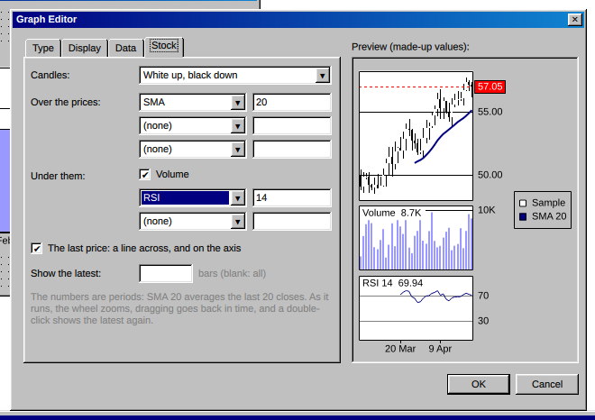

The **Stock** page:

| Setting | What it is |
|---|---|
| Candles | White up and black down, or green up and red down. |
| Over the prices | Up to three lines: **SMA** (the average of the last N closes), **EMA** (an average that weighs the latest more), **Bollinger** bands (N closes' average, and the width of the band in standard deviations), **VWAP** (the average price, weighed by volume). The numbers are the periods. |
| Under them | **Volume**, and up to two panes: **RSI** (how strongly it's been going up or down, 0 to 100, with 30 and 70 marked), **MACD** (two EMAs' difference, its signal line and the gap between them), **Stochastic** (where the close is in the last N bars' range, 0 to 100). |
| The last price | A dotted line across at the last close, and the price on the axis: green if it went up, red if down. |
| Show the latest | Only so many bars, the newest. Blank: all of them. |

When the app runs, resting the pointer on a bar shows a crosshair and
the bar's open, high, low, close, how far it moved, its volume and each
line's and pane's value there. The wheel zooms in and out, dragging goes
back in time, and a double-click shows the latest again. Clicking one
runs clicked: `graph1.clickedValue` is its close, and `graph1.clickedItem`
all of it (`open`, `high`, `low`, `close`, `volume`, `change`,
`changePercent`).

From code, a stock graph's data is a series with `open`, `high`, `low`,
`close` (and `volume`) lists; or it's built as prices come in:

```
// a bar each minute, from the trades as they happen
graph1.maxBars = 120;                       // keep two hours of them
function onTrade(price, size) {
    graph1.tick(Qt.formatTime(new Date(), "hh:mm"), price, size);
}
// or whole bars
graph1.addBar("10:31", 101.2, 101.9, 100.8, 101.5, 4200);
graph1.setData(["3 Mar", "4 Mar"], [{ name: "ACME", open: [10, 11], high: [11.5, 11.8],
                                      low: [9.8, 10.6], close: [11, 11.2], volume: [1200, 900] }]);
graph1.overlays = ["SMA 20", "Bollinger 20 2"];
graph1.studies = ["Volume", "MACD 12 26 9"];
var rsi = graph1.indicator("RSI 14");      // a value for each bar (null before there are enough)
```

`tick(label, price, volume)` with the same label as the last bar makes it
that bar's (its high, low, close and volume); a new label starts a new
bar. `addBar` with the same label as the last bar puts that bar again.
`indicator` gives a list for SMA, EMA, VWAP, RSI and Volume, and
`{ upper, middle, lower }` for Bollinger, `{ MACD, signal, histogram }`
for MACD and `{ K, D }` for Stochastic.

### AIChat

A chat with Claude, Anthropic's AI: the person types, Claude answers, and
(as its properties allow) looks up and changes records, fills in forms and
calls the project's APIs, asking the person before each change. It needs
an Anthropic API key. All about it: [An AI Chat in Your App](ai-chat.md).

## Opening other forms

The app opens with its startup form (**Project > Properties...**). Other
forms open:

- from a menu item or a tool button, with the Action **Open a form**;
- from code: `App.openForm("MembersForm")`. The form gets what's given
  after its name as `form.args`: `App.openForm("BookForm", { id: 3 })`,
  and its load code can do `form.loadRecord(form.args.id)`.
  `App.showForm("MembersForm")` brings it to the front if it's open
  already, and opens it if it isn't.

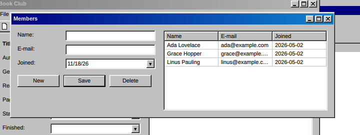

[Contents](index.md) | Previous: [The Data Designer](data-designer.md) | Next: [Writing Code](code.md)
