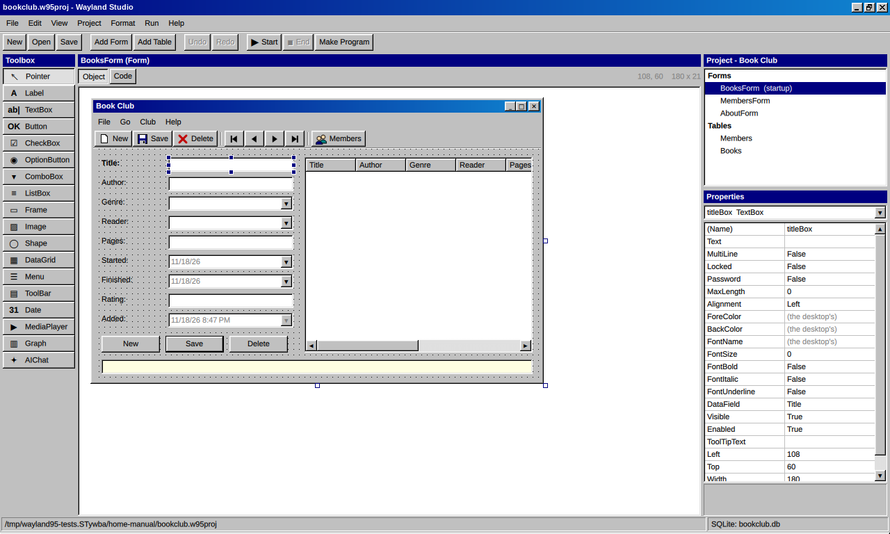

# Wayland Studio Manual

Wayland Studio makes programs for Wayland 95. You describe your data as
tables, draw forms on a grid, write a little JavaScript for what happens
when someone clicks or types, and the Studio turns it into a program of
its own: one file that runs on any Wayland 95.

This manual starts with a tutorial that builds a whole app, the Book Club,
from an empty project. The chapters after it describe every part of the
Studio in detail; come back to them while you build your own.

## Contents

1. [Building Your First App](first-app.md): the Book Club, step by step:
   tables, a form, running it, a menu and a tool bar, code, and a program
   of its own.
2. [The Studio Window](the-studio.md): what each part of the window is
   for, the menus, and the keyboard.
3. [The Data Designer](data-designer.md): tables and fields, field types,
   rules, Validation Rules, defaults (dates included), and the Data view.
4. [Forms and Elements](forms.md): the form designer, the Properties
   window, and every element in the Toolbox, from Label to
   DateTimePicker, Graph (and its Graph Editor), MediaPlayer and AIChat,
   menus and tool bars included.
5. [Writing Code](code.md): the code window, events, and what code can
   use: `form`, `App`, `Db`, `AppDates` and the elements.
6. [An AI Chat in Your App](ai-chat.md): Claude on a form, answering
   from your tables and working your forms; the key, asking first, and
   tools of your own.
7. [Running and Making Programs](running.md): Start, the Output window,
   Check for Problems, Make Program, and where the data is kept.
8. [When Something Isn't Right](troubleshooting.md): what the usual
   surprises mean, and what to do about them.
9. [Building Apps with Claude](claude.md): Claude Code builds an app for
   you with the Studio's tools, and the Studio shows it as it goes.

## The Book Club sample

The app the tutorial builds comes with the Studio. To look around it:
**Help > Open the Book Club Sample**. It's copied to the folder *Book Club*
in your home folder (the first time), with a few books and members in it,
and opens. Press **F5** to run it.

## Reading this manual

The manual opens in the Markdown Reader: click a link (blue and
underlined) to go to that chapter, and **Back** (the ← button, or
**Alt+Left**) to come back to where you were; **Home** is these Contents. Each chapter has links to the
Contents and to the chapters before and after it, at its top and its end.
Press **F1** in the Studio at any time for these Contents.

Names of menus, buttons and properties are in **bold**; what you type and
what code says are in `this type`.
