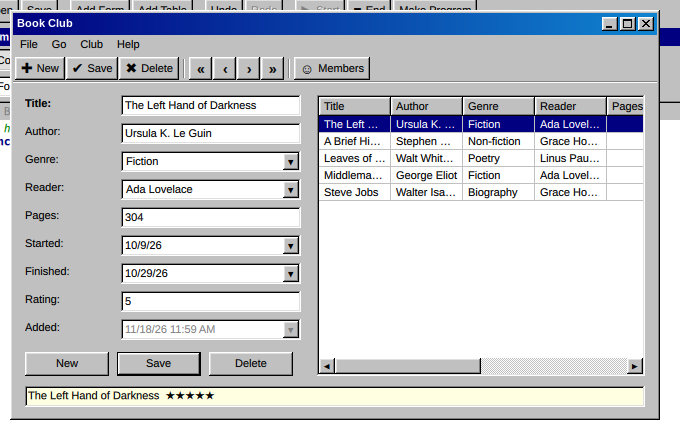
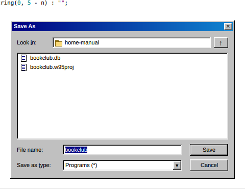
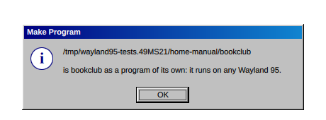
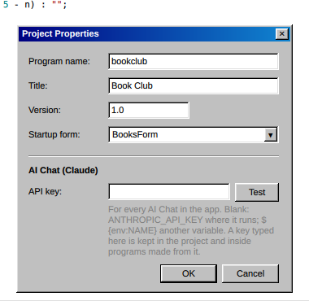

[Contents](index.md) | Previous: [An AI Chat in Your App](ai-chat.md) | Next: [When Something Isn't Right](troubleshooting.md)

# Running and Making Programs

## Start

**F5**, **Start** on the tool bar, or **Run > Start**: the Studio saves
the project, checks it, and runs it as a program of its own, starting with
the startup form. **End** (or closing all its windows) stops it.



While it runs, the **Output** window (at the bottom of the Studio) shows
what its code prints with `console.log()`, and what goes wrong in its
code, named by form, event and line:

```
--- bookclub started ---
BooksForm, saveButton.clicked, line 3: ReferenceError: titelBox is not defined
--- ended ---
```

**Clear** empties it; **View > Output** hides and shows it.

The app started from the Studio uses the project's database: the same
records the Data view shows.

## Check for Problems

**Run > Check for Problems** compiles the project without running it, and
lists what would stop it: a form or an element with a name it can't have,
two elements with one name, a picture that can't be read, an item that
opens a form that isn't there, code that doesn't make sense as
JavaScript. Start and Make Program check the same things first.

## Make Program

**Make Program** (the tool bar, or **File > Make Program...**) asks where
to put the program, and writes it there:





The program is one file: Wayland 95's app runner, with your app (its
forms, tables, code and pictures) on its end, much as a Visual Basic
program needed its runtime. It runs by itself on any Wayland 95: copy it,
double-click it, put it on the desktop or in the Start menu.

A program made from a project that keeps its data in SQLite keeps its
own file, in `~/.local/share/<its name>` (`~/.local/share/bookclub`), made
when it first starts. It doesn't take the project's records with it. A
program whose project uses a MySQL or PostgreSQL server uses that server.

When a program starts, it brings its database up to its tables: a table
or a field that's new in the project is added, and records already there
stay. Nothing is ever deleted, or changed to another type.

## The project's settings

**Project > Properties...**:



- **Program name**: the program file's name, and its data folder's.
  Small letters, digits, `-` and `_`.
- **Title**: what people see.
- **Version**: what `App.version` says.
- **Startup form**: the form the program opens with.
- **API key** (AI Chat): the Anthropic API key every AIChat in the app
  uses, and **Test** to try it: see [An AI Chat in Your App](ai-chat.md#the-key).

**Project > Database...** says where the data is kept: see [The Data
Designer](data-designer.md).

[Contents](index.md) | Previous: [An AI Chat in Your App](ai-chat.md) | Next: [When Something Isn't Right](troubleshooting.md)
