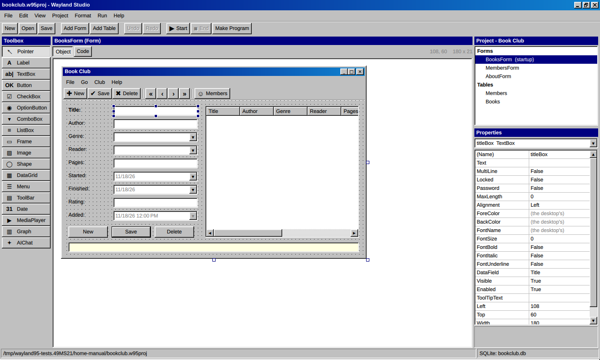
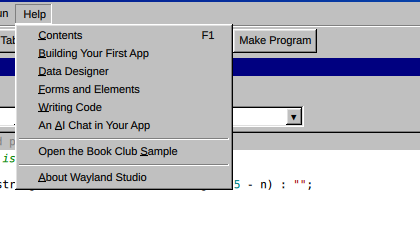

[Contents](index.md) | Previous: [Building Your First App](first-app.md) | Next: [The Data Designer](data-designer.md)

# The Studio Window

## Its parts

- **The menu bar and the tool bar**, at the top. The tool bar's buttons
  are the commands used most: **New**, **Open** and **Save** (the
  project), **Add Form**, **Add Table**, **Undo**, **Redo**, **Start**
  and **End** (running the app), and **Make Program**.
- **The Toolbox**, on the left while a form is open: the elements that
  can go on a form. Click one, then drag out where it goes on the form;
  or double-click it to put one in the middle of the form. **Pointer**
  goes back to selecting.
- **The middle**: what's open. A form, in the form designer (**Object**)
  or its code (**Code**); or a table, in the Data Designer (**Design**)
  or its records (**Data**).
- **The Project window**, top right: the project's **Forms** and
  **Tables**. Click one to open it. The form the program starts with says
  *(startup)*.
- **The Properties window**, under it: everything about what's selected,
  a name on the left and a value on the right. The list at its top picks
  the form or another of its elements. A table's and its fields'
  properties are in the Data Designer instead.
- **Output**, at the bottom, once the app has been started: what the app
  prints (`console.log()`), and what goes wrong in its code.
- **The status bar**: the project's file, and where its data is kept.

## The Properties window

Click a value to change it. A value with **▼** is picked from a list; one
with **...** opens a dialog (a colour, a font, a picture, a list of items,
the Menu Editor). Type in the others, and press **Enter**.

The keyboard works too: **Up** and **Down** move between rows, **F4** (or
**Alt+Down**) opens the current row's list or dialog. The box at the
bottom says what the selected property is for.

With several elements selected, a change goes to all of them that have
that property.

## The menus

**File**

| Command | Keys | What it does |
|---|---|---|
| New Project | Ctrl+N | An empty project (one form, Form1). |
| Open Project... | Ctrl+O | A project file (`.w95proj`). |
| Save Project | Ctrl+S | Save it (the first time: where). |
| Save Project As... | | Save it as another file. |
| Make Program... | | The app as a program file of its own. |
| Exit | | Close the Studio (it asks about unsaved changes). |

**Edit**: **Undo** (Ctrl+Z) and **Redo** (Ctrl+Y) take back any change
to the project; **Cut**, **Copy**, **Paste** (Ctrl+X, C, V), **Delete**
(Del) and **Select All** (Ctrl+A) work on the elements of a form.

**View**

| Command | Keys | What it does |
|---|---|---|
| Object | Shift+F7 | The form, to design. |
| Code | F7 | The form's code. |
| QML Source | | What the form compiles to (to read). |
| Design, Data | | A table's fields, or its records. |
| Grid Dots | | Show the form's grid. |
| Grid of 4, 8, 16 | | How far apart the grid's dots are. |
| Output | | Show or hide the Output window. |

**Project**: **Add Form**, **Add Table**, **Add Form for** (the table
that's open: a form with an element for each of its fields), **Remove**
(the form or table that's open), **Database...** (where the data is
kept), **Import Tables...** (the tables a database has already, into the
project), **APIs...** (the web APIs the project uses, and how to sign in
to each), **Add API Table...** (an API's endpoint, as a table),
**Properties...** (the program's name, title, version and
startup form, and the AI Chat's API key).

**Format** lines up the selected elements: **Align Lefts**, **Rights**,
**Tops**, **Bottoms**; **Make Same Width**, **Height** (as the one
selected last); **Center in Form** across or down; **Bring to Front**,
**Send to Back**.

**Run**: **Start** (F5), **End**, and **Check for Problems** (compile the
project and list what's wrong, without running it).

**Help**: this manual (**Contents**: F1, and its main chapters, AI Chat
included), **Open the Book Club Sample**, and **About Wayland Studio**.

## Projects and files

A project is one file, `name.w95proj`: its tables, forms, code and
settings, as text (JSON). Pictures you use stay where they are and are
put inside the program when it's made. A SQLite database is a file beside
the project (`data.db` unless you name another). The Studio asks before
closing or opening another project if there are unsaved changes; the
title bar has a `*` while there are.

[Contents](index.md) | Previous: [Building Your First App](first-app.md) | Next: [The Data Designer](data-designer.md)
